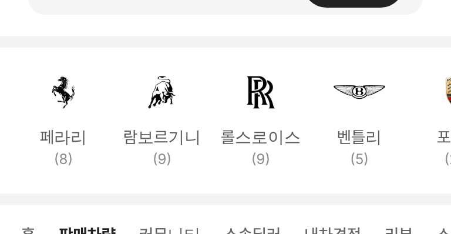
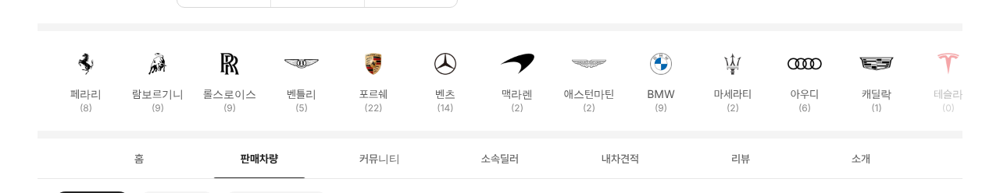

# PR #886 슈퍼카 로고 줄 위 구분선 · 대수

① 한 줄 요약: 판매자페이지 슈퍼카 로고 줄 위에 회색 구분선을 긋고, 브랜드 이름 아래에 대수 `(N)`을 넣었다.

② 과제 ID 없음 · 브랜치 `feat/dealer-brand-rail-count` · 커밋 `ec1a391` · https://github.com/bobaekimboae/bobaedream/pull/886 · 병합·배포 v=ec1a391 · 번들 `assets/main-D37kL4d9.js`

③ 한 일
- 로고 줄 위에 아래 구역 탭 위와 같은 10px 회색 띠.
- 이름 아래 그 딜러 매물 대수 `(N)` 12/16 `#8C8C8C`, 선택하면 `#222`. 칸 높이 104.

④ 원본과 비교: 해당 없음.

⑤ 검증: verify:qf 통과, 콘솔 오류 0(384 · 1280). 조이모터스 포르쉐 (22) · 벤츠 (14) · 테슬라 (0) 흐림.

⑥ 원본과 다르게 남긴 것: 없음.

⑦ 못 한 것·다음에 할 것: 브랜드 뒤 모델 줄.

⑧ 확인 링크: 모바일 https://bobaekimboae.github.io/bobaedream/?qf=guazi&profile=dealer&shop=joy&emp=1&v=ec1a391 · PC 같은 주소 + `&pc=1`
