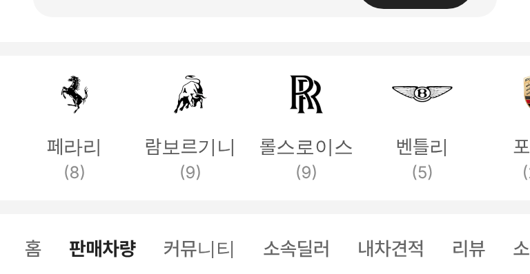
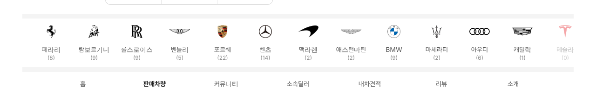

# PR #888 슈퍼카 로고 줄 위아래 여백 줄임

① 한 줄 요약: 판매자페이지 슈퍼카 로고 줄의 위아래 빈 공간을 줄여 줄 높이를 134 → 115로 낮췄다.

② 과제 ID 없음 · 브랜치 `fix/dealer-brand-rail-pad` · 커밋 `5cd4cb2` · https://github.com/bobaekimboae/bobaedream/pull/888 · 병합·배포 v=5cd4cb2 · 번들 `assets/main-CEjoVfPN.js`

③ 한 일
- 칸 높이를 내용에 맞춤(104 → 89), 줄 안쪽 위 4 · 아래 12.
- 회색 띠 → 로고 상자 14, 대수 글자 → 회색 띠 12(모바일 · PC 같음).

④ 원본과 비교: 해당 없음.

⑤ 검증: verify:qf 통과, 콘솔 오류 0(384 · 1280).

⑥ 원본과 다르게 남긴 것: 없음.

⑦ 못 한 것·다음에 할 것: 브랜드 뒤 모델 줄.

⑧ 확인 링크: 모바일 https://bobaekimboae.github.io/bobaedream/?qf=guazi&profile=dealer&shop=joy&emp=1&v=5cd4cb2 · PC 같은 주소 + `&pc=1`
