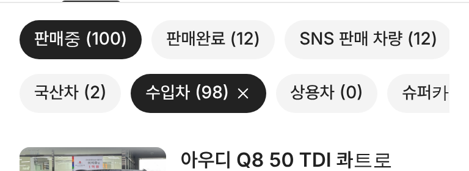

# PR #893 판매자페이지 분류 알약을 위 알약과 같은 모양으로

## ① 한 줄 요약
`국산차 · 수입차 · 상용차 · 슈퍼카` 알약을 바로 위 `판매중 · 판매완료 · SNS 판매 차량` 알약과 같은 크기·색·글자로 맞췄다.

## ② 과제 정보
- 과제 ID 없음(사용자 지시) · 브랜치 `dealer-stock-pills-match` · 커밋 `dc5a5a6` · PR https://github.com/bobaekimboae/bobaedream/pull/893
- 상태: 병합 · 배포 완료(v=`dc5a5a6`, 번들 `assets/main-CnM596eC.js`) · 함께 들어간 과제 없음

## ③ 한 일
- 알약 높이 34~36 → 32, 글자 15 → 14(500), 좌우 여백 13~16 → 12, 간격 7 → 8.
- 바탕 `#F2F3F5` · 글자 `#4F5660` → 위와 같은 `#F4F4F4` · `#222`.
- 선택 상태를 연파랑 바탕 · 파랑 글자 700 → 위와 같은 검정 바탕 · 흰 글자로 바꿈(뒤의 ×는 유지).
- 대수 `(N)`도 이름과 같은 굵기로 맞춤.

## ④ 원본과 비교
| 항목 | 위 상태 알약 | 분류 알약 전 | 분류 알약 후 |
|---|---|---|---|
| 높이 | 32 | 34(모바일) · 36(PC) | 32 |
| 글자 | 14/500 #222 | 14~15/500 #4F5660 | 14/500 #222 |
| 선택 | #222 · 흰 글자 | #EAF2FF · 파랑 700 | #222 · 흰 글자 |

 

## ⑤ 검증
- `npm run verify:qf` 통과. 콘솔 오류 PC 1280 · 모바일 384 모두 0.
- 실측: 두 줄 모든 알약 높이 32 · 굵기 500, 선택 바탕 rgb(34,34,34).

## ⑥ 원본과 다르게 남긴 것
- 분류 알약은 여러 개를 함께 고를 수 있어 선택 알약 뒤 ×를 그대로 뒀다(위 상태 알약에는 없음).

## ⑦ 못 한 것·다음
- 없음.

## ⑧ 확인 링크
- 모바일: https://bobaekimboae.github.io/bobaedream/?qf=guazi&profile=dealer&shop=joy&emp=1&v=dc5a5a6
- PC: https://bobaekimboae.github.io/bobaedream/?qf=guazi&profile=dealer&shop=joy&emp=1&v=dc5a5a6&pc=1
