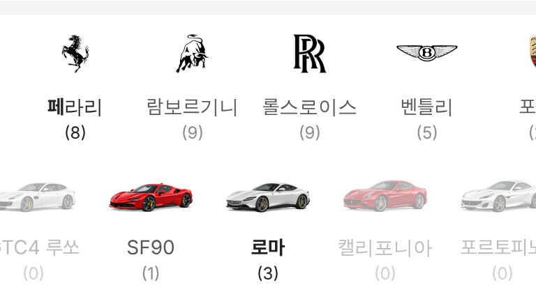
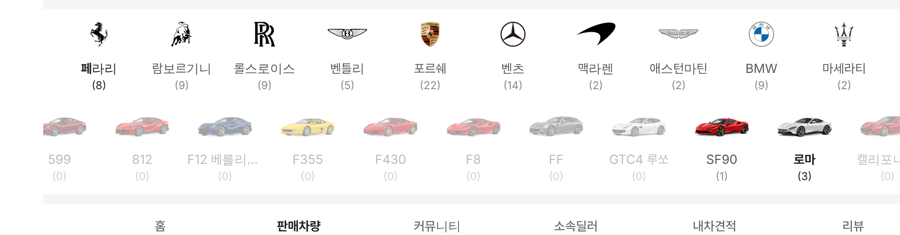

# PR #895 판매자페이지 페라리 모델 이미지 줄

## ① 한 줄 요약
판매차량 위 브랜드 로고 줄에서 페라리를 고르면, 그 아래에 우리 페라리 모델 이미지 줄이 나오고 누르면 그 모델 매물만 보인다.

## ② 과제 정보
- 과제 ID 없음(사용자 지시) · 브랜치 `dealer-ferrari-model-rail` · 커밋 `6de9f57` · PR https://github.com/bobaekimboae/bobaedream/pull/895
- 상태: 병합 · 배포 완료(v=`6de9f57`, 번들 `assets/main-BMTwHvCV.js`) · 함께 들어간 과제 없음

## ③ 한 일
- 모델 이름 · 순서는 차량 기준표의 페라리 모델그룹 18개, 이미지는 기존 `ferrari-models/angle` 3/4 카탈로그 컷(새 이미지 없음).
- 칸은 로고 줄과 같은 76(PC 84) · 간격 8, 이미지 칸은 초톳 실사 슬롯 64×40(PC 76×40) 아래 맞춤, 이름 아래 `(대수)`.
- 그 딜러 매물이 없는 모델은 흐리게. 모델을 누르면 판매중 목록이 그 모델만, 다시 누르면 해제.
- 다른 브랜드를 고르거나 페라리를 해제하면 모델 선택도 풀린다.

## ④ 원본과 비교
| 항목 | 전 | 후 |
|---|---|---|
| 페라리 선택 후 | 로고 줄만 | 로고 줄 + 모델 이미지 18칸 |
| 조이모터스 대수 | – | 로마 3 · 296 2 · 488 1 · 푸로산게 1 · SF90 1 |

 

## ⑤ 검증
- `npm run verify:qf` 통과. 콘솔 오류 · 404 없음(PC 1280 · 모바일 384).
- 이미지 18장 모두 불러옴. 로마 선택 뒤 분류 알약 수입차 (3) · 슈퍼카 (3)로 목록이 3대로 줄어듦 확인.

## ⑥ 원본과 다르게 남긴 것
- 페라리만 모델 줄을 붙였다. 다른 브랜드는 전용 모델 이미지 세트가 없어 아직 로고 줄만 있다.

## ⑦ 못 한 것·다음
- 람보르기니 · 롤스로이스 등 다른 브랜드 모델 줄은 이미지가 준비되면 같은 방식으로 붙일 수 있다.

## ⑧ 확인 링크
- 모바일: https://bobaekimboae.github.io/bobaedream/?qf=guazi&profile=dealer&shop=joy&emp=1&v=6de9f57
- PC: https://bobaekimboae.github.io/bobaedream/?qf=guazi&profile=dealer&shop=joy&emp=1&v=6de9f57&pc=1
