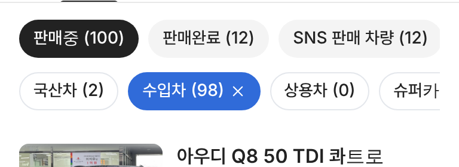

# PR #896 판매자페이지 분류 알약 흰 바탕 · 선택 파랑

## ① 한 줄 요약
판매중 밑 `국산차 · 수입차 · 상용차 · 슈퍼카` 알약을 흰 바탕으로, 선택하면 파랑으로 바꿨다.

## ② 과제 정보
- 과제 ID 없음(사용자 지시) · 브랜치 `dealer-stock-pills-white` · 커밋 `e88e6f6` · PR https://github.com/bobaekimboae/bobaedream/pull/896
- 상태: 병합 · 배포 완료(v=`e88e6f6`, 번들 `assets/main-DyO1qtJo.js`) · PR #895가 먼저 main에 들어가 있음

## ③ 한 일
- 기본: 흰 바탕 · 1px `#E4E7EC` 테두리 · 글자 `#222`(우리 문맥 알약 규칙), 마우스 올림 `#F7F8FA`.
- 선택: 보배드림 파랑 `#306BD9` 바탕 · 흰 글자 · 흰 ×.
- 크기 32 · 14/500 · 간격 8 그대로, 테두리만큼 안쪽 여백을 줄여 폭도 같다.

## ④ 원본과 비교
| 항목 | 전 | 후 |
|---|---|---|
| 기본 | 회색 #F4F4F4 | 흰색 + 1px #E4E7EC |
| 선택 | 검정 #222 | 파랑 #306BD9 |

 

## ⑤ 검증
- `npm run verify:qf` 통과. 콘솔 오류 PC · 모바일 0. 실측 높이 32, 선택 바탕 rgb(48,107,217).

## ⑥ 원본과 다르게 남긴 것
- 위 `판매중 · 판매완료 · SNS` 알약은 회색 · 검정 선택 그대로 둬서 두 줄이 서로 다른 층위로 보인다.

## ⑦ 못 한 것·다음
- 없음.

## ⑧ 확인 링크
- 모바일: https://bobaekimboae.github.io/bobaedream/?qf=guazi&profile=dealer&shop=joy&emp=1&v=e88e6f6
- PC: https://bobaekimboae.github.io/bobaedream/?qf=guazi&profile=dealer&shop=joy&emp=1&v=e88e6f6&pc=1
