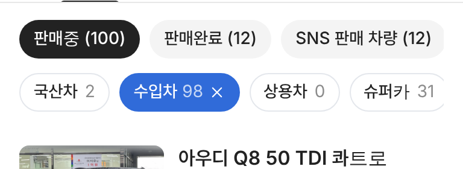

# PR #898 판매자페이지 분류 알약 대수 옅게

## ① 한 줄 요약
분류 알약 대수를 괄호 없이 옅은 회색으로 바꿨다(`국산차 2 · 수입차 98`).

## ② 과제 정보
- 과제 ID 없음(사용자 지시) · 브랜치 `dealer-stock-count-light` · 커밋 `015cf94` · PR https://github.com/bobaekimboae/bobaedream/pull/898
- 상태: 병합 · 배포 완료(v=`015cf94`, 번들 `assets/main-Bwdx-wcm.js`) · 함께 들어간 과제 없음

## ③ 한 일
- 사용자 제공 Car & Classic 앱 캡처(`3 Series 390`)처럼 괄호를 빼고 숫자만 이름 뒤 6에 둠.
- 숫자 `#8C8C8C` · 400(이름은 `#222` · 500). 파랑 선택 알약에서는 흰색 72%.

## ④ 원본과 비교
| 항목 | 참고(Car & Classic) | 전 | 후 |
|---|---|---|---|
| 표기 | 3 Series 390 | 국산차 (2) | 국산차 2 |
| 숫자 색 | 옅은 회색 | 이름과 같은 #222 | #8C8C8C 400 |

 

## ⑤ 검증
- `npm run verify:qf` 통과. 콘솔 오류 PC · 모바일 0. 알약 높이 32 유지.

## ⑥ 원본과 다르게 남긴 것
- 위 `판매중 (100)` 상태 알약은 괄호 표기 그대로 둠. 같게 하려면 알려 주면 바꾼다.

## ⑦ 못 한 것·다음
- 없음.

## ⑧ 확인 링크
- 모바일: https://bobaekimboae.github.io/bobaedream/?qf=guazi&profile=dealer&shop=joy&emp=1&v=015cf94
- PC: https://bobaekimboae.github.io/bobaedream/?qf=guazi&profile=dealer&shop=joy&emp=1&v=015cf94&pc=1
