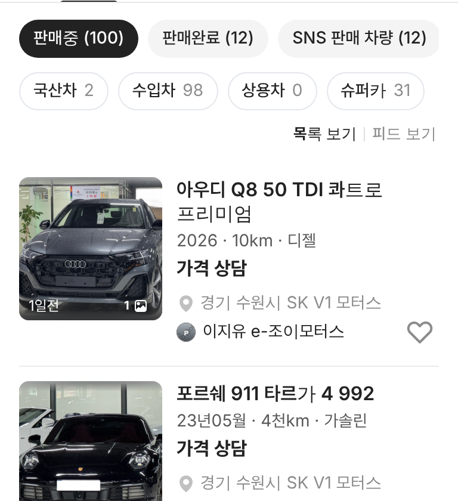

# PR #901 판매자페이지 목록 보기 · 피드 보기

## ① 한 줄 요약
판매자페이지 판매중 목록에 `목록 보기 | 피드 보기` 전환을 넣었다.

## ② 과제 정보
- 과제 ID 없음(사용자 지시) · 브랜치 `dealer-view-toggle` · 커밋 `03c7662` · PR https://github.com/bobaekimboae/bobaedream/pull/901
- 상태: 병합 · 배포 완료(v=`03c7662`, 번들 `assets/main-DkDyG8Xk.js`) · 함께 들어간 과제 없음

## ③ 한 일
- 분류 알약 줄 아래 오른쪽 끝에 글자 전환(13/18, 선택 700 #222 · 나머지 #8C8C8C, 사이 세로선).
- 목록 보기 = 기존 카드. 피드 보기 = 매물 목록 화면의 모바일 피드 카드(큰 사진 · 넘기기 · 전화 · 채팅 · 찜)를 그대로 재사용, PC는 가운데 480 한 열.
- 기본 목록, `&view=feed`로 피드로 바로 열림. 브랜드 · 모델을 바꿔도 보기 방식 유지.

## ④ 원본과 비교
| 항목 | 전 | 후 |
|---|---|---|
| 보기 방식 | 목록만 | 목록 · 피드 전환 |
| 피드 카드(384) | – | 폭 352 · 사진 264 |

  

## ⑤ 검증
- `npm run verify:qf` 통과. 콘솔 오류 PC 1280 · 모바일 384 모두 0. 피드 전환 후 카드 5장(더 보기 전) 확인.

## ⑥ 원본과 다르게 남긴 것
- 처음엔 알약 줄 오른쪽 끝에 붙였으나 모바일에서 슈퍼카 알약이 가려져 별도 줄로 뺐다.
- 전용 아이콘이 없어 아이콘 대신 글자로 전환한다.

## ⑦ 못 한 것·다음
- 목록/피드 아이콘이 필요하면 노션 원본 아이콘을 지정해 주면 바꾼다.

## ⑧ 확인 링크
- 모바일: https://bobaekimboae.github.io/bobaedream/?qf=guazi&profile=dealer&shop=joy&emp=1&v=03c7662 · 피드로 바로: https://bobaekimboae.github.io/bobaedream/?qf=guazi&profile=dealer&shop=joy&emp=1&view=feed&v=03c7662
- PC: https://bobaekimboae.github.io/bobaedream/?qf=guazi&profile=dealer&shop=joy&emp=1&v=03c7662&pc=1
