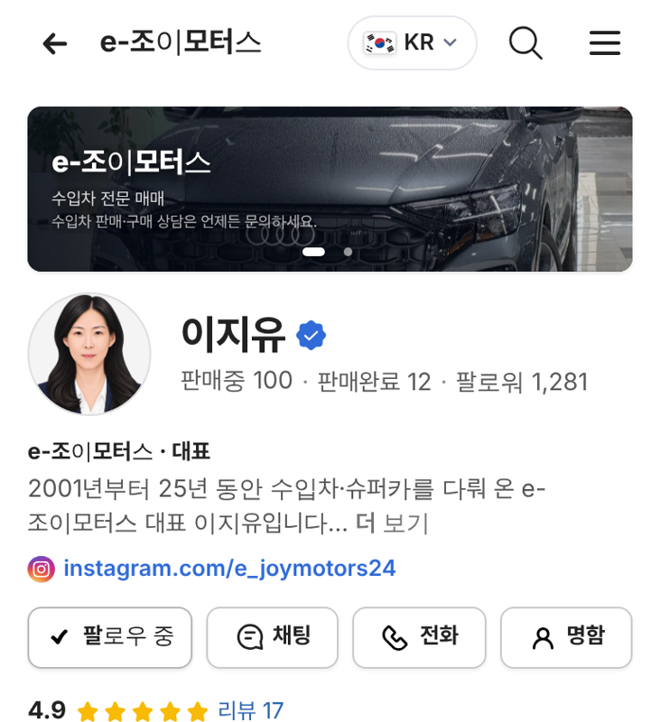

# PR #906 판매자페이지 모바일 프로필 유튜브 채널 크기로

## ① 한 줄 요약
모바일 판매자페이지 프로필을 유튜브 채널 머리 크기(프사 72 · 커버 96 · 실적 한 줄 글자)로 맞췄다.

## ② 과제 정보
- 과제 ID 없음(사용자 지시) · 브랜치 `dealer-profile-youtube` · 커밋 `d8fe5ac` · PR https://github.com/bobaekimboae/bobaedream/pull/906
- 상태: 병합 · 배포 완료(v=`d8fe5ac`, 번들 `assets/main-DJQ2Qt6L.js`) · 함께 들어간 과제 없음

## ③ 한 일
- 커버 높이 110 → 96, 커버 → 프사 16 → 12.
- 프사 88 → 72, 프사 → 이름 24 → 17, 이름 22 → 24.
- 숫자 3칸(판매중 · 판매완료 · 팔로워)을 한 줄 회색 글자 `판매중 100 · 판매완료 12 · 팔로워 1,281`로.
- 이름 + 실적 묶음을 프사 세로 가운데에 맞춤.

## ④ 원본과 비교 (384 기준)
| 항목 | 유튜브 | 전 | 후 |
|---|---|---|---|
| 커버 높이 | 약 96 | 110 | 96 |
| 커버 → 프사 | 12 | 16 | 12 |
| 프사 | 72 | 88 | 72 |
| 프사 → 글자 | 17 | 24 | 17 |
| 이름 | 약 24 굵게 | 22 | 24 |
| 이름 아래 | 한 줄 회색 글자 | 숫자 3칸 | 한 줄 회색 글자 |

  

## ⑤ 검증
- `npm run verify:qf` 통과. 콘솔 오류 0(384 · 360 · PC 1280).
- 실측: 프사 중심 206 · 글자 묶음 중심 206.5, 360 폭에서도 실적 한 줄.

## ⑥ 원본과 다르게 남긴 것
- 유튜브의 @아이디 줄은 우리에게 해당이 없어 넣지 않았다. 상사 · 직함은 아래 소개 첫 줄에 그대로.
- PC 프로필(프사 138 · 숫자 상자)은 바꾸지 않았다.

## ⑦ 못 한 것·다음
- PC도 같은 방식으로 맞출지 결정 필요.

## ⑧ 확인 링크
- 모바일: https://bobaekimboae.github.io/bobaedream/?qf=guazi&profile=dealer&shop=joy&emp=1&v=d8fe5ac
- PC: https://bobaekimboae.github.io/bobaedream/?qf=guazi&profile=dealer&shop=joy&emp=1&v=d8fe5ac&pc=1
