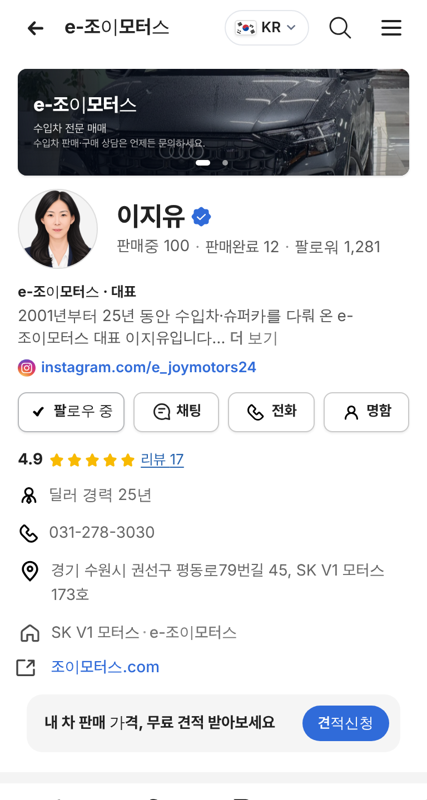
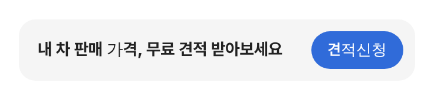
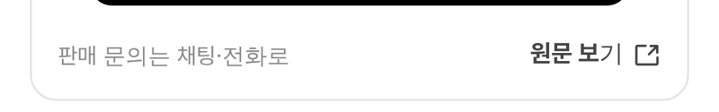

# PR #912 판매자페이지 링크 아이콘 AS24 · 견적신청 파랑 · 유튜브 프로필 기본

## ① 한 줄 요약
바깥 링크 아이콘을 오토스카우트24 원본으로, 견적신청 버튼을 파랑으로, 모바일 프로필을 유튜브 크기 기본으로 바꿨다.

## ② 과제 정보
- 과제 ID 없음(사용자 지시) · 브랜치 `dealer-homepage-as24-icon` · 커밋 `2ba3e5c` · PR https://github.com/bobaekimboae/bobaedream/pull/912
- 상태: 병합 · 배포 완료(v=`2ba3e5c`, 번들 `assets/main-BW4P6OYG.js`) · 함께 들어간 과제 없음

## ③ 한 일
- 바깥 링크 표시(홈페이지 줄 · 원문 보기 · 인스타그램에서 보기 등 6곳)를 노션 「독일_오토24 › 아웃 링크_24_24」 원본으로 교체(파일 수정 없음).
- 견적신청 버튼: 검정 → 파랑 #306BD9, 모바일 높이 40 → 32, 위아래 · 오른쪽 여백 10으로 균형, 안내 문구 말줄임 해소.
- 모바일 프로필: 유튜브 크기(커버 96 · 프사 72 · 실적 한 줄 회색 글자)를 기본으로. 이전 모양은 `&dpprofile=old`.

## ④ 원본과 비교
| 항목 | 전 | 후 |
|---|---|---|
| 링크 아이콘 | Radix 기본 | AS24 아웃 링크 원본 |
| 견적신청 | 검정 · 높이 40 · 문구 말줄임 | 파랑 · 높이 32 · 문구 한 줄 |
| 모바일 프로필 | 커버 110 · 프사 88 · 숫자 3칸 | 커버 96 · 프사 72 · 한 줄 글자 |

  

## ⑤ 검증
- `npm run verify:qf` 통과. 콘솔 오류 0(384 · 1280). 견적신청 버튼 실측 32 · 오른쪽 10.

## ⑥ 원본과 다르게 남긴 것
- PC 프로필은 그대로(프사 138 · 숫자 상자).

## ⑦ 못 한 것·다음
- 없음.

## ⑧ 확인 링크
- 모바일: https://bobaekimboae.github.io/bobaedream/?qf=guazi&profile=dealer&shop=joy&emp=1&v=2ba3e5c · 이전 프로필: https://bobaekimboae.github.io/bobaedream/?qf=guazi&profile=dealer&shop=joy&emp=1&dpprofile=old&v=2ba3e5c
- PC: https://bobaekimboae.github.io/bobaedream/?qf=guazi&profile=dealer&shop=joy&emp=1&v=2ba3e5c&pc=1
