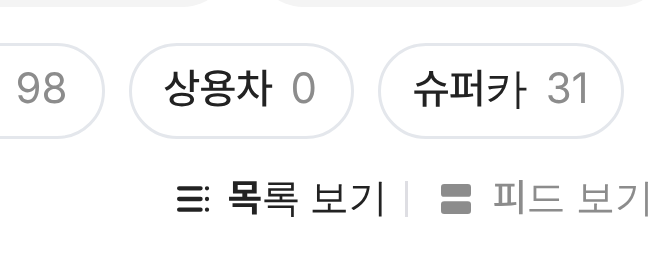
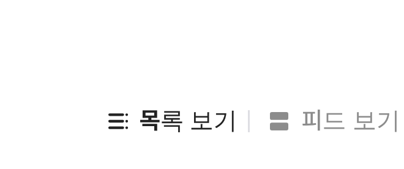

# PR #913 판매자페이지 목록 · 피드 보기 아이콘

## ① 한 줄 요약
`목록 보기 | 피드 보기` 글자 앞에 네이버 카페 보기 방식 아이콘을 붙였다.

## ② 과제 정보
- 과제 ID 없음(사용자 지시) · 브랜치 `dealer-view-toggle-icons` · 커밋 `9a00551` · PR https://github.com/bobaekimboae/bobaedream/pull/913
- 상태: 병합 · 배포 완료(v=`9a00551`, 번들 `assets/main-D-iqGe1x.js`) · PR #912가 먼저 main에 있음

## ③ 한 일
- 네이버 카페 원본 `icon_view_list` · `icon_view_feed`(저장소 `public/community/assets/view-list.svg` · `view-feed.svg`, 수정 없음)를 20px로, 색은 글자색을 따라감.

## ④ 원본과 비교
| 항목 | 전 | 후 |
|---|---|---|
| 보기 전환 | 글자만 | 아이콘 20 + 글자(간격 2) |

 

## ⑤ 검증
- `npm run verify:qf` 통과. 아이콘 파일 요청 오류 0(384 · 1280).

## ⑥ 원본과 다르게 남긴 것
- 없음.

## ⑦ 못 한 것·다음
- 없음.

## ⑧ 확인 링크
- 모바일: https://bobaekimboae.github.io/bobaedream/?qf=guazi&profile=dealer&shop=joy&emp=1&v=9a00551
- PC: https://bobaekimboae.github.io/bobaedream/?qf=guazi&profile=dealer&shop=joy&emp=1&v=9a00551&pc=1
