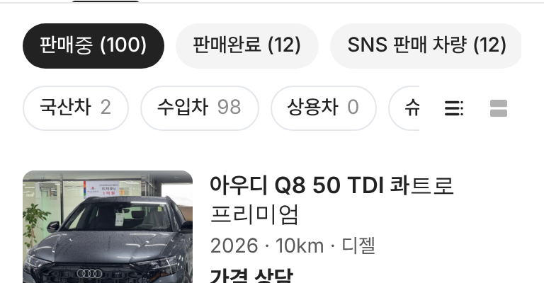

# PR #915 판매자페이지 보기 전환 아이콘만 · 알약 줄 안으로

## ① 한 줄 요약
목록 · 피드 보기 글자를 빼고, 아이콘만 분류 알약 줄 오른쪽 끝에 넣었다.

## ② 과제 정보
- 과제 ID 없음(사용자 지시) · 브랜치 `dealer-view-icons-in-pills` · 커밋 `a18f248` · PR https://github.com/bobaekimboae/bobaedream/pull/915
- 상태: 병합 · 배포 완료(v=`a18f248`, 번들 `assets/main-BKhUTWE_.js`) · 함께 들어간 과제 없음

## ③ 한 일
- 별도 줄의 `목록 보기 | 피드 보기` 글자를 없앰.
- 네이버 카페 원본 목록 · 피드 아이콘(24)을 32×32 버튼 두 개로 분류 알약 줄 오른쪽 끝에 고정.
- 선택 #222 · 나머지 #B0B0B0. 이름은 화면 읽기용 설명과 마우스 올림 안내로만 남김.
- 알약은 남은 폭에서 가로로 넘김.

## ④ 원본과 비교 (384)
| 항목 | 전 | 후 |
|---|---|---|
| 보기 전환 | 알약 아래 별도 줄, 아이콘 + 글자 | 알약 줄 오른쪽 끝, 아이콘만 |
| 알약 → 첫 매물 | 4 + 줄 32 + 4 | 16 |

  

## ⑤ 검증
- `npm run verify:qf` 통과. 콘솔 오류 0(384 · 1280). 피드 아이콘을 누르면 피드 카드로 바뀜 확인.

## ⑥ 원본과 다르게 남긴 것
- 모바일에서는 슈퍼카 알약이 오른쪽에서 일부 가려지고 가로로 넘겨 본다.

## ⑦ 못 한 것·다음
- 없음.

## ⑧ 확인 링크
- 모바일: https://bobaekimboae.github.io/bobaedream/?qf=guazi&profile=dealer&shop=joy&emp=1&v=a18f248
- PC: https://bobaekimboae.github.io/bobaedream/?qf=guazi&profile=dealer&shop=joy&emp=1&v=a18f248&pc=1
