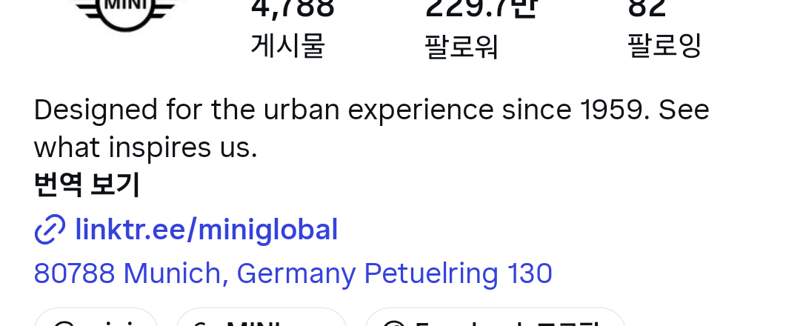
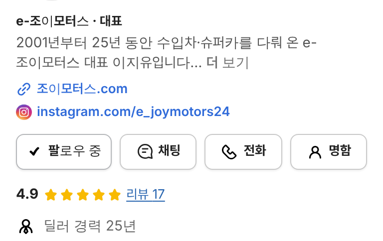
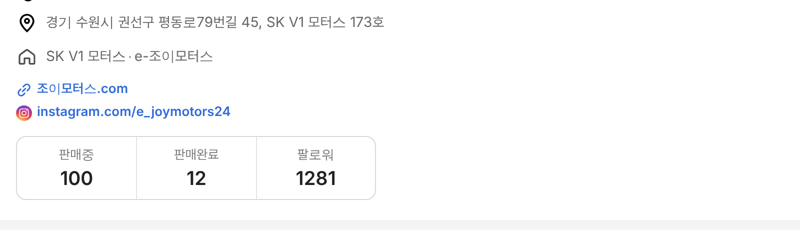

# PR #918 판매자페이지 홈페이지 링크 인스타그램식

## ① 한 줄 요약
홈페이지 링크를 인스타그램 프로필처럼 소개 아래에 체인 아이콘 + 파랑 주소 한 줄로 옮겼다.

## ② 과제 정보
- 과제 ID 없음(사용자 지시) · 브랜치 `dealer-homepage-no-icon` · 커밋 `71074de` · PR https://github.com/bobaekimboae/bobaedream/pull/918
- 상태: 병합 · 배포 완료(v=`71074de`, 번들 `assets/main-CgNb9ava.js`)
- 함께 들어간 과제: 바로 앞 PR #917(홈페이지 링크 아이콘 제거)이 먼저 main에 들어갔고, 이번 PR이 그 위치를 인스타그램식으로 바꿈

## ③ 한 일
- 매매단지 줄 아래에 있던 `조이모터스.com`을 빼고 소개 글 아래 SNS 링크 줄 맨 앞에 둠.
- 체인 아이콘: 저장소에 있던 레딧 원본 link.svg를 그대로 복사(`link-reddit.svg`), 16px로 글자색(파랑)을 따름.
- 글자 13/19 600 #306BD9, 왼쪽 시작선은 소개 글과 같음. 그 아래 인스타그램 줄은 그대로.

## ④ 원본과 비교
| 항목 | 인스타그램(MINI) | 전 | 후 |
|---|---|---|---|
| 위치 | 소개 아래 | 매매단지 줄 아래 | 소개 아래 |
| 아이콘 | 체인(파랑) | 없음 | 체인(파랑) |
| 글자 | 파랑 짧은 주소 | 파랑 | 파랑 |

  

## ⑤ 검증
- `npm run verify:qf` 통과. 콘솔 오류 0(384 · 1280). 홈페이지가 없는 서울오토갤러리 딜러는 기존 인스타 · 유튜브 줄만 보임 확인.

## ⑥ 원본과 다르게 남긴 것
- 인스타그램의 파랑 주소 줄(지도 주소)은 넣지 않음. 주소는 위 아이콘 목록에 이미 있음.

## ⑦ 못 한 것·다음
- 없음.

## ⑧ 확인 링크
- 모바일: https://bobaekimboae.github.io/bobaedream/?qf=guazi&profile=dealer&shop=joy&emp=1&v=71074de
- PC: https://bobaekimboae.github.io/bobaedream/?qf=guazi&profile=dealer&shop=joy&emp=1&v=71074de&pc=1
