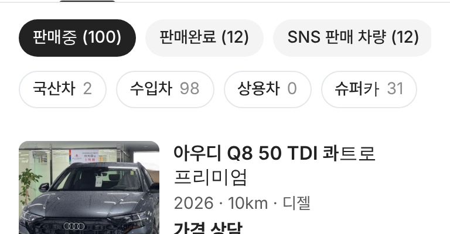

# PR #920 판매자페이지 보기 방식 아이콘 슈퍼카 옆으로

## ① 한 줄 요약
목록 · 피드 아이콘을 줄 오른쪽 끝에서 `슈퍼카` 알약 바로 옆으로 옮겼다.

## ② 과제 정보
- 과제 ID 없음(사용자 지시) · 브랜치 `dealer-view-icons-after-pills` · 커밋 `469c407` · PR https://github.com/bobaekimboae/bobaedream/pull/920
- 상태: 병합 · 배포 완료(v=`469c407`, 번들 `assets/main-Bs6V72JJ.js`) · 함께 들어간 과제 없음

## ③ 한 일
- 아이콘 두 개를 알약 줄 안 마지막(슈퍼카 뒤 간격 4)에 넣어 알약과 같이 가로로 넘김.
- 아이콘 버튼은 알약 모양 · 파랑 선택을 받지 않게 막고 아이콘 색만 바꿈(선택 #222 · 나머지 #B0B0B0).

## ④ 원본과 비교
| 항목 | 전 | 후 |
|---|---|---|
| 아이콘 위치 | 줄 오른쪽 끝 고정 | 슈퍼카 알약 바로 뒤 |
| 모바일 384 | 항상 보임 · 알약이 일부 가려짐 | 알약 4개 다 보이고 아이콘은 오른쪽 끝에 걸침(밀어서 봄) |

 

## ⑤ 검증
- `npm run verify:qf` 통과. 콘솔 오류 0(384 · 1280). 피드 아이콘 누르면 피드로 바뀜 확인.

## ⑥ 원본과 다르게 남긴 것
- 모바일은 알약 4개가 화면 폭을 거의 다 써서 아이콘이 오른쪽 끝에 걸쳐 보인다.

## ⑦ 못 한 것·다음
- 모바일에서도 아이콘을 다 보이게 하려면 알약 크기를 줄이거나 아이콘을 하나(전환 버튼)로 합치는 방법이 있다.

## ⑧ 확인 링크
- 모바일: https://bobaekimboae.github.io/bobaedream/?qf=guazi&profile=dealer&shop=joy&emp=1&v=469c407
- PC: https://bobaekimboae.github.io/bobaedream/?qf=guazi&profile=dealer&shop=joy&emp=1&v=469c407&pc=1
