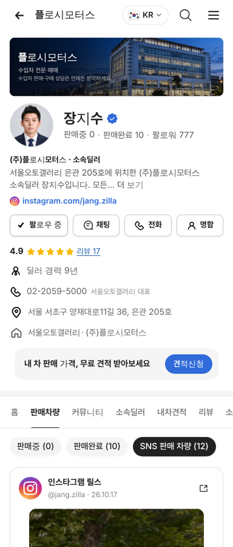
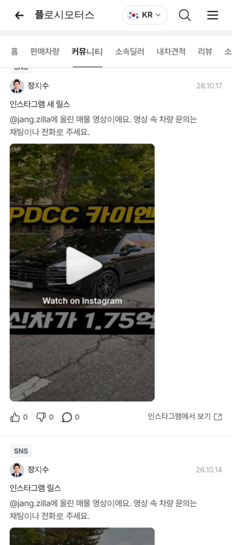

# PR #922 장지수 딜러 인스타그램 릴스 12개 임베드

## ① 한 줄 요약
장지수(@jang.zilla) 판매자페이지에 공개 릴스 12개를 SNS 판매 차량과 커뮤니티 피드에 넣었다.

## ② 과제 정보
- 과제 ID 없음(사용자 지시) · 브랜치 `dealer-jangjisu-reels` · 커밋 `567730c` · PR https://github.com/bobaekimboae/bobaedream/pull/922
- 상태: 병합 · 배포 완료(v=`567730c`, 번들 `assets/main-7ix_Dtv_.js`) · 함께 들어간 과제 없음

## ③ 한 일
- 인스타그램 릴스 탭에서 로그인 없이 보이는 최신 12개(2026-09-15 ~ 10-17) 게시물 코드만 저장(영상 · 글 저장 없음).
- 게시일은 게시물 코드에서 계산(한지훈 게시물 날짜로 맞는지 대조).
- `SNS 판매 차량 (12)`: 5개씩 + 더보기. 커뮤니티 `SNS` 말머리: 릴스 4개. 모양은 조이모터스와 같다.
- 프로필 인스타그램 주소는 기존 `instagram.com/jang.zilla` 그대로.

## ④ 원본과 비교
| 항목 | 전 | 후 |
|---|---|---|
| SNS 판매 차량 | 가상 카드 2개 | 실제 릴스 12개 |
| 커뮤니티 SNS 글 | 가상 글 | 실제 릴스 4개 |

 

## ⑤ 검증
- `npm run verify:qf` 통과. 384 화면에서 SNS 판매 차량 (12) · 첫 화면 퍼가기 5개 · 커뮤니티 릴스 4개 확인, 콘솔 오류 0.

## ⑥ 원본과 다르게 남긴 것
- 목표는 50개지만 로그인 없이 12개만 보여 12개로 배포.

## ⑦ 못 한 것·다음
- 인스타그램에 로그인해 주면 나머지 38개를 받아 50개로 채운다.

## ⑧ 확인 링크
- 모바일: https://bobaekimboae.github.io/bobaedream/?qf=guazi&profile=dealer&shop=450560&emp=2&v=567730c
- PC: https://bobaekimboae.github.io/bobaedream/?qf=guazi&profile=dealer&shop=450560&emp=2&v=567730c&pc=1
