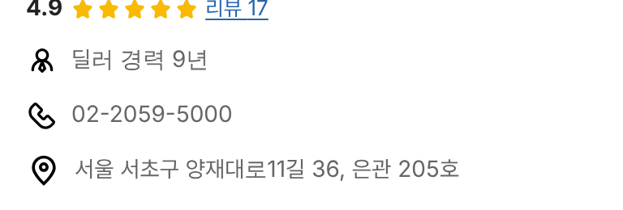

# PR #924 판매자페이지 프로필 전화 줄 보조 글자 제거

## ① 한 줄 요약
프로필 전화번호 뒤에 같이 보이던 `서울오토갤러리 대표` 글자를 뺐다.

## ② 과제 정보
- 과제 ID 없음(사용자 지시) · 브랜치 `dealer-phone-note-remove` · 커밋 `56844ce` · PR https://github.com/bobaekimboae/bobaedream/pull/924
- 상태: 병합 · 배포 완료(v=`56844ce`, 번들 `assets/main-CExHmzgp.js`) · 함께 들어간 과제 없음

## ③ 한 일
- 상사 대표 전화가 없어 서울오토갤러리 대표 번호를 쓰는 22개 상사의 프로필 전화 줄에서 보조 글자를 지우고 번호만 남김.
- 소개 탭 라벨 `단지 대표 전화`는 그대로.

## ④ 원본과 비교
| 항목 | 전 | 후 |
|---|---|---|
| 프로필 전화 줄 | 02-2059-5000 서울오토갤러리 대표 | 02-2059-5000 |

## ⑤ 검증
- `npm run verify:qf` 통과. 장지수 페이지(384) 전화 줄 글자 `02-2059-5000`만, 보조 글자 0개.

## ⑥ 원본과 다르게 남긴 것
- 없음.

## ⑦ 못 한 것·다음
- 없음.

## ⑧ 확인 링크
- 모바일: https://bobaekimboae.github.io/bobaedream/?qf=guazi&profile=dealer&shop=450560&emp=2&v=56844ce
- PC: https://bobaekimboae.github.io/bobaedream/?qf=guazi&profile=dealer&shop=450560&emp=2&v=56844ce&pc=1
