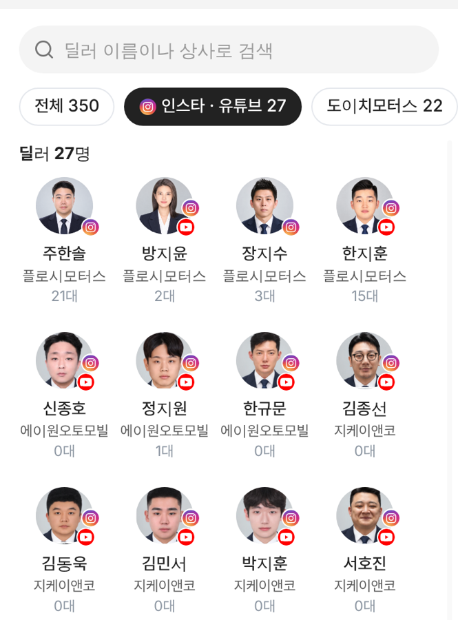

# PR #926 서울오토갤러리 딜러 인스타 · 유튜브 표시 + 계정별 게시물 12개 임베드

## ① 한 줄 요약
딜러 탭에 인스타 · 유튜브가 있는 딜러를 표시하고, 인스타그램 계정 15곳의 최신 게시물 12개씩을 각 판매자페이지에 넣었다.

## ② 과제 정보
- 과제 ID 없음(사용자 지시) · 브랜치 `sag-dealer-sns-links` · 커밋 `83996db` · PR https://github.com/bobaekimboae/bobaedream/pull/926
- 상태: 병합 · 배포 완료(v=`83996db`, 번들 `assets/main-CI6V08U-.js`) · 함께 들어간 과제 없음

## ③ 한 일
- 딜러 카드 프사 오른쪽 아래에 인스타그램 · 유튜브 원본 아이콘 16(27명), `딜러` 탭에 `인스타 · 유튜브 27` 거르기 알약.
- 본인 계정 11명 + 상사 계정 4곳의 공개 프로필 최신 12개(사진 · 릴스, 로그인 없이 보이는 범위)를 등록. 상사 계정은 본인 계정 없는 그 상사 딜러 모두에게.
- 강심균은 퍼가기 가능한 게시물이 5개뿐이라 5개.
- 커뮤니티 SNS는 릴스 우선, 모자라면 사진 게시물로 4개.

## ④ 원본과 비교
| 항목 | 전 | 후 |
|---|---|---|
| 딜러 탭 SNS 표시 | 없음 | 아이콘 + 거르기 알약 |
| 실제 인스타 게시물이 붙은 판매자페이지 | 3명(한지훈 · 장지수 · 이지유) | 28명(서울오토갤러리 27 + 이지유) |

## ⑤ 검증
- `npm run verify:qf` 통과. 주한솔 · 방지윤(상사 계정) · 강심균 · 장금용 · 김종선 · 정다인 페이지에서 SNS 판매 차량 개수와 커뮤니티 4개 확인, 콘솔 오류 0.
- 배포본 선우혁 페이지에서 인스타그램 퍼가기가 실제로 그려지는 것 확인.

## ⑥ 원본과 다르게 남긴 것
- 로그인 없이 보이는 12개 기준이라 고정 글(오래된 글)이 앞쪽에 섞일 수 있다.

## ⑦ 못 한 것·다음
- 장지수 50개처럼 더 많이 넣으려면 인스타그램 로그인이 필요하다.

## ⑧ 확인 링크
- 딜러 탭(모바일): https://bobaekimboae.github.io/bobaedream/?qf=guazi&category=%EC%84%9C%EC%9A%B8%EC%98%A4%ED%86%A0%EA%B0%A4%EB%9F%AC%EB%A6%AC&v=83996db
- 선우혁: https://bobaekimboae.github.io/bobaedream/?qf=guazi&profile=dealer&shop=450548&emp=3&v=83996db · PC: 같은 주소 &pc=1
