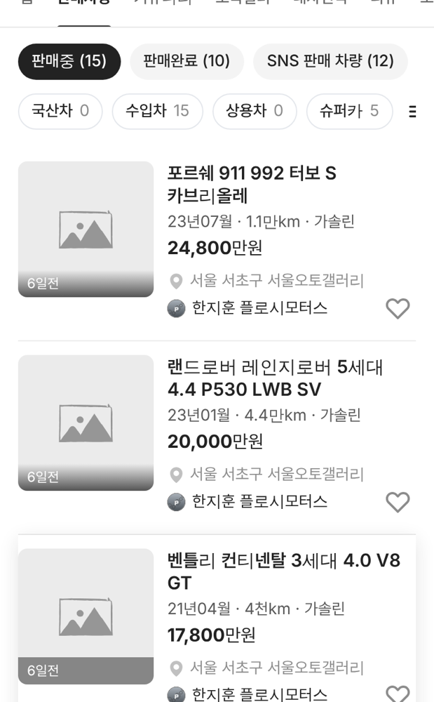

# PR #928 서울오토갤러리 인스타 · 유튜브 딜러 상사 매물 81대 등록

## ① 한 줄 요약
인스타 · 유튜브 딜러가 속한 상사의 실제 광고 매물 81대를 서울오토갤러리 공식 사이트에서 받아 딜러별로 등록했다.

## ② 과제 정보
- 과제 ID 없음(사용자 지시) · 브랜치 `sag-dealer-listings-site` · 커밋 `c4c3469` · PR https://github.com/bobaekimboae/bobaedream/pull/928
- 상태: 병합 · 배포 완료(v=`c4c3469`, 번들 `assets/main-B9FzauBI.js`) · 함께 들어간 과제 없음

## ③ 한 일
- KB차차차는 「무단 복제 · 스크래핑 금지」라 쓰지 않음. 대신 딜러가 직접 올리는 서울오토갤러리 공식 사이트의 상사 광고 차량을 사용.
- 7개 상사 중 매물이 있는 5곳: 만소리오토모빌리 8 · 플로시모터스 40 · 에이원오토모빌 1 · 씨엔모터스 17 · 비나인 15(비아로쏘 · 지케이앤코 0).
- 상사 · 딜러 · 차명 · 최초등록 연월 · 배기량 · 주행 · 연료 · 색상 · 가격만 저장. 차량번호 · 제시번호 · 매물번호 · 연락처 · 원본 주소 미저장.
- 사이트에 사진이 없어 사진 없는 매물로 등록(기본 그림).

## ④ 원본과 비교
| 딜러 | 전 판매중 | 후 판매중 |
|---|---|---|
| 주한솔 | 1 | 20 |
| 한지훈 | 0 | 15 |
| 장지수 | 0 | 3 |
| 장정훈 | 0 | 4 |
| 선우혁 · 정다인 | 0 | 0(사이트 매물 없음) |

## ⑤ 검증
- `npm run verify:qf` 통과. 5명 판매자페이지에서 판매중 대수 · 첫 카드 확인, 콘솔 오류 0. 기존 시트 매물과 중복 0.

## ⑥ 원본과 다르게 남긴 것
- 사진 없음. 게시 시각은 사이트 값이 없어 화면 확인용 가상 값.
- 서울오토갤러리 카테고리 목록에서는 사진 있는 기존 매물 뒤에 붙는다.

## ⑦ 못 한 것·다음
- 사진: 딜러 인스타그램 게시물로 대신하거나, 우리 모델 이미지를 붙이는 방법 중 결정 필요.
- 인스타 · 유튜브가 없는 다른 상사 매물도 같은 방법으로 넣을 수 있다.

## ⑧ 확인 링크
- 한지훈(모바일): https://bobaekimboae.github.io/bobaedream/?qf=guazi&profile=dealer&shop=450560&emp=3&v=c4c3469
- 주한솔: https://bobaekimboae.github.io/bobaedream/?qf=guazi&profile=dealer&shop=450560&emp=1&v=c4c3469 · PC: 같은 주소 &pc=1
