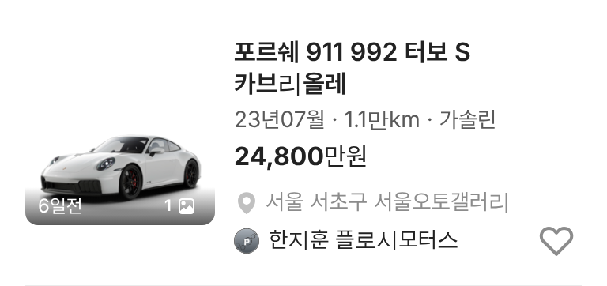
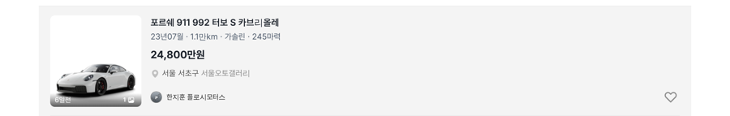

# PR #930 서울오토갤러리 사이트 매물 차종 대표 이미지

## ① 한 줄 요약
사진 없이 등록했던 서울오토갤러리 사이트 매물 81대 중 80대에 차종 대표 이미지를 붙였다.

## ② 과제 정보
- 과제 ID 없음(사용자 지시) · 브랜치 `sag-site-listing-images` · 커밋 `21b26b0` · PR https://github.com/bobaekimboae/bobaedream/pull/930
- 상태: 병합 · 배포 완료. #930 자체 배포는 바로 뒤 커밋에 밀려 취소됐고, 그 다음 main `45233e1`(다른 작업: 한지훈 릴스 30개) 배포에 함께 들어감(v=`45233e1`, 번들 `assets/main-Dj1wJBEI.js`)

## ③ 한 일
- 페라리 = 우리 3/4 카탈로그 컷, 벤츠 · BMW · 현대 · 포르쉐 · 벤틀리 · 롤스로이스 · 람보르기니 = 저장소 모델 이미지(세대 코드가 맞는 세부모델 우선).
- 그 밖 브랜드 = 당근 차량 기준표 모델 이미지(외부 주소).
- 카탈로그 그림이라 contain · 아래 맞춤. 애스턴마틴 DBS 슈퍼레제라 1대는 맞는 이미지가 없어 기본 그림.
- 차명 해석 보정: 모델 X · RS Q8 · 레인지로버 스포츠 · 레인지로버 이보크 · G90 · DBS 슈퍼레제라 · 디스커버리 5세대.

## ④ 원본과 비교
| 항목 | 전 | 후 |
|---|---|---|
| 사진 | 81대 모두 기본 그림 | 80대 차종 대표 이미지 · 1대 기본 그림 |

 

## ⑤ 검증
- `npm run verify:qf` 통과. 한지훈 페이지(384 · 1280) 첫 화면 이미지 10장 모두 로드, 요청 오류 0.

## ⑥ 원본과 다르게 남긴 것
- 실제 그 차의 사진이 아니라 차종 대표 이미지다.

## ⑦ 못 한 것·다음
- 실사 사진이 필요하면 딜러가 직접 올린 사진 출처가 있어야 한다.

## ⑧ 확인 링크
- 한지훈(모바일): https://bobaekimboae.github.io/bobaedream/?qf=guazi&profile=dealer&shop=450560&emp=3&v=45233e1
- PC: 같은 주소 &pc=1
