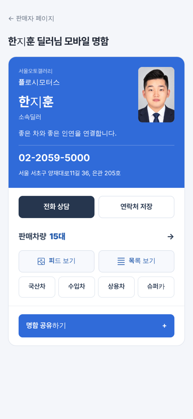
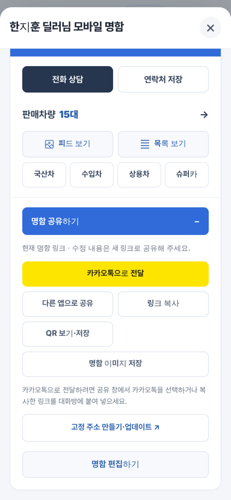
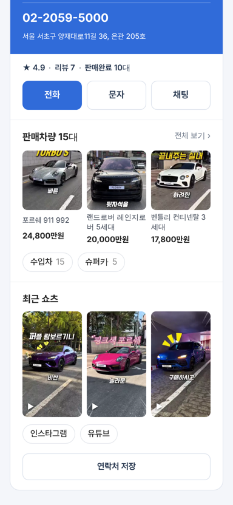
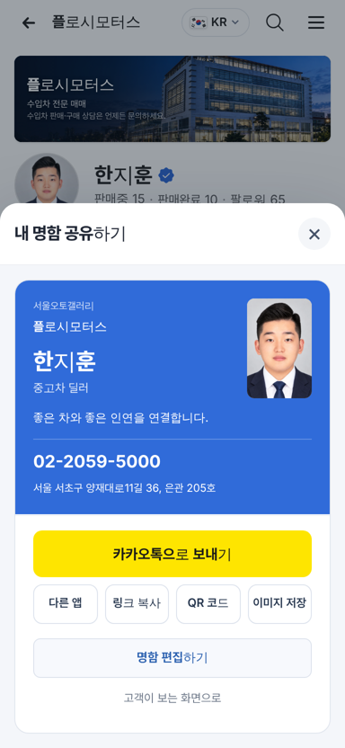

# PR #935 딜러 모바일 명함 고객·딜러 화면 분리

## ① 한 줄 요약
딜러가 고객에게 보내는 모바일 명함을 고객이 보는 화면과 딜러가 공유·편집하는 화면으로 나눴다.

## ② 정보
- 과제 ID: 없음(사용자 지시 「모바일 명함 컨설팅해봐라 → 수정해라」)
- 브랜치: `dealer-card-customer-view` · 커밋 `f081738`
- PR: https://github.com/bobaekimboae/bobaedream/pull/935
- 상태: 병합 · 배포 완료, v=`8ab3e92`, 번들 `assets/main-BlfZCQsG.js`
- 함께 들어간 과제: 없음

## ③ 한 일
- 고객 화면: 명함 카드 → 실적 한 줄(★ 4.9 · 리뷰 7 · 판매완료 10대) → `전화 · 문자 · 채팅` 3버튼 → 판매차량 N대와 대표 매물 사진 3장 · 0대가 아닌 분류만 → 최근 쇼츠 3개 · 인스타그램/유튜브 → 연락처 저장.
- 역할 표기 `소속딜러` → `중고차 딜러`, `대표` → `대표 딜러`. 제목은 `이름 · 상사`.
- 고객 화면에서 `명함 공유하기` 큰 버튼, 피드/목록 보기 버튼, 4분류 고정 칸을 뺐다. 판매차량 0대면 그 칸을 숨긴다.
- SNS는 딜러가 직접 입력한 값이 없으면 판매자페이지 SNS 매핑을 자동으로 쓴다.
- 딜러 화면(`딜러 본인이세요? 명함 공유·편집`): 노란 `카카오톡으로 보내기` 하나 + `다른 앱 · 링크 복사 · QR 코드 · 이미지 저장` 4칸 → 명함 편집 → 고객 화면으로 돌아가기. 고정 주소 저장은 편집 화면에만.
- 받는 사람 페이지는 오른쪽 위 작은 `공유` 알약만 둔다.

## ④ 원본과 비교
| 영역 | 작업 전 | 작업 후 |
|---|---|---|
| 고객 화면 버튼 수(명함 아래) | 전화·연락처 저장 2 + 보기 2 + 분류 4 + 공유 1 = 9 | 연락 3 + 분류(있는 것만) + 연락처 저장 1 |
| 신뢰 정보 | 없음 | 별점 · 리뷰 · 판매완료 |
| 판매차량 | 숫자만 | 대표 사진 3장 + 가격 |
| SNS · 쇼츠 | 딜러 입력값만(한지훈 빈칸) | 자동 연결 + 릴스 3개 |
| 딜러 공유 메뉴 | 버튼 6 + 안내문 2줄 + 고정 주소 | 카카오톡 1 + 4칸 |

 
 
 

## ⑤ 검증
- `npm run verify:qf` 통과(타입 검사 · 빌드).
- 콘솔 오류: 모바일 384 판매자페이지 · 받는 사람 페이지 0건. PC는 명함 화면 변경만이라 별도 측정 안 함.
- 가로 넘침 0. 배포본에서 대표 매물 3장 · 릴스 3개 · 제목 `한지훈 · 플로시모터스` 확인.
- 퀵필터 규격(measure:qf)은 이번 변경 범위 밖이라 재측정하지 않았다.

## ⑥ 원본과 다르게 남긴 것과 이유
- 로그인이 없어 고객/딜러를 구분할 수 없으므로, 딜러 화면은 창 아래 링크로 들어가게 했다.
- 상사 허가 · 종사원 확인 배지는 실제 확인 데이터가 없어 넣지 않았다.
- 실적 숫자는 판매자페이지와 같은 화면 확인용 가상 값이다.

## ⑦ 못 한 것 · 다음에 할 것
- 카카오톡 미리보기(딜러별 og 사진·이름): GitHub Pages로는 불가, 명함 서버에서 만들어야 한다.
- 카카오 공유 SDK 피드 템플릿, 딜러 직통번호(안심번호), 로그인 기반 고객/딜러 구분.
- 화면 캡처에서 한 단어 안 글자 굵기가 섞여 보이는 글꼴 문제(실제 폰 확인 필요).

## ⑧ 확인 링크
- 판매자페이지(모바일): https://bobaekimboae.github.io/bobaedream/?qf=guazi&profile=dealer&shop=450560&emp=3&v=8ab3e92
- 받는 사람 명함: https://bobaekimboae.github.io/bobaedream/?profile=dealer&shop=450560&emp=3&card=1&v=8ab3e92
- PC: https://bobaekimboae.github.io/bobaedream/?qf=guazi&profile=dealer&shop=450560&emp=3&v=8ab3e92&pc=1
