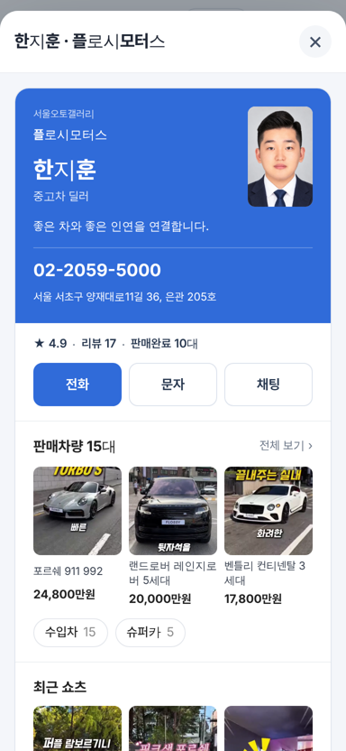
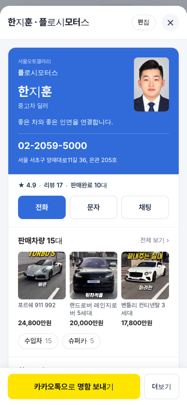
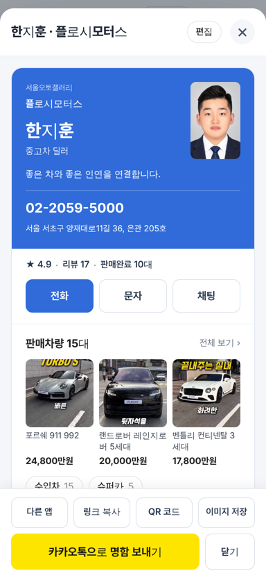
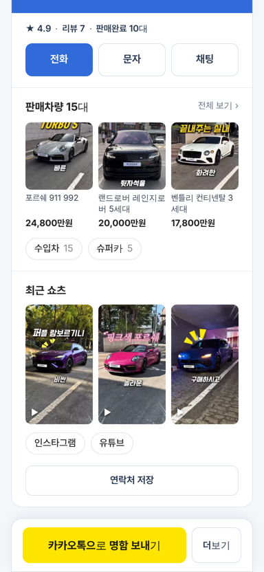

# PR #937 딜러 명함 공유 막대 고정

## ① 한 줄 요약
명함 창과 받는 사람 페이지 아래에 `카카오톡으로 명함 보내기` 공유 막대를 늘 보이게 붙였다.

## ② 정보
- 과제 ID: 없음(사용자 지시 「공유하기 이런거 없잖아」)
- 브랜치: `dealer-card-share-bar` · 커밋 `8cf15dc`
- PR: https://github.com/bobaekimboae/bobaedream/pull/937
- 상태: 병합(`b380feb`) · 배포 완료. 배포 실행이 뒤 커밋에 밀려 취소되어 `27a4814`(다른 작업 「brand video listings」 포함) 배포에 함께 들어갔다. v=`27a4814`, 번들 `assets/main-CIrYTc9U.js`
- 함께 들어간 과제: 다른 작업 커밋 `27a4814`

## ③ 한 일
- PR #935에서 공유를 「딜러 본인이세요?」 링크 뒤로 숨긴 것을 되돌렸다.
- 명함 창 · 받는 사람 페이지 아래에 공유 막대 고정: 노란 `카카오톡으로 명함 보내기` + `더보기`. 더보기를 누르면 `다른 앱 · 링크 복사 · QR 코드 · 이미지 저장` 4칸이 위로 펼쳐진다.
- 편집은 창 머리 `편집` 알약으로 옮겼다. 편집 중에는 막대를 숨기고 `편집 완료`로 끝낸다.
- 받는 사람 페이지 오른쪽 위 `공유` 알약은 막대와 겹쳐 뺐다.

## ④ 원본과 비교
| 영역 | 작업 전(#935) | 작업 후 |
|---|---|---|
| 공유 찾는 방법 | 맨 아래 작은 링크 → 다른 화면 | 화면 아래 늘 고정 |
| 카카오톡 공유 | 딜러 화면 안 | 막대 첫 버튼(52) |
| 편집 | 딜러 화면 아래 | 머리 `편집` 알약 |

   

## ⑤ 검증
- `npm run verify:qf` 통과. 배포본 모바일 384 판매자페이지 · 받는 사람 페이지 콘솔 오류 0. 더보기 펼침 · 편집 전환 확인.
- 퀵필터 규격은 변경 범위 밖.

## ⑥ 원본과 다르게 남긴 것과 이유
- 받는 사람(고객) 페이지에도 같은 막대를 둔다. 고객이 지인에게 넘기는 경우도 있고 버튼 위치를 하나로 맞추기 위해서다.

## ⑦ 못 한 것 · 다음에 할 것
- 카톡 상담 버튼(오픈채팅 · 채널 · ID) 추가는 의견만 냈고 적용 전.
- 카카오 공유 SDK · 딜러별 카톡 미리보기는 서버 과제.

## ⑧ 확인 링크
- 판매자페이지: https://bobaekimboae.github.io/bobaedream/?qf=guazi&profile=dealer&shop=450560&emp=3&v=27a4814
- 받는 사람 명함: https://bobaekimboae.github.io/bobaedream/?profile=dealer&shop=450560&emp=3&card=1&v=27a4814
- PC: https://bobaekimboae.github.io/bobaedream/?qf=guazi&profile=dealer&shop=450560&emp=3&v=27a4814&pc=1
