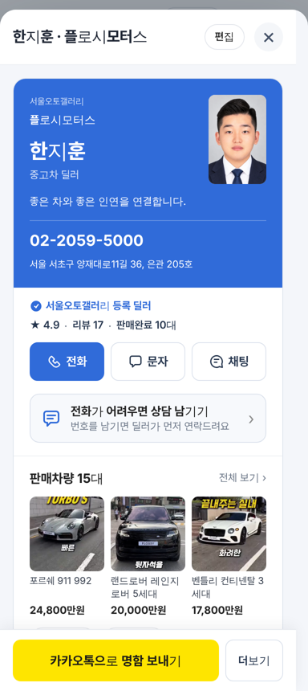
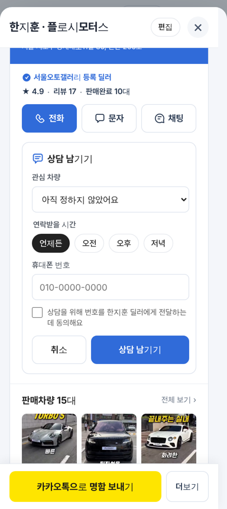
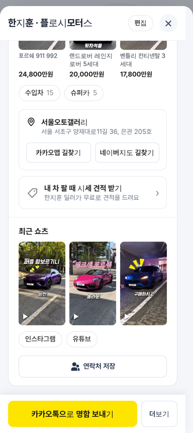
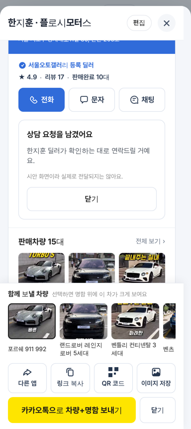
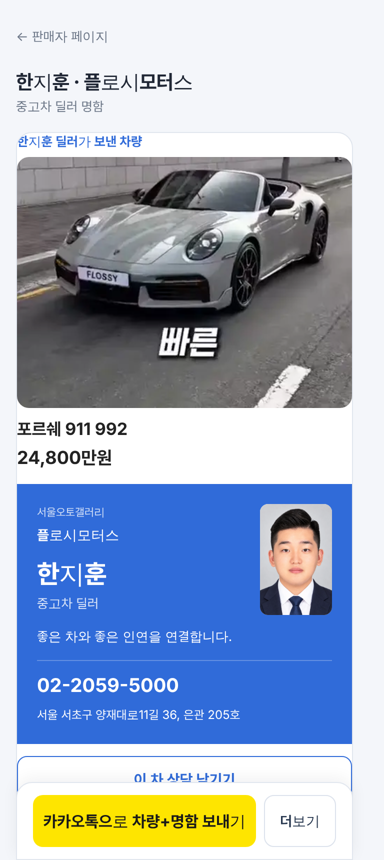
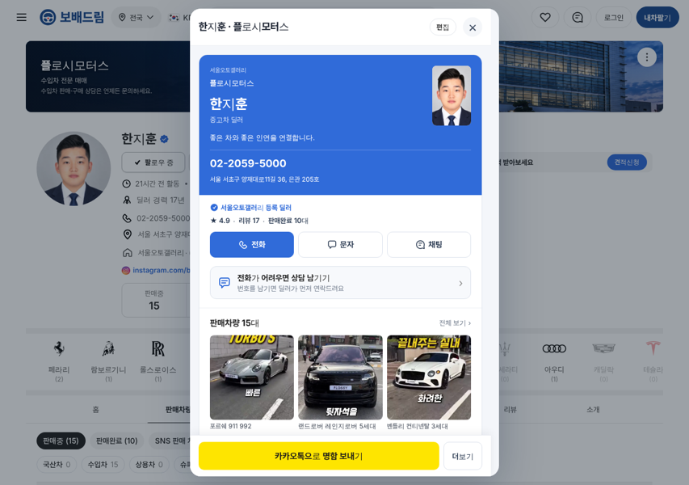

# PR #939 딜러 명함 — 국내외 벤치마킹 구조 적용

## ① 한 줄 요약
국내외 자동차 딜러·부동산 중개사 디지털 명함에서 공통으로 쓰는 기능(고객 연락처 받기·매물 한 대 공유·길안내·내 차 견적)을 우리 명함 고객 화면에 순서대로 넣고, 아이콘은 오토스카우트24·초톳 원본으로 맞췄다.

## ② 정보
- 과제 ID: 없음(사용자 지시)
- 브랜치 `dealer-card-benchmark` · 커밋 `00d5470` · PR https://github.com/bobaekimboae/bobaedream/pull/939
- 상태: 병합 `daa98b2` · 배포 v=`daa98b2` · 번들 `assets/main-8f9gv9EA.js`
- 이번 병합으로 main에 함께 들어간 과제: 없음

## ③ 한 일
1. 고객 화면을 9단계로 묶음: 문의 차량 → 명함 → 신뢰(단지 등록 딜러 배지 + 별점·리뷰·판매완료) → 전화·문자·채팅 → 상담 남기기 → 판매차량 → 방문 안내 → 내 차 시세 견적 → 쇼츠·SNS → 연락처 저장.
2. 상담 남기기: 관심 차량 · 연락받을 시간(언제든·오전·오후·저녁) · 휴대폰 번호 · 전달 동의. 시안이라 저장·전송하지 않고 완료 안내만 보인다.
3. 차 한 대 붙여 보내기: 공유 막대 `더보기` → `함께 보낼 차량`에서 고르면 주소에 `&car=`가 붙고 버튼이 `카카오톡으로 차량+명함 보내기`로 바뀜. 받는 사람은 명함 위에 그 차 사진·가격과 `이 차 상담 남기기`를 먼저 본다.
4. 방문 안내: 단지명·주소 + 카카오맵·네이버지도 길찾기 버튼.
5. 내 차 시세 견적: 판매자페이지 내차견적 탭(`tab=valuation`)으로 바로 가는 줄.
6. 아이콘: 전화·문자·상담·위치·내 차 판매는 오토스카우트24, 채팅·공유·복사·이미지·연락처·인증 체크는 초톳 원본(파일 수정 없이 색만 mask).

## ④ 원본과 비교
벤치마킹 근거와 우리 적용 여부

| 해외·국내 공통 기능 | 출처 | 이번 적용 |
|---|---|---|
| 고객 연락처 받기(리드 수집) | Wave·KADO·Uniqode·HiHello | 상담 남기기(화면만) |
| 매물 연결·특정 매물 공유 | Wave·KADO·Uniqode | 판매차량 + 함께 보낼 차량 |
| 길안내 | Wave(구글 지도) | 카카오맵·네이버지도 |
| 금융·견적 | Wave·KADO | 내 차 시세 견적 줄 |
| 검증 리뷰·거래 이력 | 질로 조사 | 자리만(값은 가상) |
| 조회 분석·안심번호·딜러별 카톡 미리보기 | HiHello 등 | 서버 필요 — 미적용 |

동작 점검(384, Playwright): 명함 열기 → 상담 남기기 열기 → 번호·동의 입력 → 완료 안내 ✅ / 더보기 → 차량 선택 → 버튼 문구 변경 ✅ / `card=1&car=14018` 받는 화면 문의 차량 ✅ / PC 1280 모달 ✅

## ⑤ 검증
- `npm run verify:qf` 통과
- 콘솔 오류: 우리 화면 오류 없음. 명함 고정 주소 서버(chatgpt.site) CORS 차단은 기존과 같음
- 퀵필터 규격은 이번 변경 범위 밖(딜러 명함만 수정)

## ⑥ 원본과 다르게 남긴 것과 이유
- 오토스카우트24·초톳 아이콘 DB에 QR 아이콘이 없어 QR 칸만 CSS 사각 표시로 대신함.
- 초톳 `링크 복사` 원본은 회색 원 배경형이라 같은 초톳의 `복사` 선형 아이콘을 씀.
- 별점·리뷰·판매완료는 여전히 가상 값. 실제 서비스에서는 종사원 확인·실거래 리뷰로 바꿔야 함.

## ⑦ 못 한 것·다음에 할 것
- 상담 내용 저장·딜러 알림, 열람 알림, 딜러별 카톡 미리보기, 안심번호(서버 필요)
- 상사 대표의 소속딜러 명함 일괄 관리, 지갑 담기, 다국어

## ⑧ 확인 링크
- 모바일: https://bobaekimboae.github.io/bobaedream/?qf=guazi&profile=dealer&shop=450560&emp=3&v=daa98b2 (프로필의 `명함`)
- 받는 사람(차량 포함): https://bobaekimboae.github.io/bobaedream/?qf=guazi&profile=dealer&shop=450560&emp=3&card=1&car=14018&v=daa98b2
- PC: https://bobaekimboae.github.io/bobaedream/?qf=guazi&profile=dealer&shop=450560&emp=3&pc=1&v=daa98b2

     
