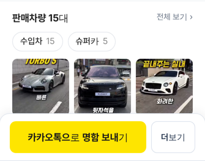
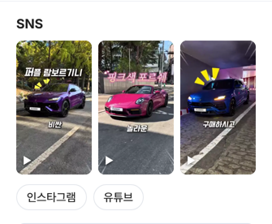

# PR #941 딜러 명함 — 크로스체크 보정

## ① 한 줄 요약
명함 고객 화면을 크로스체크해 분류 알약을 사진 위로 올리고, `최근 쇼츠`를 `SNS`로 바꾸고, 일반전화에 뜨던 `문자` 버튼을 숨겼다.

## ② 정보
- 과제 ID: 없음(사용자 지시)
- 브랜치 `dealer-card-chips-sns` · 커밋 `41fe9ad` · PR https://github.com/bobaekimboae/bobaedream/pull/941
- 상태: 병합 `daae6f8` · 배포 v=`a3970e6`(뒤이은 main 커밋 배포에 포함) · 번들 `assets/main-Bv9Dyx9K.js`
- 이번 병합으로 main에 함께 들어간 과제: 없음(배포본 `a3970e6`에는 다른 작업 커밋이 함께 있음)

## ③ 한 일
1. 판매차량 칸 순서를 `판매차량 N대 → 분류 알약(수입차 15 · 슈퍼카 5) → 사진 3장`으로 바꿨다.
2. `최근 쇼츠` 제목을 `SNS`로 바꾸고, 릴스가 없는 딜러도 인스타·유튜브 링크가 있으면 같은 제목 아래 보이게 했다.
3. 크로스체크 오류 수정: 상사·단지 대표 일반전화(02-2059-5000, 031-278-3030)에도 `문자`가 떠서 보낼 수 없는 문자 창이 열렸다. 이제 휴대폰 번호(01X)일 때만 `문자`가 보인다.

## ④ 원본과 비교 · 동작 점검
| 점검 | 한지훈(플로시) | 조이모터스 |
|---|---|---|
| 분류 알약 → 사진 순서 | 알약 y654 → 사진 y698 ✅ | 같음 ✅ |
| SNS 제목 | SNS ✅ | SNS ✅ |
| 연락 버튼 | 전화 · 채팅(문자 숨김) ✅ | 전화 · 채팅 ✅ |
| 길찾기(카카오·네이버) | 연결 ✅ | 연결 ✅ |
| 내 차 견적 → 내차견적 탭 | ✅ | ✅ |
| 아이콘 8개 응답 | 모두 200 ✅ | — |
| 가로 넘침 | 없음 ✅ | 없음 ✅ |

## ⑤ 검증
- `npm run verify:qf` 통과, 배포본(384)에서 같은 점검 재확인
- 콘솔 오류 없음(명함 고정 주소 서버 CORS는 기존과 같음)

## ⑥ 원본과 다르게 남긴 것과 이유
- 서울오토갤러리 딜러 대부분은 개인 휴대폰을 저장하지 않아(개인정보) 문자 버튼이 안 보인다. 딜러가 명함 편집 `휴대폰 번호`에 직접 넣으면 문자가 나타난다.

## ⑦ 못 한 것·다음에 할 것
- 상담 저장·알림, 딜러별 카톡 미리보기, 안심번호(서버 필요)

## ⑧ 확인 링크
- 모바일: https://bobaekimboae.github.io/bobaedream/?qf=guazi&profile=dealer&shop=450560&emp=3&card=1&v=a3970e6
- PC: https://bobaekimboae.github.io/bobaedream/?qf=guazi&profile=dealer&shop=450560&emp=3&pc=1&v=a3970e6

 
