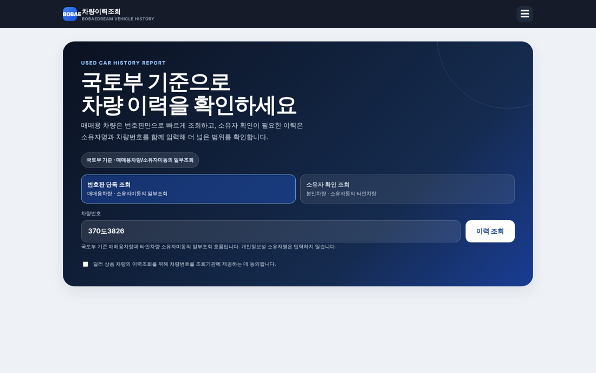
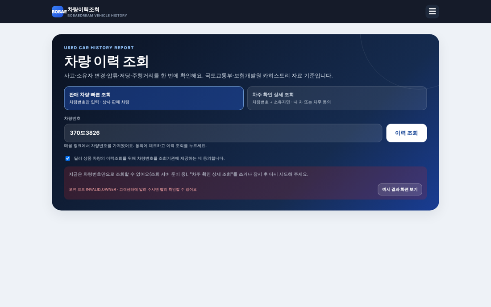
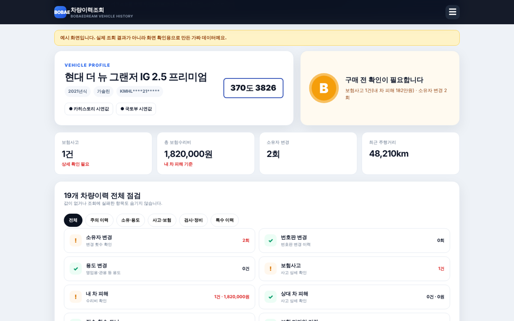
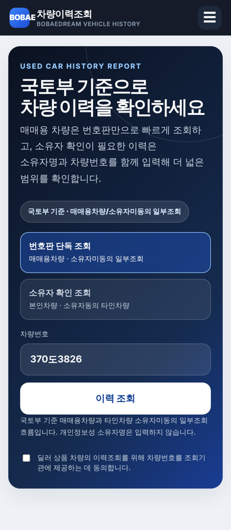
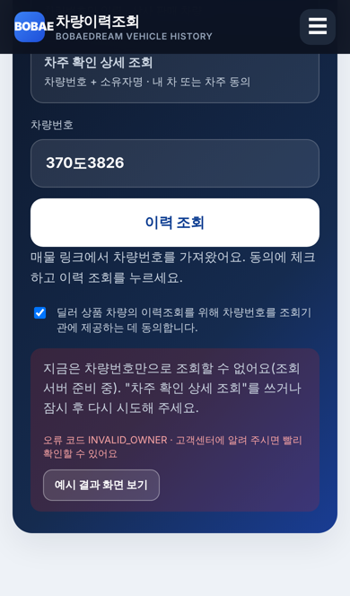

# PR #943 차량이력조회 화면 정리

① 차량이력조회 첫 화면을 줄이고 쉬운 말로 바꿨으며, 조회 실패 시 딜러가 이해할 수 있는 안내와 예시 결과 화면을 넣었다.

② 과제 ID: 없음(사용자 요청 "화면 먼저 수정") · 브랜치 `ccr-05f7541e-5h1fm0` · 커밋 `cf8d5adf` · PR https://github.com/bobaekimboae/bobaedream/pull/943 · 상태: 푸시 완료, 병합·배포 전(승인 대기)

③ 한 일
- 큰 제목·긴 설명을 "차량 이력 조회" + 한 줄로 줄이고, 세 번 반복되던 국토부 조회 유형 배지를 없앴다.
- 조회 방법 이름을 "판매 차량 빠른 조회 / 차주 확인 상세 조회"로 바꿨다.
- 오류 문구를 딜러용 문장 + 오류 코드로 바꾸고, 휴대폰에서 안내가 화면 밖에 있던 문제를 고쳤다(자동 스크롤).
- "예시 결과 화면 보기"(또는 `?demo=1`)로 결과 화면을 확인할 수 있게 했다. 노란 배너로 예시임을 표시하고 최근 조회에는 저장하지 않는다.
- 최근 조회를 입력칸 아래에 보여 주고, 매물 링크로 들어오면 차량번호를 가져왔다고 안내한다.
- 결과 화면이 상단 고정바에 가려지던 문제를 고쳤다.

④ 원본과 비교
| 영역 | 작업 전 | 작업 후 |
|---|---|---|
| 첫 화면 높이(PC) | 제목 2줄 + 설명 2줄 + 배지 | 제목 1줄 + 설명 1줄 |
| 오류 안내 | "국토부 매매용·소유자미동의 조회 API 설정을 확인해주세요." | 딜러용 문장 + 오류 코드 + 예시 결과 버튼 |
| 휴대폰 오류 표시 | 화면 밖(스크롤해야 보임) | 화면 가운데로 자동 이동 |
| 결과 화면 확인 | API 실패로 확인 불가 | 예시 결과로 확인 가능 |

    

⑤ 검증
- PC 1440px·아이폰 13 크기에서 매물 링크 → 조회 → 오류 안내 → 예시 결과까지 확인, 콘솔 오류 없음(PC·모바일), 휴대폰 가로 넘침 없음(폭 390px).
- `verify:qf`는 이번 변경 범위(`public/vehicle-history` 정적 페이지) 밖이라 돌리지 않았다.

⑥ 원본과 다르게 남긴 것과 이유
- 동의 체크박스는 테스트 단계라 그대로 두었다(요청).
- "매매상사·경매" 항목이 상품용 등록 1건만으로 주의(!) 표시되는 기존 판정은 화면 범위 밖이라 두었다.

⑦ 못 한 것·다음에 할 것
- 스테이징 API가 번호판 단독 조회에도 `owner`를 필수로 요구해 400(`INVALID_OWNER`)을 돌려준다. 서버 수정이 필요하다.
- 딜러 로그인·조회 횟수 제한·조회 기록, 구매자 공유 리포트, 매물 이력 배지.

⑧ 확인 링크(배포 후)
- https://bobaekimboae.github.io/bobaedream/vehicle-history/?mode=dealer&plate=370%EB%8F%843826
- 예시 결과: https://bobaekimboae.github.io/bobaedream/vehicle-history/?mode=dealer&plate=370%EB%8F%843826&demo=1
