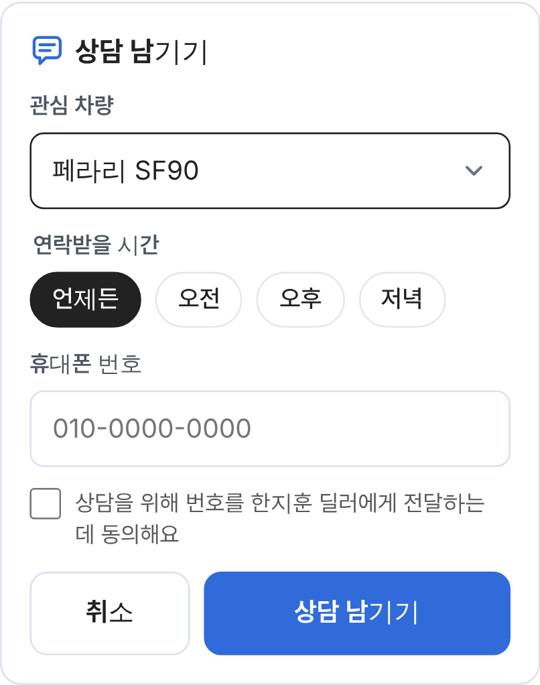

# PR #945 딜러 명함 상담 폼 넘침 수정

## ① 한 줄 요약
폰에서 `상담 남기기` 폼의 선택칸·휴대폰 칸·버튼이 폼 밖으로 넘치고 선택칸에 파랑 테두리가 두 겹 생기던 문제를 고쳤다.

## ② 과제 · 브랜치 · 커밋 · 상태
- 과제 ID: 없음(사용자 「크로스체크」 지시)
- 브랜치: `fix/dealer-card-consult-overflow` · 병합 커밋 `810c366`
- PR: https://github.com/bobaekimboae/bobaedream/pull/945 · 병합·배포 완료 · v=810c366

## ③ 한 일
- 선택칸(관심 차량)이 가장 긴 차량 이름 폭만큼 커지던 것을 폼 폭에 고정하고, 긴 이름은 말줄임했다.
- 선택칸 기본 모양을 지우고 회색 꺾쇠를 오른쪽에 직접 그렸다.
- 포커스 때 공용 파랑 바깥 테두리를 끄고 칸 테두리만 검정(`#222`)으로 바꿨다.
- `취소 · 상담 남기기` 버튼 줄이 넘치지 않게 폭 계산을 바꿨다.
- 동의 문구가 낱말 단위로 줄바꿈되게 해 `요` 한 글자만 내려가지 않게 했다.

## ④ 원본과 비교
| 항목 | 전 | 후 |
|---|---|---|
| 폼 안쪽 넘침(360·384·412) | 폰에서 선택칸·버튼이 오른쪽 밖 | 0 |
| 선택칸 포커스 | 파랑 이중 테두리 | `#222` 1px 한 겹 |
| 동의 문구 | `요` 한 글자 줄바꿈 | 낱말 단위 |

## ⑤ 검증
- `npm run verify:qf` 통과
- 360·384·412 폭, 한지훈·조이모터스 명함 전체에서 화면 밖으로 나가는 요소 0
- 퀵필터 규격 영역은 바꾸지 않음

## ⑥ 원본과 다르게 남긴 것
- 없음

## ⑦ 못 한 것 · 다음
- 실제 폰 브라우저(삼성 인터넷·사파리)의 선택 목록 모양은 브라우저 기본이라 그대로 둔다.

## ⑧ 확인 링크
- 모바일: https://bobaekimboae.github.io/bobaedream/?qf=guazi&profile=dealer&shop=450560&emp=3&card=1&v=810c366
