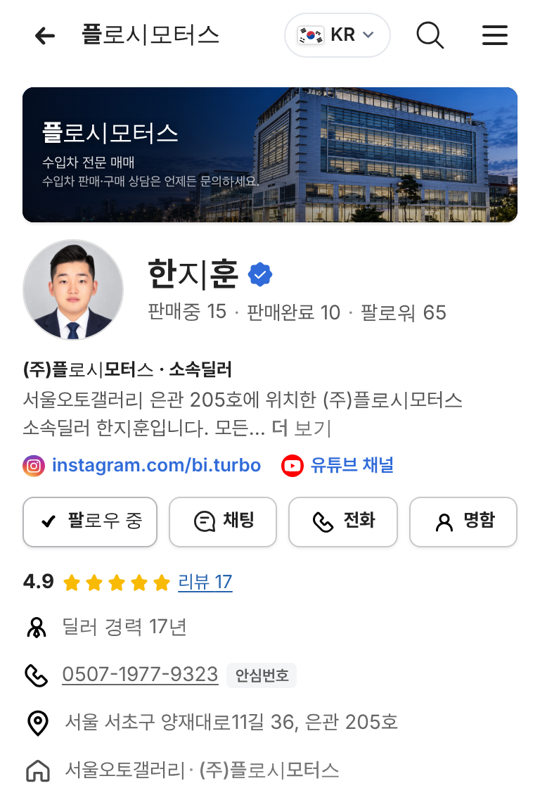
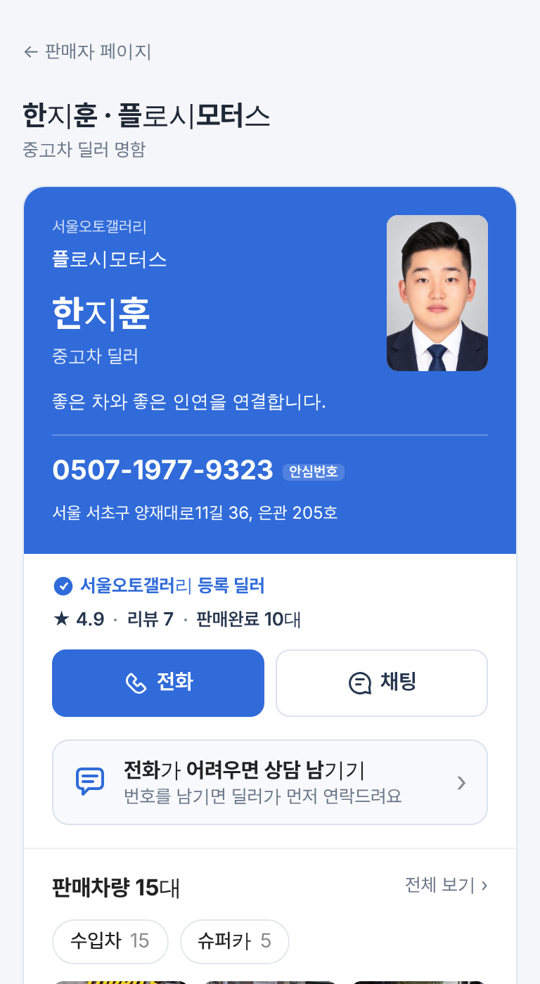

# PR #947 딜러 연락처 050 안심번호 표시

## ① 한 줄 요약
판매자페이지와 딜러 명함의 전화번호를 0507 안심번호로 바꿔 보이게 했다.

## ② 과제 · 브랜치 · 커밋 · 상태
- 과제 ID: 없음(사용자 「050 번호」 → 「안심번호로 표시」)
- 브랜치: `feat/dealer-safe-number` · 병합 커밋 `6c5f5f9`
- PR: https://github.com/bobaekimboae/bobaedream/pull/947 · 병합·배포

## ③ 한 일
- 프로필 전화 줄, `전화` 버튼, 소개 탭, 명함 카드 번호와 `전화` 버튼을 `0507-1XXX-XXXX` 안심번호로 바꿨다.
- 번호 뒤에 `안심번호` 꼬리표를 붙였다.
- 번호는 딜러마다 다른 예시 값이라, 실제 남의 번호로 걸리지 않게 전화 연결 대신 안내 문구를 띄운다.
- 050 번호는 문자 수신이 보장되지 않아 명함의 `문자` 버튼은 계속 숨긴다.
- 딜러가 명함 편집에서 직접 넣은 휴대폰 번호는 그대로 전화가 걸린다.

## ④ 원본과 비교
| 위치 | 전 | 후 |
|---|---|---|
| 프로필 전화 줄 | 상사 대표 전화(02-…) | 0507 안심번호 + 꼬리표 |
| 명함 카드 번호 | 상사 대표 전화 | 0507 안심번호 + 꼬리표 |
| 전화 버튼 | 바로 전화 연결 | 안심번호 연결 안내(시안) |

 

## ⑤ 검증
- `npm run verify:qf` 통과
- 384 판매자페이지·명함: 화면 안 `tel:` 링크 0, `문자` 버튼 0, 콘솔 오류 0

## ⑥ 원본과 다르게 남긴 것
- 안심번호는 실제 발급 번호가 아닌 예시 값이다.

## ⑦ 못 한 것 · 다음
- 실제 안심번호 발급·연결은 서버 작업이다.
- 매물 목록·상세의 전화 버튼은 이번 범위에 넣지 않았다.

## ⑧ 확인 링크
- 판매자페이지: https://bobaekimboae.github.io/bobaedream/?qf=guazi&profile=dealer&shop=450560&emp=3&v=6c5f5f9
- 명함: https://bobaekimboae.github.io/bobaedream/?qf=guazi&profile=dealer&shop=450560&emp=3&card=1&v=6c5f5f9
