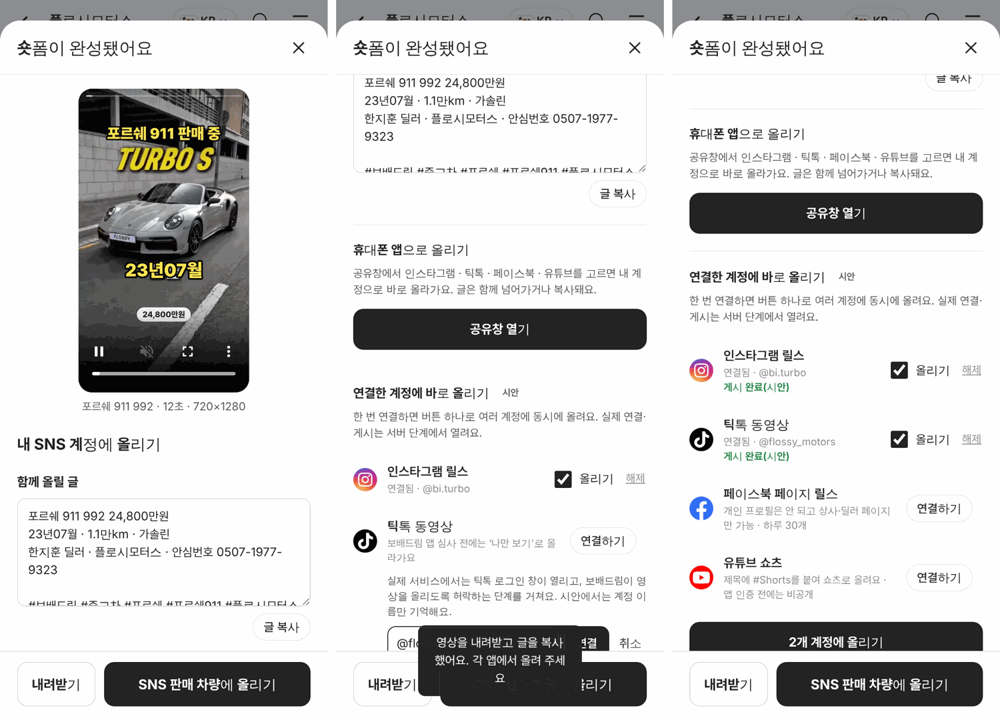
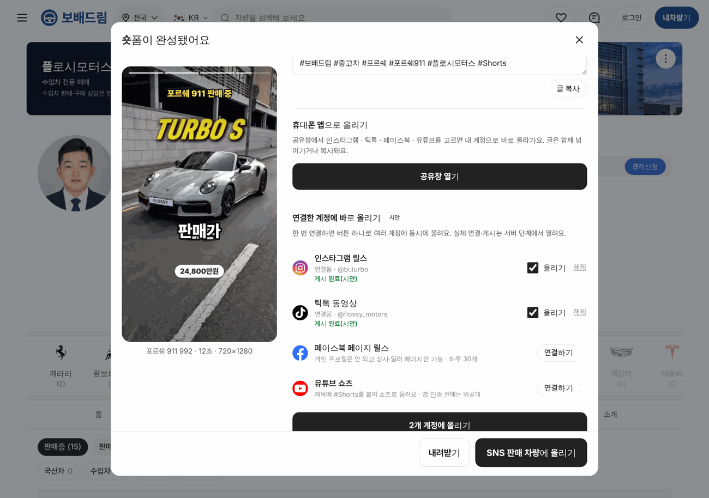

# PR #958 숏폼 내 SNS 계정에 올리기

## ① 한 줄 요약
숏폼 완성 화면에서 인스타그램·틱톡·페이스북·유튜브 쇼츠의 딜러 본인 계정으로 올리는 기능을 붙였다(공유창 = 실제 동작, 계정 연결 후 바로 올리기 = 시안).

## ② 과제 · 브랜치 · 커밋 · 상태
- 과제 ID: 없음(사용자 지시 「인스타 · 틱톡 · 페이스북 · 쇼츠 본인 계정에 등록하는 기능」)
- 브랜치: feat/shortform-sns-publish → main 320b457 (PR [#958](https://github.com/bobaekimboae/bobaedream/pull/958))
- 상태: 병합·배포 완료, v=320b457, 번들 assets/main-CWOnB7sz.js

## ③ 한 일
- 완성 화면에 `내 SNS 계정에 올리기`: 함께 올릴 글(차명·가격·사양·딜러·안심번호·해시태그 자동, 고칠 수 있음, 글 복사).
- 휴대폰 앱으로 올리기: 공유창에 영상 파일과 글을 넘기면 딜러가 고른 앱에서 본인 계정으로 올린다. PC는 내려받기 + 글 복사.
- 연결한 계정에 바로 올리기(시안): 4개 플랫폼 계정 연결 → 체크 → `N개 계정에 올리기`로 올리는 중 → 처리 중 → 게시 완료(시안) 흐름. 실제로 보내지 않는다.
- 판매자페이지 SNS 링크가 있으면 연결 칸에 계정을 미리 넣는다(한지훈 @bi.turbo).

## ④ 원본과 비교
원본 화면 없음. 플랫폼 조건은 공식 개발자 문서로 확인했다.

| 플랫폼 | 공식 조건(문구에 반영) |
|---|---|
| 인스타그램 릴스 | 프로페셔널 계정만, 하루 100개 |
| 틱톡 | 앱 심사 전에는 비공개(나만 보기) |
| 페이스북 릴스 | 페이지만(개인 프로필 불가), 하루 30개 |
| 유튜브 쇼츠 | 앱 인증 전 업로드는 비공개 |

## ⑤ 검증
- verify:qf 통과
- 384·1280, 배포본: 숏폼 제작 → 글 자동 작성 → 공유창 없는 환경에서 내려받기(bobae-shortform-14018.mp4)+글 복사 → 인스타 연결(@bi.turbo 미리 채움)·틱톡 연결 → 2개 계정 게시 흐름 완료
- 콘솔 오류 PC·모바일 0

## ⑥ 원본과 다르게 남긴 것과 이유
- 바로 올리기는 시안: 각 플랫폼 로그인 권한(OAuth)·토큰 보관·영상 공개 주소가 모두 서버에 있어야 하고, 플랫폼 앱 심사가 필요하다.

## ⑦ 못 한 것 · 다음에 할 것
- 서버 연결: 각 플랫폼 개발자 앱 등록·심사(Meta 앱 검수, 틱톡 감사, 구글 앱 인증), 토큰 저장, 영상 공개 주소, 예약 게시, 게시 결과·조회 수 가져오기
- 공유창은 휴대폰 실기기에서 아직 확인하지 않았다.

## ⑧ 확인 링크
- 모바일: https://bobaekimboae.github.io/bobaedream/?qf=guazi&profile=dealer&shop=450560&emp=3&tab=ads&shortform=1&v=320b457
- PC: https://bobaekimboae.github.io/bobaedream/?qf=guazi&profile=dealer&shop=450560&emp=3&tab=ads&shortform=1&v=320b457&pc=1
