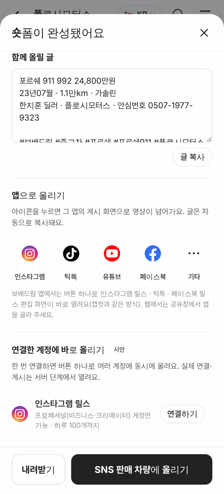

# PR #960 숏폼 캡컷식 앱으로 올리기

## ① 한 줄 요약
숏폼 완성 화면의 공유 버튼을 캡컷처럼 인스타그램·틱톡·유튜브·페이스북·기타 아이콘 줄로 바꾸고, 보배드림 이름으로 직접 올리는 개발 방법을 노션에 인계했다.

## ② 과제 · 브랜치 · 커밋 · 상태
- 과제 ID: 없음(사용자 지시 「캡컷처럼 우리가 직접 업로드 가능하게」)
- 브랜치: feat/shortform-capcut-share → main 6f42741 (PR [#960](https://github.com/bobaekimboae/bobaedream/pull/960))
- 상태: 병합·배포 완료, v=6f42741, 번들 assets/main-CfUnBsDm.js

## ③ 한 일
- `앱으로 올리기`: 52px 원 안에 원본 아이콘 + 이름, 5칸(인스타그램·틱톡·유튜브·페이스북·기타).
- 누르면 글을 먼저 복사하고, 웹은 휴대폰 공유창에 영상+글을 넘긴다. 공유창이 없는 PC는 내려받기 + 「○○ 앱에서 올려 주세요」.
- 앱(Flutter) 단계에서는 같은 버튼이 인스타그램·페이스북 Sharing to Reels, 틱톡 Share Kit로 그 앱 게시 화면을 바로 연다 → 개발 인계 문서(노션).
- 대행 서비스(Postiz) 연결 시도는 사용자 지시로 멈췄다.

## ④ 원본과 비교
캡컷 내보내기 화면의 「앱 아이콘 줄로 공유」 구조를 따랐다(아이콘·색은 우리 규칙). 캡컷 화면 실측은 하지 않았다.

## ⑤ 검증
- verify:qf(빌드·타입) 통과, 배포본 384에서 인스타그램 버튼 → 내려받기 + 알림 확인, 콘솔 오류 0

## ⑥ 원본과 다르게 남긴 것과 이유
- 웹은 특정 앱을 바로 지정해 열 수 없어서 공유창을 거친다(웹 브라우저 제한). 앱에서만 캡컷과 똑같이 바로 열린다.

## ⑦ 못 한 것 · 다음에 할 것
- 회사 계정으로 Meta 앱 ID·틱톡 개발자 앱(Share Kit)·구글 프로젝트 만들기, 앱(Flutter)에 공유 SDK 연결, 서버 직접 게시(방법 B)
- 틱톡 Share Kit 최대 프레임 1100px → 앱 단계에서 틱톡용 해상도 조정 필요

## ⑧ 확인 링크
- 모바일: https://bobaekimboae.github.io/bobaedream/?qf=guazi&profile=dealer&shop=450560&emp=3&tab=ads&shortform=1&v=6f42741
- PC: https://bobaekimboae.github.io/bobaedream/?qf=guazi&profile=dealer&shop=450560&emp=3&tab=ads&shortform=1&v=6f42741&pc=1
