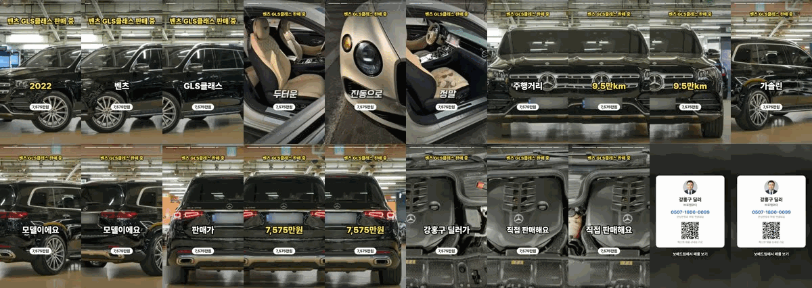
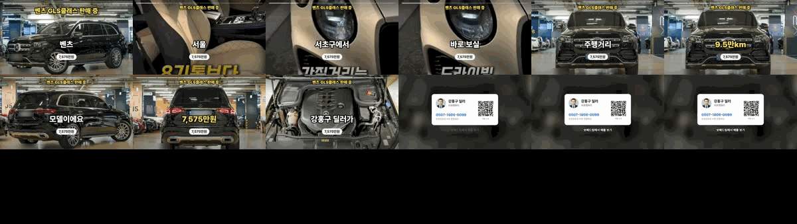
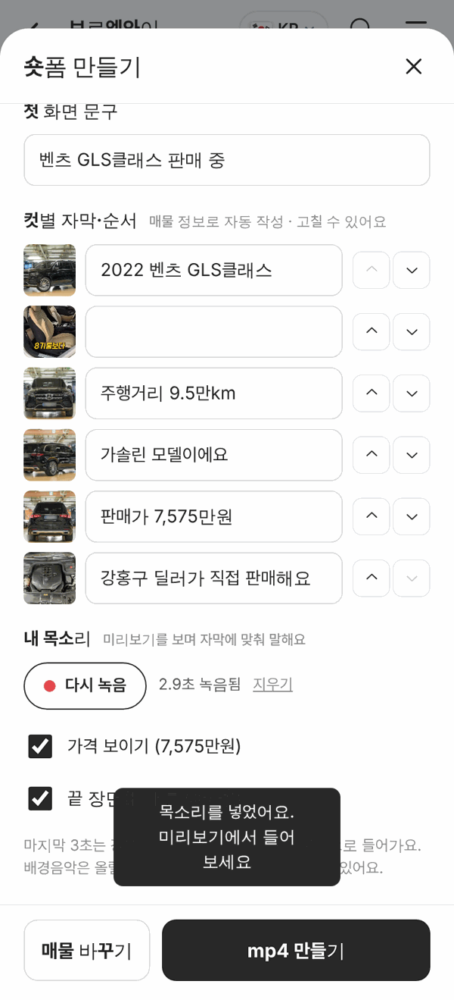
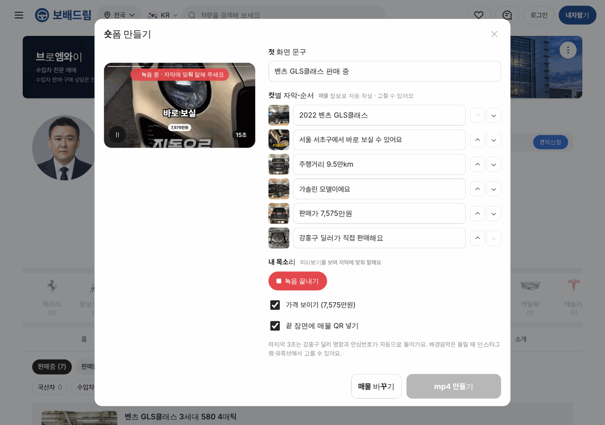

# PR #962 숏폼 제작기 2단계 — 영상·순서·비율·길이·목소리·QR

## ① 한 줄 요약
숏폼 제작기에 서버 없이 되는 추가 기능 7가지를 넣었다: 딜러 영상 넣기, 컷 순서 바꾸기, 사진 제한 해제, 화면 비율, 길이, 목소리 녹음, 끝 장면 매물 QR.

## ② 과제 · 브랜치 · 커밋 · 상태
- 과제 ID: 없음(사용자 지시 「추가 기능」 = 추가 기능 목록의 1차 묶음)
- 브랜치: feat/shortform-studio-v2 → main eb2b354 (PR [#962](https://github.com/bobaekimboae/bobaedream/pull/962))
- 상태: 병합·배포 완료, v=eb2b354, 번들 assets/main-CvBhcrEI.js

## ③ 한 일
- 사진 12장 제한을 없애고 한 영상 최대 12컷.
- `＋ 영상`: 딜러가 찍은 영상을 넣는다(컷 길이 = 영상 길이 최대 6초, 화면만).
- 컷마다 위·아래 버튼으로 순서 바꾸기(자막도 함께 이동).
- 화면 비율: 세로 9:16 · 정사각 1:1 · 가로 16:9. 정사각·가로는 카드형·끝 장면 배치가 따로 있다.
- 길이: 자동 · 15 · 30 · 60초(사진 컷 길이를 자동으로 나눔).
- 내 목소리: 미리보기를 보며 녹음(캡컷 보이스오버 방식), mp4에 소리로 들어간다. 목소리가 없어도 무음 소리 트랙을 넣는다.
- 끝 장면 매물 QR(기본 켬): 찍으면 이 매물 상세로 간다.

## ④ 원본과 비교
원본 화면 없음(캡컷 보이스오버·비율·길이 기능을 참고). 결과 영상 프레임:

## ⑤ 검증
- verify:qf 통과
- 384 9:16 릴스형 30초(사진 5 + 영상 1 + 목소리 2.9초) → 30.0초, 영상+소리 트랙 / 384 1:1 카드형 20초 / 1280 16:9 릴스형 15초 / 배포본 384 9:16 15초 모두 성공, 콘솔 오류 0
- 시험 브라우저는 H.264·AAC 인코더가 없어 VP9·Opus로 나왔다(크롬·사파리는 H.264·AAC 우선). 시험용 마이크는 가짜 장치(삐 소리)다.

## ⑥ 원본과 다르게 남긴 것과 이유
- 딜러 영상의 원래 소리는 넣지 않는다(목소리·배경음과 섞이는 문제, 다음 단계).
- 순서 바꾸기는 끌기 대신 위·아래 버튼(휴대폰에서 정확하고 키보드로도 된다).

## ⑦ 못 한 것 · 다음에 할 것
- 배경음악·AI 음성(서버), 영상 원래 소리 켜기/끄기, 영상 구간 자르기, 자막 글꼴 선택
- 휴대폰 실기기에서 영상 넣기·녹음 확인

## ⑧ 확인 링크
- 모바일: https://bobaekimboae.github.io/bobaedream/?qf=guazi&profile=dealer&shop=450555&emp=1&tab=ads&shortform=1&v=eb2b354
- PC: https://bobaekimboae.github.io/bobaedream/?qf=guazi&profile=dealer&shop=450555&emp=1&tab=ads&shortform=1&v=eb2b354&pc=1
