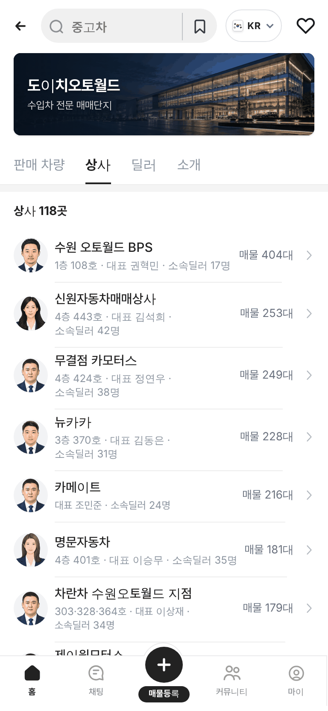
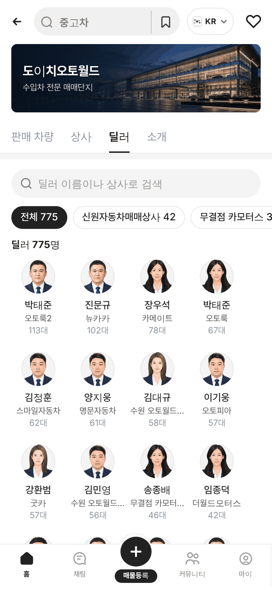
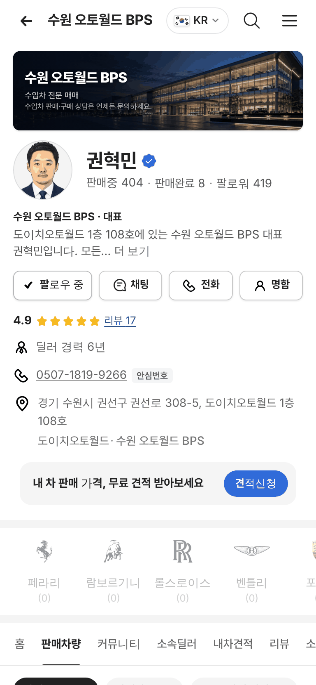
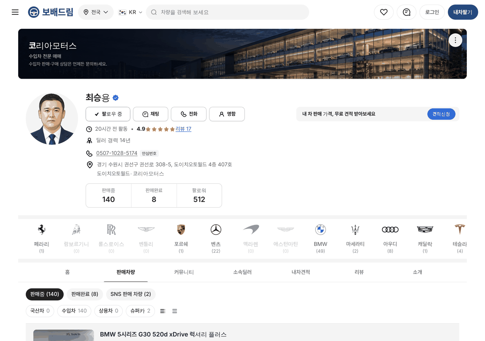

# PR #965 도이치오토월드 단지 · 상사 · 딜러 페이지

① 한 줄 요약: 도이치오토월드에도 서울오토갤러리와 같은 `판매 차량 · 상사 · 딜러 · 소개` 탭과, 상사 대표 · 딜러 판매자페이지(상사 118곳 · 딜러 775명)를 만들었다.

② 과제 ID: 없음(사용자 지시) · 브랜치 `feat/deutsch-dealer-pages` · 커밋 `7376d80b` → main `0320fdc` · PR https://github.com/bobaekimboae/bobaedream/pull/965 · 상태: 병합 · 배포 완료(v=0320fdc, 번들 `assets/main-BxqAHN-V.js`) · 함께 들어간 과제: 없음

③ 한 일
- 구글 시트 「도이치오토월드 상사 리스트」(dautoworld.com 공개 상사 목록 114곳)의 상사명 · 대표 · 상사 전화 · 팩스 · 층·호수를 `src/prototype/data/deutsch-autoworld-shops-v01.ts`로 옮겼다. 팩스 칸에 있던 휴대폰 번호 1건은 뺐다.
- 도이치오토월드 매물 4,298대의 실제 상사명 · 딜러명을 공식 상사에 맞춰 딜러 775명을 만들었다(같은 이름 → 법인 표기 · 띄어쓰기 뺀 이름 → 앞부분 일치). 맞는 상사가 없는 5곳은 대표 · 연락처 없는 상사로 뒀다.
- 단지 첫 화면에 탭을 붙였다. 상사 탭은 매물 많은 순, 딜러 탭은 판매 차량 많은 순 + 검색 + 상사 알약칩 + 60명씩 더 보기, 소개 탭은 지도(권선로 308-5).
- 판매자페이지 `?qf=guazi&profile=dealer&shop=da<ShopNo>&emp=<n>`: 대표 페이지는 상사 매물 전체, 딜러 페이지는 본인 매물. 커버는 단지 사진(서울오토갤러리 영상 끔), 전화는 안심번호.
- 매물 상세 지역 줄의 상사명을 그 상사 대표 페이지로 연결했다.

④ 원본과 비교: 서울오토갤러리 화면 구조를 그대로 재사용해 별도 비교표 없음.

| 화면 | 캡처 |
|---|---|
| 상사 탭 |  |
| 딜러 탭 |  |
| 대표 페이지(모바일) |  |
| 대표 페이지(PC) |  |

⑤ 검증: `npm run verify:qf` 통과. 배포본 모바일 384(판매 차량 · 상사 · 딜러 · 소개 · 대표 · 딜러 · 소속딜러 탭) · PC 1280 대표 페이지 콘솔 오류 0, 가로 넘침 0. 퀵필터 규격은 바꾸지 않음(measure:qf 대상 아님).

⑥ 원본과 다르게 남긴 것: 평점 · 리뷰 · 판매완료 · 팔로워 · 경력은 가상 값. 프로필 사진은 정장 일러스트 돌려쓰기. 층이 없는 호수(차란차 303·328·364호)는 원본대로.

⑦ 못 한 것 · 다음: PC 도이치오토월드 화면에는 탭이 아직 없음(서울오토갤러리와 같음). 매물 0대 상사를 숨길지 정해야 함. 딜러 실사진 없음.

⑧ 확인 링크
- 모바일 단지: https://bobaekimboae.github.io/bobaedream/?qf=guazi&category=도이치오토월드&sag=companies&v=0320fdc
- 대표 페이지: https://bobaekimboae.github.io/bobaedream/?qf=guazi&profile=dealer&shop=da100088&emp=1&v=0320fdc
- PC: https://bobaekimboae.github.io/bobaedream/?qf=guazi&profile=dealer&shop=da100067&emp=1&v=0320fdc&pc=1
