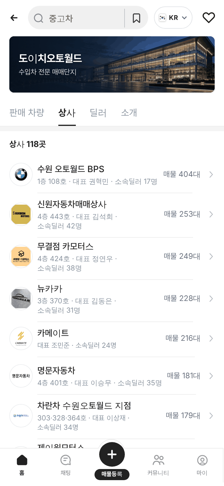
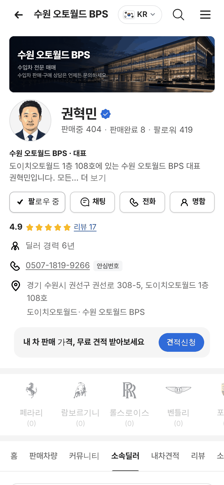
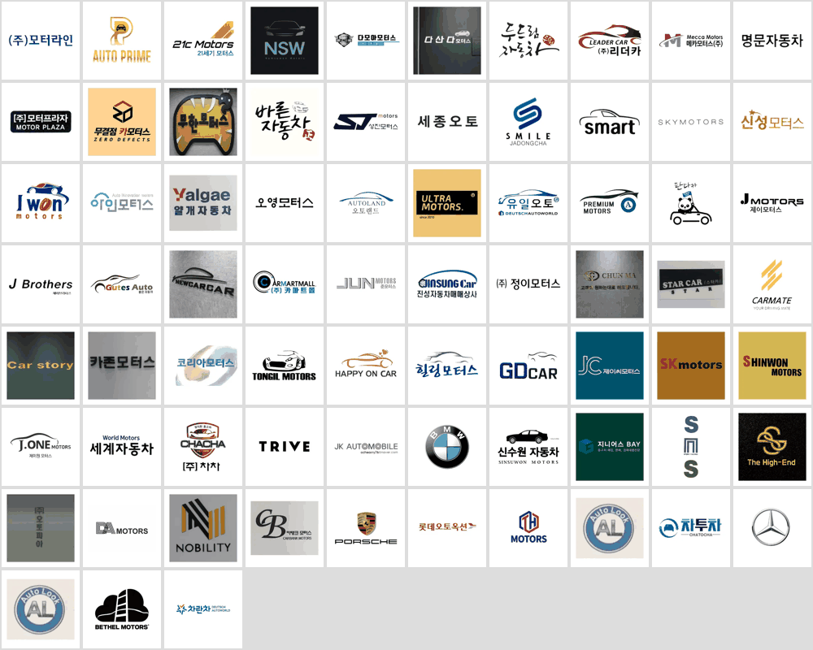

# PR #967 도이치오토월드 상사 로고 적용

① 한 줄 요약: 도이치오토월드 상사 73곳의 공식 사이트 상사 이미지를 단지 `상사` 탭과 판매자페이지 `소속딜러` 탭에 넣었다.

② 과제 ID: 없음(사용자 지시) · 브랜치 `feat/deutsch-shop-logos` · 커밋 `f201ac10` → main `0c6579f` · PR https://github.com/bobaekimboae/bobaedream/pull/967 · 상태: 병합 · 배포 v=0c6579f · 함께 들어간 과제: 없음

③ 한 일
- dautoworld.com 상사 페이지 114곳을 열어 상사 대표 이미지가 있는 74곳을 받았다.
- 그중 케이에스자동차(100103)는 개인 얼굴이 들어간 서류 사진이라 뺐다.
- 73곳을 240×240 흰 정사각에 원본 비율 그대로 담아 `public/assets/deutsch-autoworld/shop-logos/`에 저장했다(352KB).
- `상사` 탭 줄 사진과 판매자페이지 `소속딜러` 탭의 상사 칸을 로고로 바꿨다. 로고가 없는 상사는 기존 대표 일러스트.
- 사이트의 딜러 사진은 전부 기본 그림이라 딜러 프사는 바꾸지 않았다.

④ 원본과 비교

| 화면 | 캡처 |
|---|---|
| 상사 탭 |  |
| 소속딜러 탭 |  |
| 적용한 로고 73곳 |  |

⑤ 검증: `npm run verify:qf` 통과. 모바일 384 상사·딜러·소개·대표·딜러 화면, PC 1280 대표 화면 콘솔 오류 0, 가로 넘침 0.

⑥ 원본과 다르게 남긴 것: 로고는 정사각 흰 바탕에 맞춘 사본이다(원본 파일은 그대로). 일부 상사(오토룩 · 오토룩2)는 같은 로고를 쓴다.

⑦ 못 한 것 · 다음: 상사 이미지가 없는 41곳은 일러스트. 딜러 실사진은 공식 사이트에 없어 받을 곳이 필요하다.

⑧ 확인 링크
- 모바일 상사 탭: https://bobaekimboae.github.io/bobaedream/?qf=guazi&category=도이치오토월드&sag=companies&v=0c6579f
- 소속딜러 탭: https://bobaekimboae.github.io/bobaedream/?qf=guazi&profile=dealer&shop=da100088&emp=1&tab=dealers&v=0c6579f
- PC: https://bobaekimboae.github.io/bobaedream/?qf=guazi&category=도이치오토월드&sag=companies&v=0c6579f&pc=1
