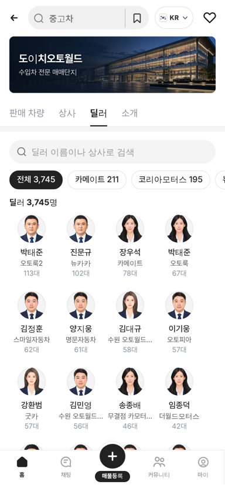
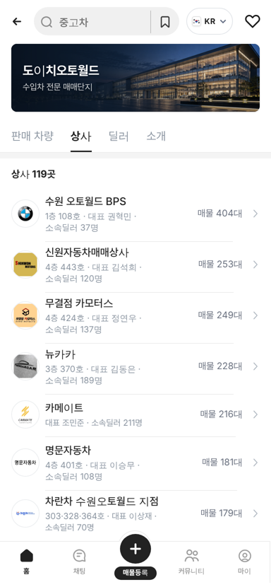
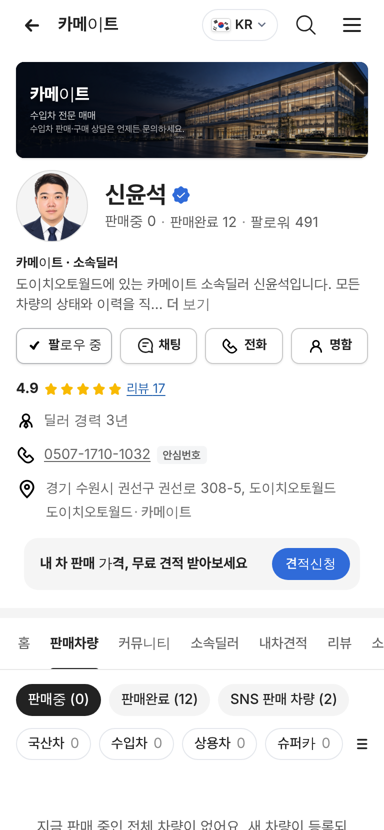
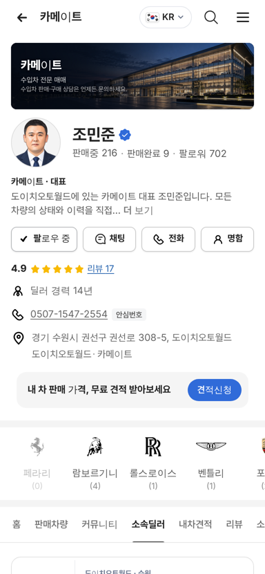

# PR #969 도이치오토월드 딜러 전수 추가

① 한 줄 요약: 도이치오토월드 딜러 탭이 매물 있는 딜러 775명에서 사이트 공개 명단 전원 3,745명으로 늘었다.

② 과제 ID 없음 · 브랜치 `feat/deutsch-dealers-all` · 커밋 `3ef82fc` · PR https://github.com/bobaekimboae/bobaedream/pull/969 · 상태: 병합·배포 완료(v `3ef82fc`, 번들 `assets/main-CKXrCYgT.js`) · 함께 들어간 과제 없음

③ 한 일
- dautoworld.com 상사 페이지가 화면에 띄우는 공개 소속딜러 목록을 114개 상사 모두 받았다(3,883건: 상사대표 89 · 사무장 87 · 딜러 3,707).
- 같은 상사 안에 두 번 올라간 같은 이름 182건을 하나로 줄여 3,701명을 남겼다. 저장한 것은 이름과 직책뿐이다(연락처 · 사진 · 딜러 번호는 저장하지 않음).
- 기존 대표와 매물 있는 딜러의 판매자페이지 주소(emp 번호)는 그대로 두었다. 명단에만 있는 사람은 사이트 순서대로 뒤 번호를 받는다(매물 0대).
- 직책은 `대표 · 사무장 · 소속딜러`로 표시한다.
- 단지 `딜러` 탭, 상사 탭의 `소속딜러 N명`, 판매자페이지 `소속딜러` 탭이 모두 같은 명단을 쓴다.

④ 원본과 비교
| 영역 | 작업 전 | 작업 후 |
|---|---|---|
| 딜러 탭 인원 | 775명 | 3,745명 |
| 카메이트 소속딜러 | 매물 있는 딜러만 | 211명(사이트 206명 + 매물에만 있는 이름) |
| 명단에만 있는 딜러 페이지 | 없음 | 열림(예: 카메이트 emp 150 신윤석) |

| 딜러 탭 | 상사 탭 | 명단 딜러 페이지 | 대표 소속딜러 |
|---|---|---|---|
|  |  |  |  |

⑤ 검증
- `npm run verify:qf` 통과.
- 모바일 384에서 콘솔 오류 0건, 가로 넘침 0.
- 이번 작업은 퀵필터 레일과 칩 크기를 건드리지 않았다.

⑥ 원본과 다르게 남긴 것과 이유
- 사이트에 올라온 딜러 사진 51장은 개인 사진이라 쓰지 않았다. 정장 일러스트를 그대로 쓴다.
- 3,745명은 사이트 명단 3,701명에 매물에만 이름이 있는 딜러 44명이 더해진 숫자다.

⑦ 못 한 것 · 다음에 할 것
- PC 도이치오토월드 화면에는 아직 상사 · 딜러 탭이 없다.
- 매물 0대인 딜러를 뒤로 미루는 정렬은 이미 적용돼 있다. 숨김 여부는 결정이 필요하다.

⑧ 확인 링크
- 모바일 딜러 탭: https://bobaekimboae.github.io/bobaedream/?qf=guazi&category=도이치오토월드&sag=dealers&v=3ef82fc
- PC: https://bobaekimboae.github.io/bobaedream/?qf=guazi&category=도이치오토월드&v=3ef82fc&pc=1
