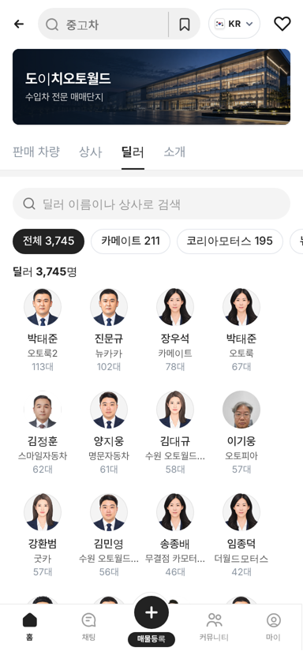
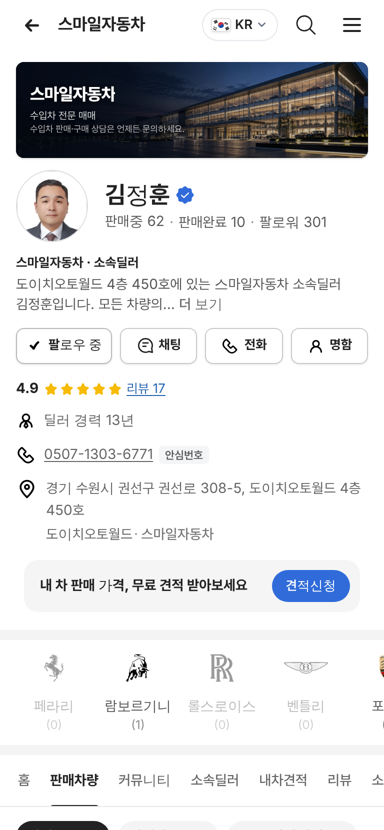
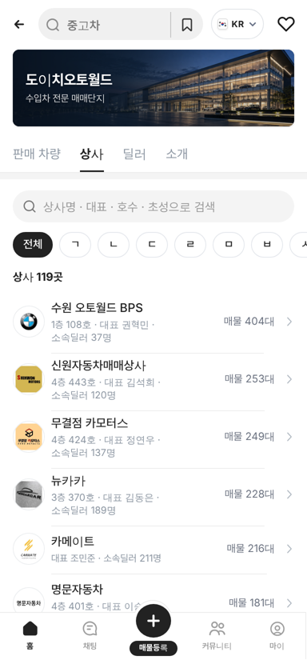
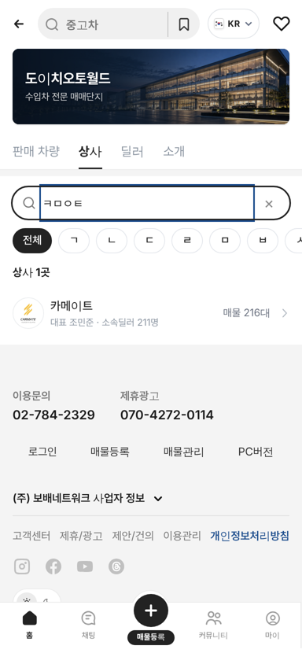
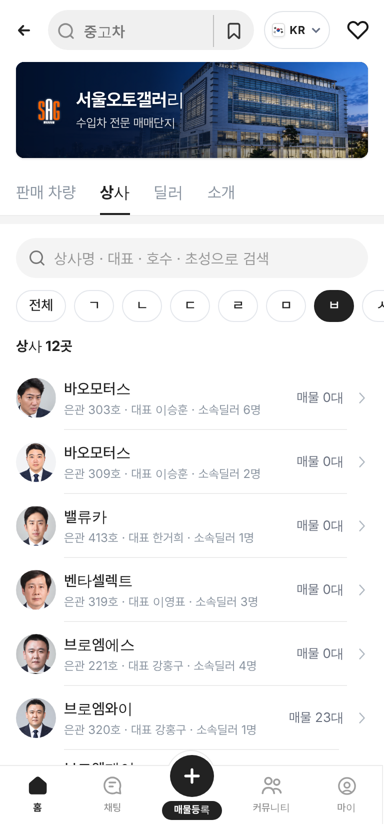

# PR #971 도이치오토월드 딜러 실사진 · 상사 탭 검색바와 ㄱㄴㄷ

① 한 줄 요약: 도이치오토월드 딜러 298명이 실제 프로필 사진으로 바뀌었고, 도이치오토월드·서울오토갤러리 상사 탭에 검색바와 ㄱㄴㄷ 색인이 생겼다.

② 과제 ID 없음 · 브랜치 `feat/deutsch-dealer-photos` · 커밋 `8589beb` · PR https://github.com/bobaekimboae/bobaedream/pull/971 · 상태: 병합·배포 완료(v `8589beb`, 번들 `assets/main-BPurFiDn.js`) · 함께 들어간 과제 없음

③ 한 일
- 차란차 판매중 매물 10,089대를 모두 훑어 판매 딜러가 올린 프로필 사진을 찾았다. 도이치오토월드 딜러 956명 중 550명이 사진을 올렸고 528장을 받았다.
- 한 사람이 혼자 나온 성인 얼굴 사진 276장만 골라 정사각으로 잘랐다. 사원증·명함(사원번호·전화가 보임)·로고·아이·여러 명·풍경·화면 캡처 252장은 뺐다.
- 차란차 상사명을 우리 상사에 맞춘 뒤 같은 상사 + 같은 이름인 딜러에 붙였다(268명). 매물에 없는 딜러는 dautoworld 소속딜러 목록의 얼굴 사진(30명)을 쓴다.
- 연락처·사원번호·딜러 고유키는 저장하지 않았다.
- 상사 탭 맨 위에 검색칸과 `전체 · ㄱ~ㅎ · A-Z · 0-9` 알약 줄을 넣었다. 자음만 넣으면 초성으로 찾는다(`ㅋㅁㅇㅌ` → 카메이트).

④ 원본과 비교

| 영역 | 작업 전 | 작업 후 |
|---|---|---|
| 실사진 딜러 | 0명(전부 정장 일러스트) | 298명(차란차 268 + dautoworld 30) |
| 상사 탭 찾기 | 목록만 | 검색 + ㄱㄴㄷ 색인 |
| `ㅋ` 고르기(도이치) | - | 상사 10곳 |
| `ㅋㅁㅇㅌ` 검색 | - | 카메이트 1곳 |
| `ㅂ` 고르기(서울오토갤러리) | - | 상사 12곳 |

| 딜러 탭 | 딜러 판매자페이지 | 상사 탭 | 초성 검색 | 서울오토갤러리 상사 |
|---|---|---|---|---|
|  |  |  |  |  |

⑤ 검증
- `npm run verify:qf` 통과.
- 모바일 384에서 콘솔 오류 0건, 가로 넘침 0.
- 딜러 탭 3,745명을 전부 펼쳐 사진 경로 확인: 차란차 사진 268 · dautoworld 사진 30 · 나머지 일러스트.
- 퀵필터 레일과 칩 크기는 건드리지 않았다.

⑥ 원본과 다르게 남긴 것과 이유
- 사원증·명함 사진은 사원번호와 휴대폰 번호가 보여서 쓰지 않았다.
- 차란차 사진 276장 중 8장은 우리 상사와 이름이 맞는 딜러가 없어 붙지 않았다.
- 사진은 자르기만 하고 색·밝기는 그대로다.

⑦ 못 한 것 · 다음에 할 것
- 사진이 없는 딜러 3,447명은 정장 일러스트 그대로다.
- PC 도이치오토월드 화면에는 아직 상사·딜러 탭이 없다.

⑧ 확인 링크
- 모바일 딜러 탭: https://bobaekimboae.github.io/bobaedream/?qf=guazi&category=도이치오토월드&sag=dealers&v=8589beb
- 모바일 상사 탭: https://bobaekimboae.github.io/bobaedream/?qf=guazi&category=도이치오토월드&sag=companies&v=8589beb
- 딜러 판매자페이지 예: https://bobaekimboae.github.io/bobaedream/?qf=guazi&profile=dealer&shop=da100025&emp=2&v=8589beb
- PC: https://bobaekimboae.github.io/bobaedream/?qf=guazi&category=도이치오토월드&v=8589beb&pc=1
