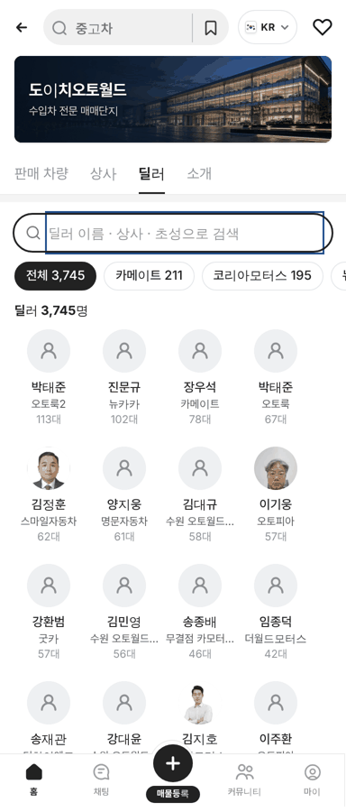
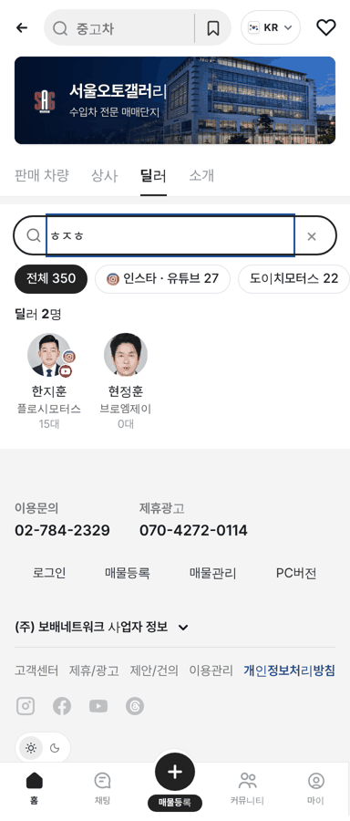

# PR #975 도이치오토월드 딜러 기본 프로필(AS24) · 딜러 초성 검색

① 한 줄 요약: 사진이 안 맞는(없는) 도이치오토월드 딜러는 오토스카우트24 사람 아이콘 기본 프로필로 바꾸고, 두 단지 딜러 탭 검색이 초성을 찾는다.

② 과제 ID 없음 · 브랜치 `feat/deutsch-dealer-as24-avatar` · 커밋 `d2e0a4b` · PR https://github.com/bobaekimboae/bobaedream/pull/975 · 상태: 병합·배포 완료(v `d2e0a4b`, 번들 `assets/main-BX1nPxWd.js`) · 함께 들어간 과제 없음

③ 한 일
- 도이치오토월드 딜러 중 실사진이 없거나 본인 사진을 가릴 수 없는 딜러는 정장 일러스트 대신 AS24 사람 아이콘 기본 프로필(회색 원 + 아이콘)을 쓴다.
- 아이콘은 노션 AS24 `person` 원본 경로를 그대로 옮겨 회색 바탕 가운데에 놓았다(모양 수정 없음).
- 단지 딜러 탭 · 판매자페이지 · 소속딜러 탭이 같은 그림을 쓴다. 서울오토갤러리는 그대로다.
- 도이치오토월드 · 서울오토갤러리 `딜러` 탭 검색에 초성 검색을 넣었다(이름 · 상사명). 안내 문구 `딜러 이름 · 상사 · 초성으로 검색`.

④ 원본과 비교

| 항목 | 작업 전 | 작업 후 |
|---|---|---|
| 사진 없는 딜러 프로필 | 정장 일러스트(성별·얼굴 안 맞음) | AS24 기본 프로필 |
| 실사진 딜러 | 차란차 271 · dautoworld 30 | 그대로 |
| `ㄱㅁㅅ` 검색(도이치) | 0명 | 17명(김민석 · 강명수 …) |
| `ㅎㅈㅎ` 검색(서울오토갤러리) | 0명 | 2명 |

| 딜러 탭 기본 프로필 | 도이치 초성 검색 | 서울오토갤러리 초성 검색 |
|---|---|---|
|  |  |  |

⑤ 검증
- `npm run verify:qf` 통과.
- 모바일 384 콘솔 오류 0건. 딜러 탭 첫 화면 정장 일러스트 0장.
- 퀵필터 레일·칩 크기는 건드리지 않았다.

⑥ 원본과 다르게 남긴 것과 이유
- 서울오토갤러리 딜러 일러스트는 이번 요청 범위가 도이치오토월드라 바꾸지 않았다.

⑦ 못 한 것 · 다음에 할 것
- 서울오토갤러리도 같은 기본 프로필로 바꿀지 결정 필요.
- PC 도이치오토월드 화면에는 아직 상사·딜러 탭이 없다.

⑧ 확인 링크
- 모바일 딜러 탭: https://bobaekimboae.github.io/bobaedream/?qf=guazi&category=도이치오토월드&sag=dealers&v=d2e0a4b
- 서울오토갤러리 딜러 탭: https://bobaekimboae.github.io/bobaedream/?qf=guazi&category=서울오토갤러리&sag=dealers&v=d2e0a4b
- PC: https://bobaekimboae.github.io/bobaedream/?qf=guazi&category=도이치오토월드&v=d2e0a4b&pc=1
