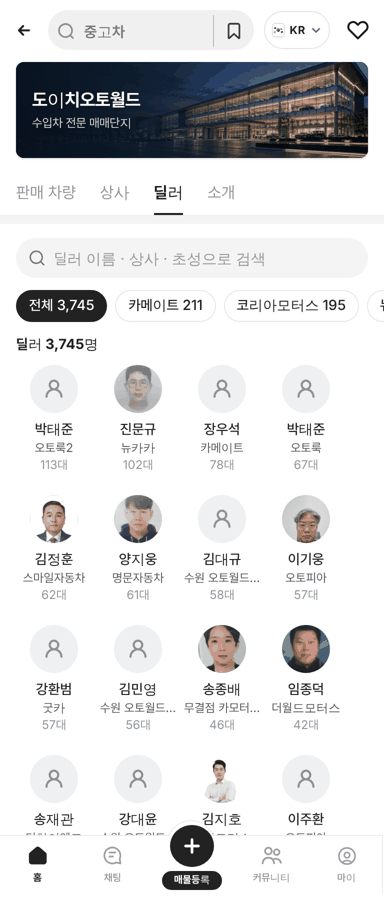
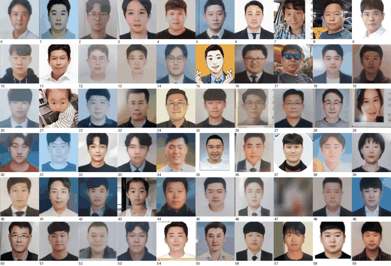
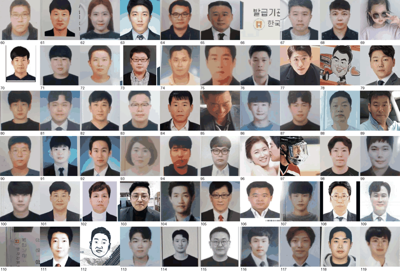

# PR #978 도이치오토월드 딜러 실사진 101명 추가

① 한 줄 요약: 차란차 매물 딜러 프로필 사진을 다시 받아, 이전에 뺀 사원증·증명사진에서 얼굴만 잘라 실사진 딜러를 271명 → 371명으로 늘렸다.

② 과제 ID 없음 · 브랜치 `feat/deutsch-dealer-photos-backend` · 커밋 `3872868` · PR https://github.com/bobaekimboae/bobaedream/pull/978 · 상태: 병합·배포 완료(v `3872868`, 번들 `assets/main-DwphE8HO.js`) · 함께 들어간 과제 없음

③ 한 일
- 차란차 판매중 매물 검색 API(10,125대)를 다시 받아 딜러 프로필 사진을 대조했다. 공개 API에 매물 없는 딜러 목록은 없어 판매중 매물 딜러가 전부다(도이치오토월드 957명 · 사진 551명).
- 사진 551장 중 19장은 차란차 저장소에서도 없음(404)이라 못 받았다.
- 이전에 뺀 사원증·증명사진 묶음에서 얼굴 인식으로 한 사람 얼굴만 정사각으로 잘랐다. 120장 중 글자·사원번호·바코드가 보이는 컷, 아이, 만화, 여러 명, 흐린 사진 17장은 눈으로 보고 뺐다.
- 남은 101장을 같은 상사 + 같은 이름 딜러에 붙였다. 연락처·사원번호·딜러 고유키는 저장하지 않았다.

④ 원본과 비교

| 항목 | 작업 전 | 작업 후 |
|---|---|---|
| 차란차 실사진 딜러 | 271명 | 371명 |
| dautoworld 사진 딜러 | 30명 | 29명(차란차 사진이 우선) |
| AS24 기본 프로필 | 3,444명 | 3,345명 |

| 딜러 탭 | 얼굴 자르기 검수 1 | 얼굴 자르기 검수 2 |
|---|---|---|
|  |  |  |

⑤ 검증
- `npm run verify:qf` 통과.
- 모바일 384 딜러 탭 3,745명을 모두 펼쳐 사진 경로를 셌다: 차란차 371 · dautoworld 29 · 기본 프로필 3,345. 콘솔 오류 0건.
- 퀵필터 레일·칩 크기는 건드리지 않았다.

⑥ 원본과 다르게 남긴 것과 이유
- 사원증 원본 전체는 쓰지 않고 얼굴 부분만 잘랐다(번호·글자가 화면에 나오지 않게).
- 서울오토갤러리 도이치모터스 노대규·김동우 사진도 받았지만 이미 정장 실사 일러스트가 있어 그것을 우선한다.

⑦ 못 한 것 · 다음에 할 것
- 판매중 매물이 없는 딜러는 차란차에서 사진을 받을 길이 없다.
- 얼굴이 실제 그 사람인지는 차란차가 올린 사진을 믿는다(얼굴 대조 안 함).

⑧ 확인 링크
- 모바일 딜러 탭: https://bobaekimboae.github.io/bobaedream/?qf=guazi&category=도이치오토월드&sag=dealers&v=3872868
- PC: https://bobaekimboae.github.io/bobaedream/?qf=guazi&category=도이치오토월드&v=3872868&pc=1
