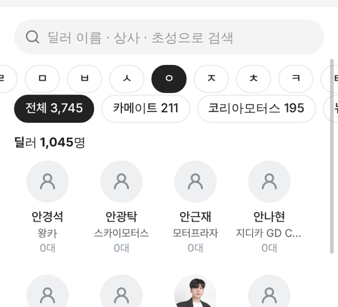

# PR #980 딜러 탭 ㄱㄴㄷ 이름 색인

① 한 줄 요약: 도이치오토월드 · 서울오토갤러리 `딜러` 탭에 상사 탭과 같은 ㄱㄴㄷ 이름 색인 알약 줄을 붙였다.

② 브랜치 `feat/dealer-choseong-index` · 커밋 `4dcdea9` · PR https://github.com/bobaekimboae/bobaedream/pull/980 · 상태: 병합 · 배포 v=4dcdea9 · 함께 들어간 과제 없음

③ 한 일
- 검색칸의 초성 검색(`ㄱㅁㅅ` → 김민석)은 PR #975에 이미 있었다. 이번에는 상사 탭처럼 누르기만 하는 이름 색인을 더했다.
- 검색칸 아래, 소속 상사 알약 줄 위에 `전체 · ㄱ ~ ㅎ · A-Z · 0-9` 알약 줄을 둔다(공용 `DealerIndex`).
- 딜러 이름 첫 글자(성)의 초성으로 묶고, 지금 조건에서 딜러가 없는 글자는 흐리게 눌리지 않는다.
- 글자를 고르면 그 딜러만 가나다순으로 보이고, 다시 누르면 해제된다. 검색어 · 상사 알약과 함께 걸린다.

④ 원본과 비교: 상사 탭 색인과 같은 알약 모양 · 간격(32 · 선택 `#222`). 대조할 외부 원본 없음.

⑤ 검증: `npm run verify:qf` 통과. 384 측정 — 도이치오토월드 3,745명 → `ㅇ` 1,045명(안경석 · 안광탁 …), 서울오토갤러리 350명 → `ㅇ` 101명. 콘솔 오류 0.

⑥ 원본과 다르게 남긴 것: 서울오토갤러리 명단에 같은 이름(`아베타케시`)이 두 번 보이는 것은 원본 명단 그대로다.

⑦ 다음에 할 것: 도이치오토월드 딜러 정장 사진은 이미지 생성 도구(캔바 크레딧 · 위브 연결)가 막혀 대기 중.

⑧ 확인 링크
- 도이치오토월드 딜러 탭: https://bobaekimboae.github.io/bobaedream/?qf=guazi&category=%EB%8F%84%EC%9D%B4%EC%B9%98%EC%98%A4%ED%86%A0%EC%9B%94%EB%93%9C&sag=dealers&v=4dcdea9
- 서울오토갤러리 딜러 탭: https://bobaekimboae.github.io/bobaedream/?qf=guazi&category=%EC%84%9C%EC%9A%B8%EC%98%A4%ED%86%A0%EA%B0%A4%EB%9F%AC%EB%A6%AC&sag=dealers&v=4dcdea9
