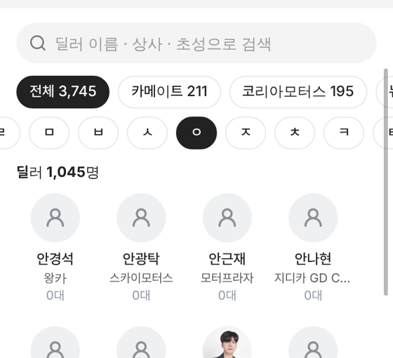

# PR #982 딜러 탭 ㄱㄴㄷ 색인을 상사 알약 아래로

① 한 줄 요약: 딜러 탭의 ㄱㄴㄷ 이름 색인 줄을 소속 상사 알약 줄 아래로 옮겼다.

② 브랜치 `feat/dealer-index-below` · 커밋 `ccc818b` · PR https://github.com/bobaekimboae/bobaedream/pull/982 · 상태: 병합 · 배포 · 함께 들어간 과제 없음

③ 한 일
- 도이치오토월드 · 서울오토갤러리 `딜러` 탭 순서를 검색칸 → 상사 알약 → ㄱㄴㄷ 색인 → `딜러 N명`으로 바꿨다.
- 간격: 상사 알약 → 색인 8, 색인 → 제목 14.
- 상사 탭(검색칸 → 색인)은 그대로다.

④ 원본과 비교: 해당 없음(위치만 이동).

⑤ 검증: `npm run verify:qf` 통과. 384 측정 — 도이치오토월드 `ㅇ` 1,045명 · 서울오토갤러리 `ㅇ` 101명 동작 그대로, 콘솔 오류 0.

⑥ 원본과 다르게 남긴 것: 없음.

⑦ 다음에 할 것: 도이치오토월드 딜러 정장 사진(이미지 생성 도구 대기).

⑧ 확인 링크
- 도이치오토월드 딜러 탭: https://bobaekimboae.github.io/bobaedream/?qf=guazi&category=%EB%8F%84%EC%9D%B4%EC%B9%98%EC%98%A4%ED%86%A0%EC%9B%94%EB%93%9C&sag=dealers
- 서울오토갤러리 딜러 탭: https://bobaekimboae.github.io/bobaedream/?qf=guazi&category=%EC%84%9C%EC%9A%B8%EC%98%A4%ED%86%A0%EA%B0%A4%EB%9F%AC%EB%A6%AC&sag=dealers
