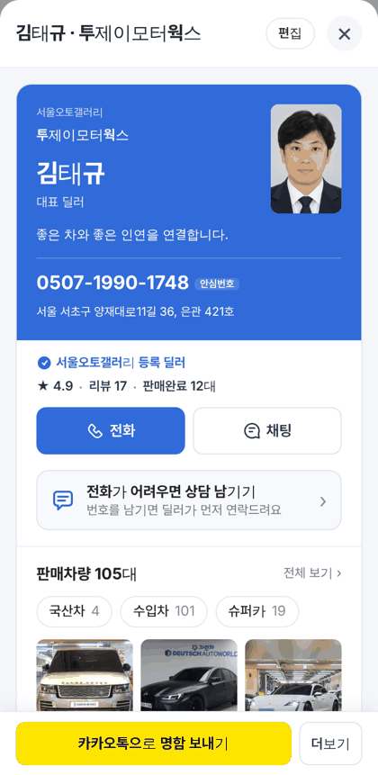
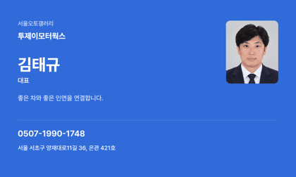
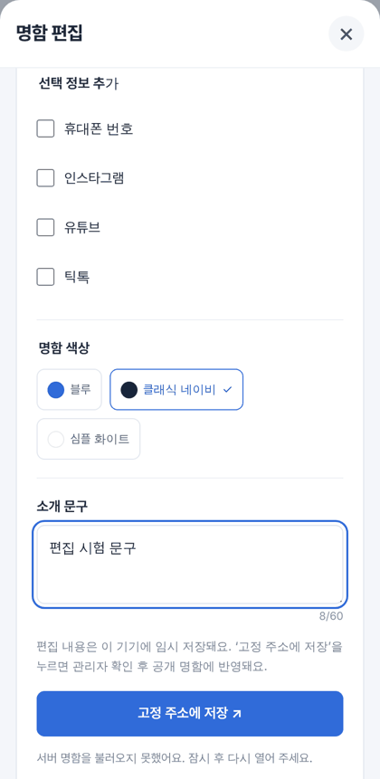
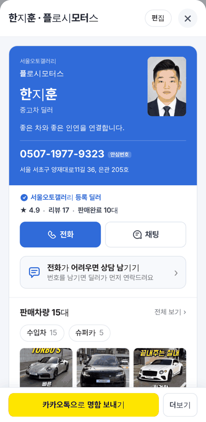
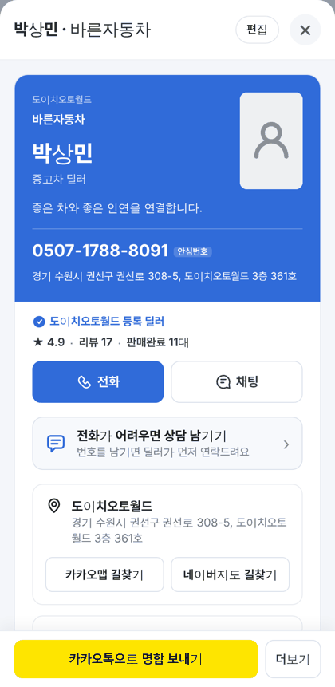
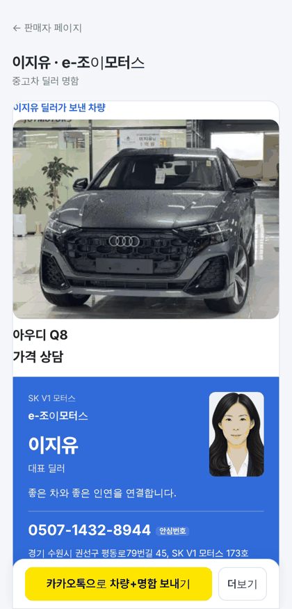

# PR #993 명함 기능 전수조사

## ① 한 줄 요약
딜러 명함의 모든 기능을 폭 360·384·412와 PC 1280에서 눌러 봤습니다. 오류 3건(외부 서버 콘솔 오류, 영어 QR 오류 문구, 소속딜러 명함에 상사 전체 매물이 나오던 문제)을 고쳤습니다.

## ② 과제 정보
- 과제 ID: 없음(사용자 지시 「명함 기능 전수조사해라」)
- 브랜치: `fix/card-audit`
- 병합 커밋: `e03a800`
- PR: https://github.com/bobaekimboae/bobaedream/pull/993
- 상태: 병합 · 배포 완료(v=`e03a800`, 번들 `main-Bev76NRh.js`)
- 함께 들어간 과제: 없음

## ③ 한 일
- 딜러 6명(대표 · 소속딜러 · 매물 0대 딜러 · 조이모터스)을 대상으로 명함 열기부터 상담 남기기, 링크·QR, 이미지 저장, 차량 붙이기, 받는 사람 화면까지 모두 눌러 봤습니다.
- 외부 명함 저장 서버가 모든 주소에서 401(로그인 필요)을 돌려주고 CORS(다른 사이트 요청 허용)도 없었습니다. 그래서 명함을 열 때마다 콘솔 오류가 났습니다. 서버 연결을 `cardServiceLive = false` 스위치로 꺼 두었습니다. 작동하지 않는 「고정 주소에 저장」 버튼도 함께 숨겼습니다.
- QR 오류 문구를 한국어로 바꿨습니다. 꾸밈 값이 많아 QR이 안 될 때는 「링크 복사를 이용해 주세요」라고 안내합니다.
- 투제이모터웍스 소속딜러(예: 김민석) 명함에 상사 전체 매물 105대가 나오던 문제를 고쳤습니다. 이제 본인 매물만 보이고, 전체 재고는 대표(김태규)만 보여 줍니다.

## ④ 원본과 비교 / 동작 점검표
화면 디자인은 바꾸지 않아 비교 비율은 없습니다. 동작을 점검한 결과는 다음과 같습니다.

| 항목 | 결과 |
|---|---|
| 명함 창 열기 · 가로 넘침 없음(360·384·412·PC 1280) | 통과 |
| 신뢰 줄(별점·리뷰·판매완료) | 통과 |
| 전화 → 안심번호 안내(`tel:` 없음) | 통과 |
| 상담 남기기 입력 확인 · 완료 안내 | 통과 |
| 판매차량 · 분류 알약 링크 | 통과 |
| 길찾기 · 내 차 견적 링크 | 통과 |
| SNS · 연락처 저장(vcf) | 통과 |
| 카카오 짧은 주소 복사 | 통과 |
| QR → 읽으면 같은 주소 | 통과 |
| 이미지 저장 · 차량 붙이기 · Esc 닫기 | 통과 |
| 외부 서버 콘솔 오류 | 실패 → 수정 |
| 소속딜러 매물 수 | 실패 → 수정 |

배포본(`v=e03a800`) 확인 결과:
- 450554-5(소속딜러) 명함: 판매차량 칸 없음
- 450554-1(대표) 명함: 판매차량 105대
- da100022-36 명함: 판매차량 칸 없음
- 콘솔 오류: 0개

캡처:

## ⑤ 검증
- `npm run verify:qf`: 통과
- 콘솔 오류: PC 0개, 모바일 0개(배포본 기준)
- `measure:qf`: 퀵필터는 바꾸지 않았습니다. 이전 값(레일 96 · 카드 80×72 · 이미지 56×28 · 트림 칩 32)을 그대로 유지합니다.
- 필터 선택지 303개 · 시트 마감 6 · 광고기간 「전체」 유지: 이번 작업으로 바뀌지 않았습니다.

## ⑥ 원본과 다르게 남긴 것과 이유
- 「고정 주소에 저장」 버튼은 숨겼습니다. 외부 서버가 로그인을 요구해 지금은 저장할 수 없기 때문입니다. 서버가 살아나면 스위치를 `true`로 바꾸면 다시 보입니다.
- 짧은 주소 이동 같은 몇 가지는 로컬 미리보기에서만 실패했습니다. 로컬 서버가 `.html` 없는 주소를 처리하지 못하는 탓이며, 배포본에서는 정상입니다.

## ⑦ 못 한 것 · 다음에 할 것
- 김태규(450554-1)의 카카오톡 미리보기 그림은 「판매중」 대수를 다른 방식으로 셉니다. 그래서 그림 속 숫자가 페이지의 105대와 다를 수 있습니다.
- 외부 명함 서버 복구 여부는 확인이 필요합니다.

## ⑧ 확인 링크
- 모바일: https://bobaekimboae.github.io/bobaedream/?qf=guazi&v=e03a800
- PC: https://bobaekimboae.github.io/bobaedream/?qf=guazi&v=e03a800&pc=1
- 대표 명함: https://bobaekimboae.github.io/bobaedream/?qf=guazi&profile=dealer&shop=450554&emp=1&v=e03a800
- 소속딜러 명함: https://bobaekimboae.github.io/bobaedream/?qf=guazi&profile=dealer&shop=450554&emp=5&v=e03a800
