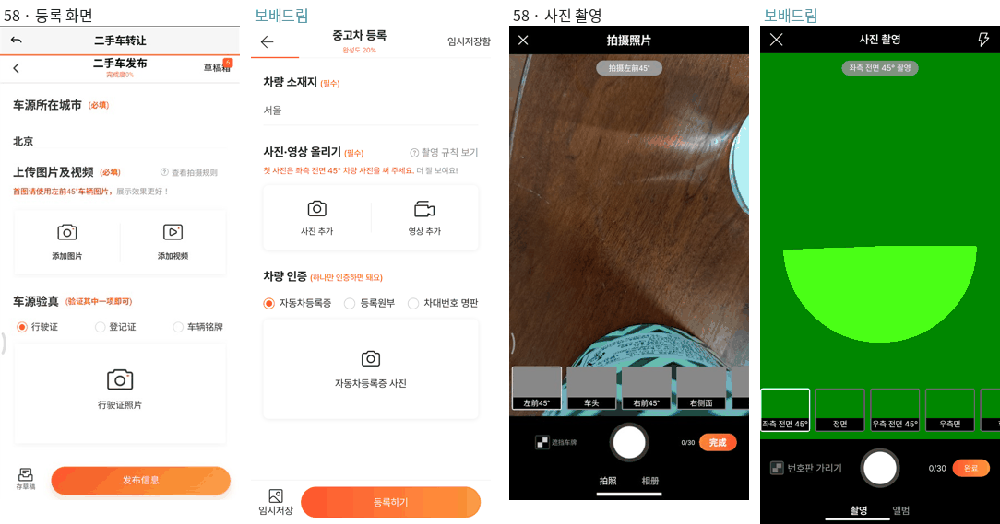
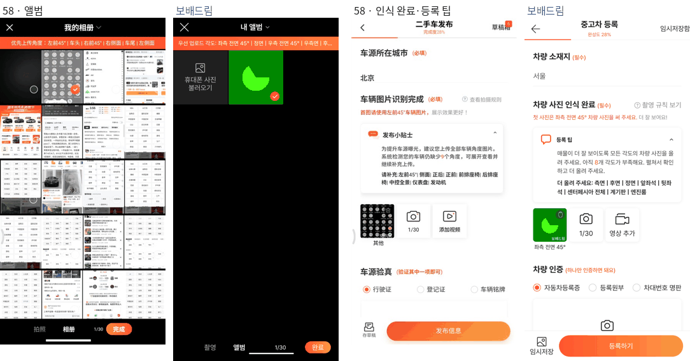
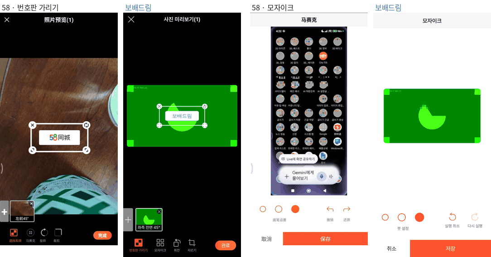
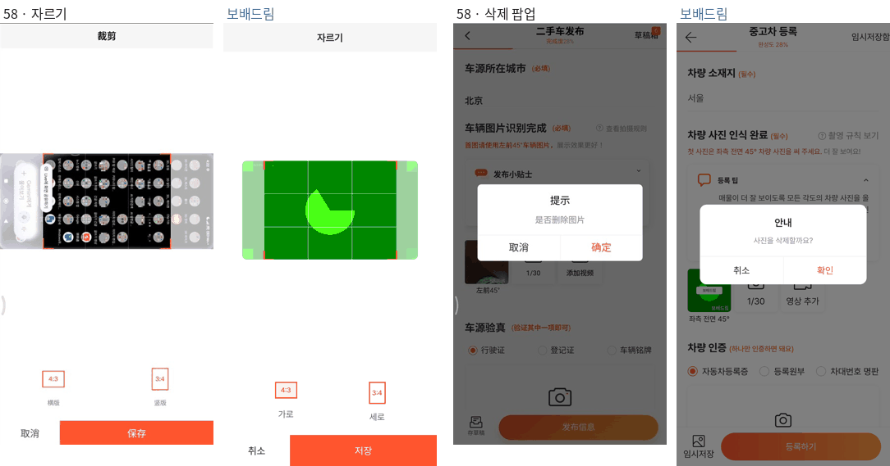
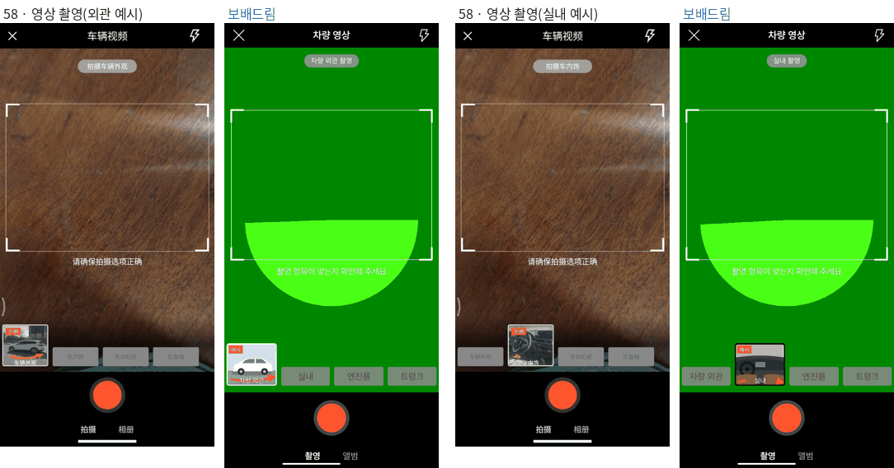
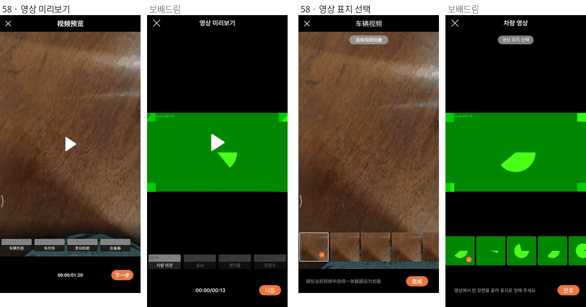
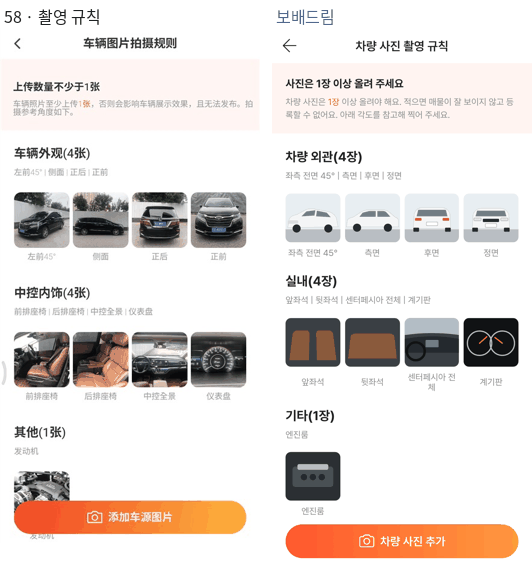

# PR #995 58 촬영 흐름 재현 — 사진·영상 촬영·편집

## ① 한 줄 요약
58同城 중고차 등록의 사진·영상 촬영 흐름을 폰에서 직접 눌러 캡처했고, 같은 화면 12개와 기능을 `?register=shoot`에 만들었습니다. 편집(번호판 가리기·모자이크·회전·자르기), 영상 4단계 템플릿, 찰칵 소리까지 들어 있습니다.

## ② 과제 정보
- 과제 ID: 없음(사용자 지시 「58 닷컴 영상 사진 촬영 그대로 프로그램 만들어라」 외)
- 브랜치: `feat/shoot-58`
- 병합 커밋: `8904c70`
- PR: https://github.com/bobaekimboae/bobaedream/pull/995
- 상태: 병합·배포 완료(v=`8904c70`, 번들 `main-DaPJTWTD.js`)
- 함께 들어간 과제: 없음

## ③ 한 일
- 연결된 폰의 58 앱에서 화면을 하나씩 누르며 약 90장을 캡처하고 화면 녹화 2개를 떴습니다. 「发布信息」(실제 등록)는 누르지 않았습니다.
- 화면 12개를 찾았습니다(등록·사진 촬영·앨범·미리보기·모자이크·회전·자르기·영상 촬영·영상 앨범·영상 미리보기·표지 선택·촬영 규칙). 팝업 2개와 토스트 5개도 있습니다.
- 같은 동작을 만들었습니다. 사진 칸 12개는 찍으면 다음 칸으로 넘어가고, 번호판 스티커는 사진당 1개(×·회전·크기)입니다. 모자이크 붓은 3개이고 실행 취소·다시 실행이 됩니다. 영상은 3·2·1 카운트다운, 10초 미만이면 토스트, 22초에 자동으로 멈추고 표지를 고릅니다.
- 촬영 부위 템플릿: 58의 실사 예시 영상 대신, 같은 구성(「예시」 표시, 촬영 대상, 움직이는 주황 화살표)을 그림으로 그렸습니다.
- 찰칵 소리는 58 원본을 녹음할 수 없어 브라우저 소리 합성(Web Audio)으로 만들었습니다.
- 아이콘은 레딧 공식 원본(devvit-docs `b0a55e7`)과 AS24 말풍선을 고치지 않고 썼습니다.
- 전체 화면·기능·상태 변화 명세와 검수표는 `docs/58-shoot-flow-spec.md`에 정리했습니다.

## ④ 원본과 비교
같은 상태에서 58(왼쪽)과 보배드림(오른쪽)을 나란히 놓았습니다. 보배드림 쪽 초록 화면은 시험용 가짜 카메라 화면입니다.

동작 점검표(전체는 명세 3장):

| 항목 | 결과 |
|---|---|
| 완성도 0→20→28 · 인식 중→인식 완료 · 등록 팁 부족 각도 수 | 통과 |
| 사진 칸 선택 · 다음 칸 자동 이동 · × 빼기 · N/30 · 30장 제한 | 통과 |
| 앨범 선택 · 새로 고른 사진이 있을 때만 완료 표시 | 통과 |
| 스티커 ×·회전·크기·다시 표시 · 아래 줄 × → 다시 올리기 | 통과 |
| 모자이크 붓 3개 · 실행 취소 · 다시 실행 · 저장 | 통과 |
| 회전 90° · 자르기 4:3·3:4 · 취소 시 원래대로 | 통과 |
| 영상 단계 선택·예시 · 3·2·1 · 10초 미만 토스트 · 22초 자동 멈춤 · 계속·다음 | 통과 |
| 합치기 · 미리보기 · 표지 8장 · 영상 칸 올리는 중 → 완료 · 삭제 팝업 | 통과 |
| 크로스체크에서 찾아 고침: 사진 촬영 화면 플래시 제거(58에는 영상 화면에만 있음) · 칸 이름 글자 12px · 영상 미리보기·표지 꽉 채움 · 편집 뒤 미리보기 사진이 사라지던 문제 · 표지 추출이 멈추던 문제 | 수정 |

## ⑤ 검증
- `npm run verify:qf`: 통과
- 콘솔 오류: 배포본(`v=8904c70`) 모바일 384 전체 흐름 0개. PC는 같은 화면을 가운데 430 폭으로 보여 주며, 로컬에서 0개였습니다.
- measure:qf: 퀵필터는 바꾸지 않았습니다(레일 96 · 카드 80×72 · 이미지 56×28 · 트림 칩 32 유지). 개발 시안형 필터 선택지 303개 · 시트 마감 6 · 광고기간 「전체」도 이번 작업으로 바뀌지 않았습니다.

## ⑥ 원본과 다르게 남긴 것과 이유
- 58의 예시 사진·영상, 규칙 사진, 「58同城」 스티커·워터마크는 58의 저작물입니다. 그래서 그림과 「보배드림」으로 바꿨습니다.
- 강조색은 58 주황(#FF552E) 그대로입니다. CSS 변수 `--shoot-accent` 하나만 바꾸면 보배드림 파랑이 됩니다.
- 58 버그 2개는 따라 하지 않았습니다.
  - 회전 후 취소해도 자르기 화면에 회전된 사진이 남습니다.
  - 자르기에서 3:4를 누르면 앱이 다른 화면으로 튕깁니다.
- 스티커 끌어 옮기기는 58에서 PC 대신 누르기(adb 합성 터치)로 움직이지 않아 확인하지 못했습니다. 일반적인 동작대로 끌어서 옮기게 만들었습니다.
- 각도 인식(AI)은 없습니다. 찍은 칸 이름을 각도로 쓰고, 앨범 사진은 `기타`로 둡니다.
- 웹은 휴대폰 사진첩을 직접 못 보므로, 앨범 첫 칸에 「휴대폰 사진 불러오기」를 두었습니다.

## ⑦ 못 한 것 · 다음에 할 것
- 58 영상 화면에서 녹화 중에 X를 누르는 경우는 확인하지 못했습니다. 보배드림은 확인 팝업을 띄웁니다.
- 실제 폰 카메라(후면·플래시)로 보배드림 화면을 찍는 확인은 사용자 폰에서 한 번 해 주세요(자동 확인은 가짜 카메라 기준).
- 실서비스 연결: 사진 각도 인식·업로드·영상 합치기 서버 과제.

## ⑧ 확인 링크
- 촬영 흐름(모바일): https://bobaekimboae.github.io/bobaedream/?register=shoot&v=8904c70
- 모바일: https://bobaekimboae.github.io/bobaedream/?qf=guazi&v=8904c70
- PC: https://bobaekimboae.github.io/bobaedream/?qf=guazi&v=8904c70&pc=1
