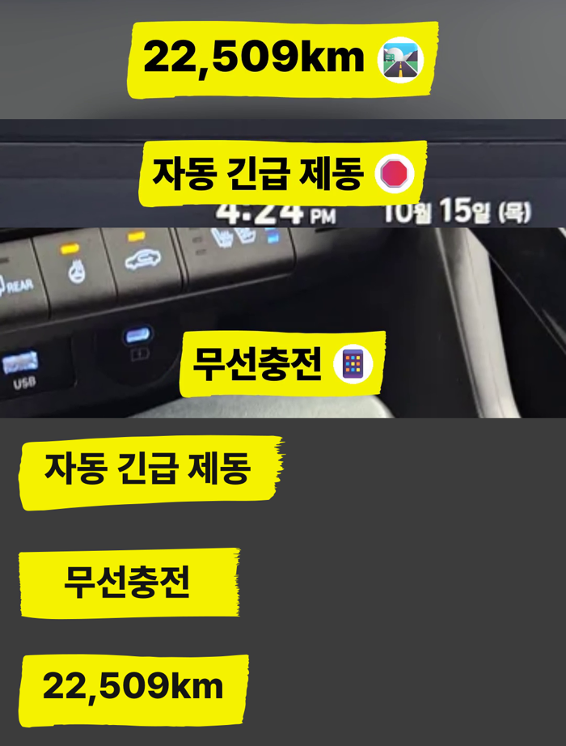
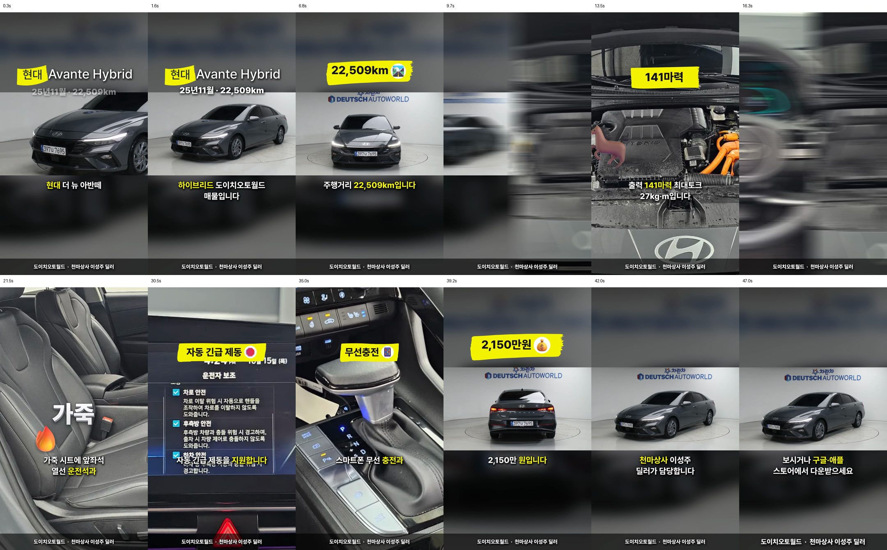

# 아반떼 사진판 숏폼 v5 — 매뉴얼 기준 재정리 (2026-11-26)

지시: 「너 옵션 칠 칩 왜 여러개 쓰고 / 전 버전 마력 시트 규칙도 어긋나고 / 매뉴얼 확인해라」

| 항목 | v2~v4(틀림) | 매뉴얼 | v5 |
|---|---|---|---|
| 옵션 칩 | 컷 하나에 칩 2개(어댑티브 크루즈+자동 긴급 제동 등) | NL/BE 매뉴얼 v4: 한 장비 = 한 문장 = 칩 1개 | 컷마다 1개(어댑티브 크루즈 · 후방카메라 · 무선충전), 두 번째 옵션은 말로만 |
| 마력 | 노랑 칩 「141마력」 | option_visual_rules: 엔진 = 3D 「{hp} 마력」, G350 c15 「211마력」 큰 숫자 | 칩 「1.6 하이브리드」 + 3D 「141 마력」 카운트업 + 말 달리기·울음 |
| 메모리 시트 | 🔢 숫자 키패드 | G350 v8 · 스킬: 💺 + 노랑 ①②③ | 💺 + 노랑 원 ①②③ |

- 코드: `option_visual_rules.json`(seat_memory 💺·badge 123), `auto_visuals.py`(badge 전달), `common.py`(sticker_img 노랑 원 합성, 말 달리기를 3D 마력 숫자에도 연결)
- 설정: `card_info/samples/avante_be_photo/cfg_v5.py`
- 화면: `avante_v5_sheet.jpg` (13.2 · 14.5 마력 / 21 · 23 · 24.5 시트 / 28 · 31.5 · 34.5 옵션)
- 검사: check_be 음량 −14.1 LUFS · 효과음 · 칩 글자 크기 · 칩 노랑 통과. 「칩 윗선 340~410」「칩 칠 높이 133~191」 2건은 v4에서도 같이 나던 것(제목 판·칠 판 모양 차이 측정), 이번 변경과 무관 — 확인 필요
- 남은 것: 💺 아이콘이 ❄️와 조금 겹침, 한 컷 숫자 1개 규칙이라 27kg·m는 말로만 나옴

---

# 아반떼 사진판 숏폼 v4 — 옵션 칩 원본 방식 통일

① 한 줄 요약: 아반떼 사진판 칩을 G350 v13과 같은 원본 칠 고르기 방식(fill_fit)으로 바꾸고, 휙 넘김·첫 화면·딜러 대사를 더한 v4를 렌더해 자동 검사 2종을 통과했다.

② 과제 ID 없음 · 브랜치 `shortform/card-info-samples` · 커밋 d93778961(코드) + 이 보고서 커밋 · PR 없음 · 상태: 푸시, 병합·배포 안 함

③ 한 일
- 사진판 칩이 납작한 칠 하나(126_40)를 늘려 써서 원본과 모양이 달랐다 → 노션 원본 칠 8개 중 맞는 것을 같은 배율로만 키우는 fill_fit으로 바꿨다(`photo_listing/common.py` `be_chip_fillfit`).
- 칩 글자가 커지며 나타날 때 빈 칠 위에 글자만 키우도록 `brush_box(draw_text=False)`를 더했다.
- 효과음 많은 판에서 휙 넘김 컷에 휙 소리가 빠지던 조건을 고쳤다.
- 구역 넘김 4곳 휙 넘김, 켄번스 103~112% 4가지 돌려쓰기, 첫 화면 영문 모델명 + 엠블럼 확대, 딜러 대사 컷, 말 크기 300.
- v3 재렌더(17:34)는 v4(17:49)에 모두 포함되어 v4를 기준으로 검사했다. v3 검사 때 났던 🛑 Fluent 아이콘 없음 오류는 v4에서 나지 않는다.

④ 원본과 비교(글자 높이 기준 배수)
| 칩 | 칠 높이 | 왼쪽 여백 | 오른쪽 여백 |
|---|---|---|---|
| G350 자동 긴급 제동 | 2.34 | 0.84 | 1.10 |
| G350 무선충전 | 2.21 | 1.46 | 1.64 |
| 아반떼 v3 22,509km(고치기 전) | 1.93 | 0.43 | 1.00 |
| 아반떼 v4 | 원본 칠 고르기(fill_fit, 칠 = 글자 × 2.0) | 0.5~0.8 | 0.5~0.8 |

⑤ 검증
- `check_be.py`: 통과(칩 칠 높이 124~147px 고름, 노랑 (242,241,0), 칩 윗선 흔들림 24px 이내, 같은 소리 간격 1.56초 이상, 끝 로고 효과음 0)
- `photo_listing/check_render.py`: 통과
- 화면 확인: 12장면만 확인(전체 재생 확인은 안 함). 소리를 귀로 들어보는 별도 검수는 하지 않았다.
- 화면 시안 코드는 바꾸지 않아 verify:qf·measure:qf는 해당 없음.

⑥ 원본과 다르게 남긴 것
- 22,509km 칩 아이콘이 길 그림이 아닌 다른 그림으로 나온다(6.8초).

⑦ 못 한 것·다음에 할 것
- 구역 넘김 한 곳(약 27.4초)에 휙 소리가 빠져 있다.
- 벨기에 원본에서 오른쪽 모델명 뒤에도 붓칠이 깔리는지 원본 장면으로 확인해야 한다.
- 영상 파일은 저장소에 커밋하지 않았다(작업 폴더에만 있음).

⑧ 확인 링크: 화면 시안 변경 없음. 노션 기록 https://app.notion.com/p/424ee9c4b60681a580f1dc6cb27bc916
