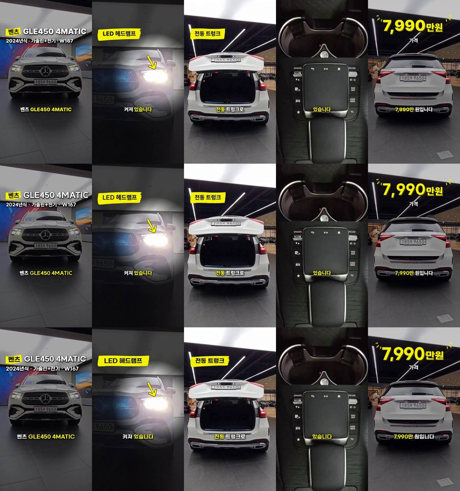
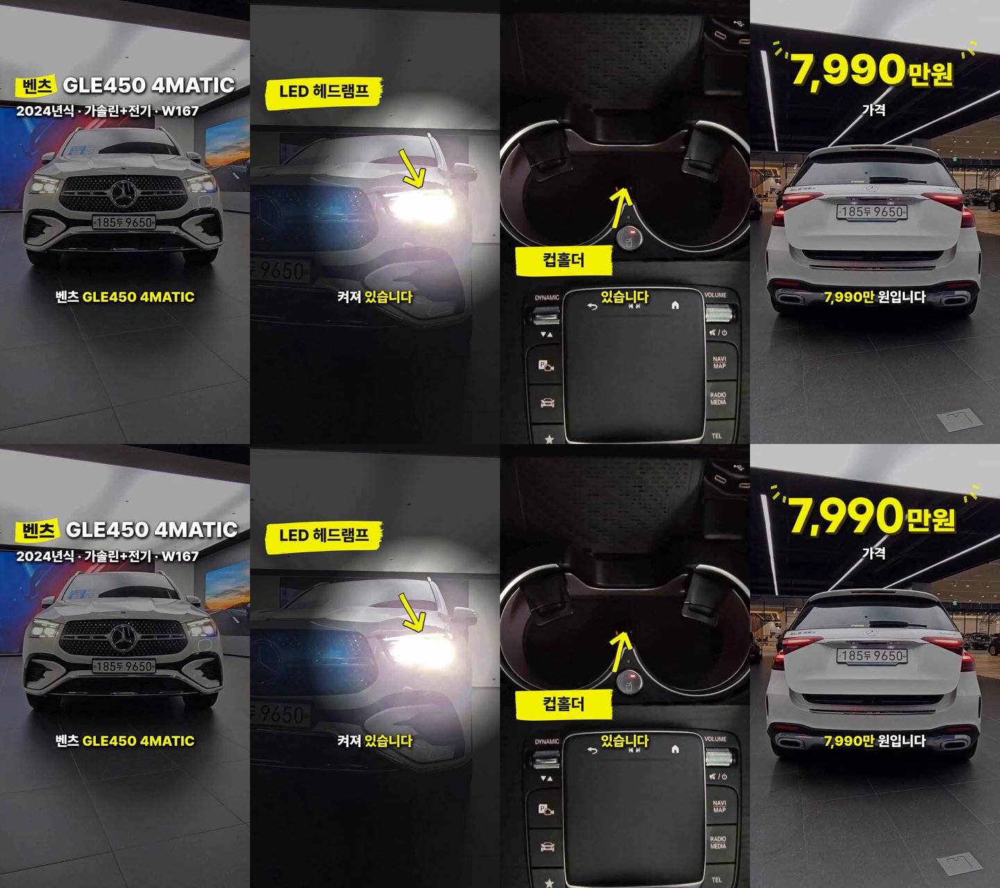
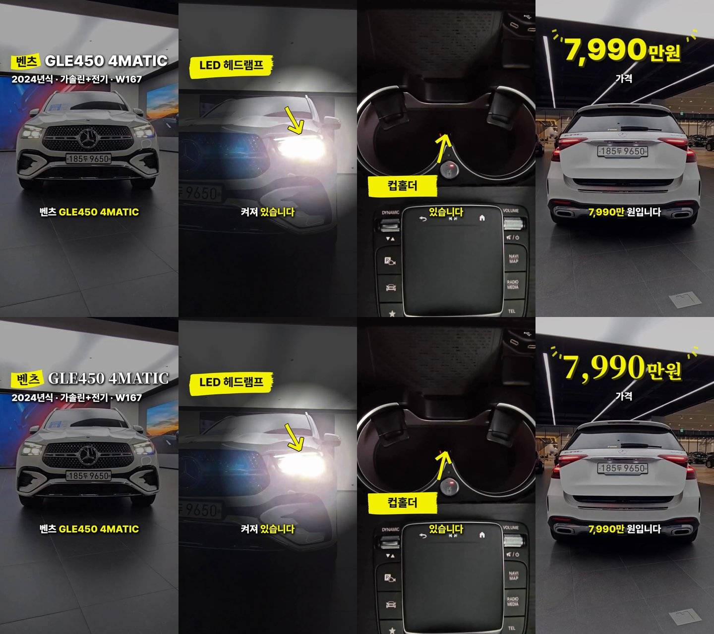
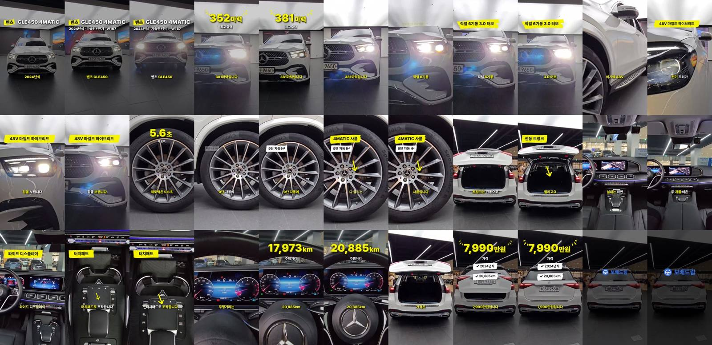
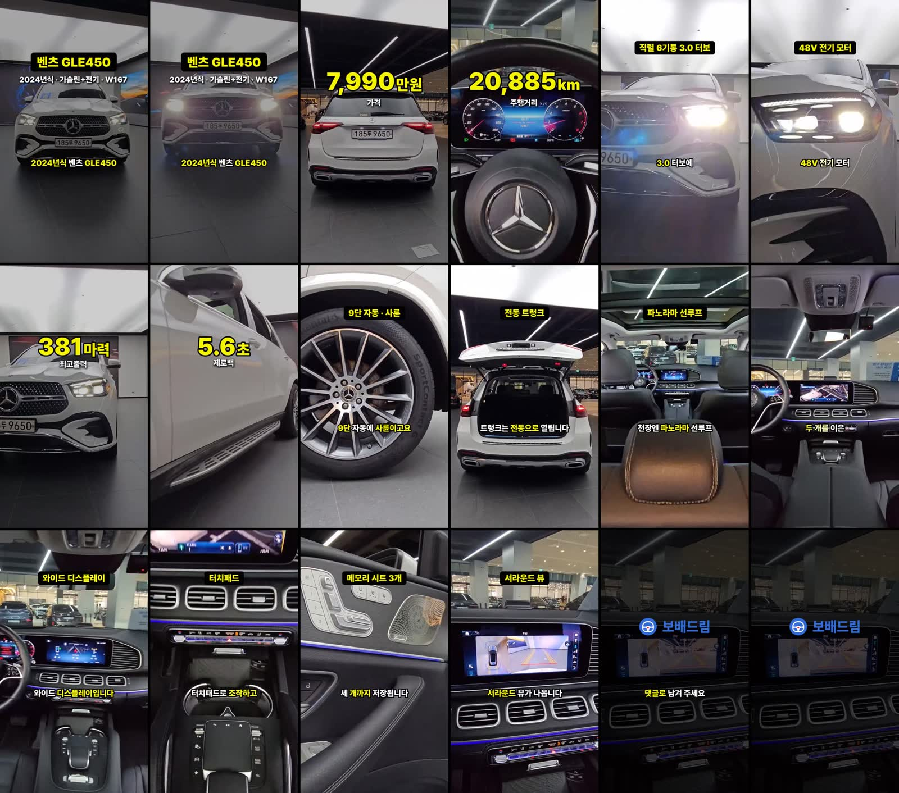
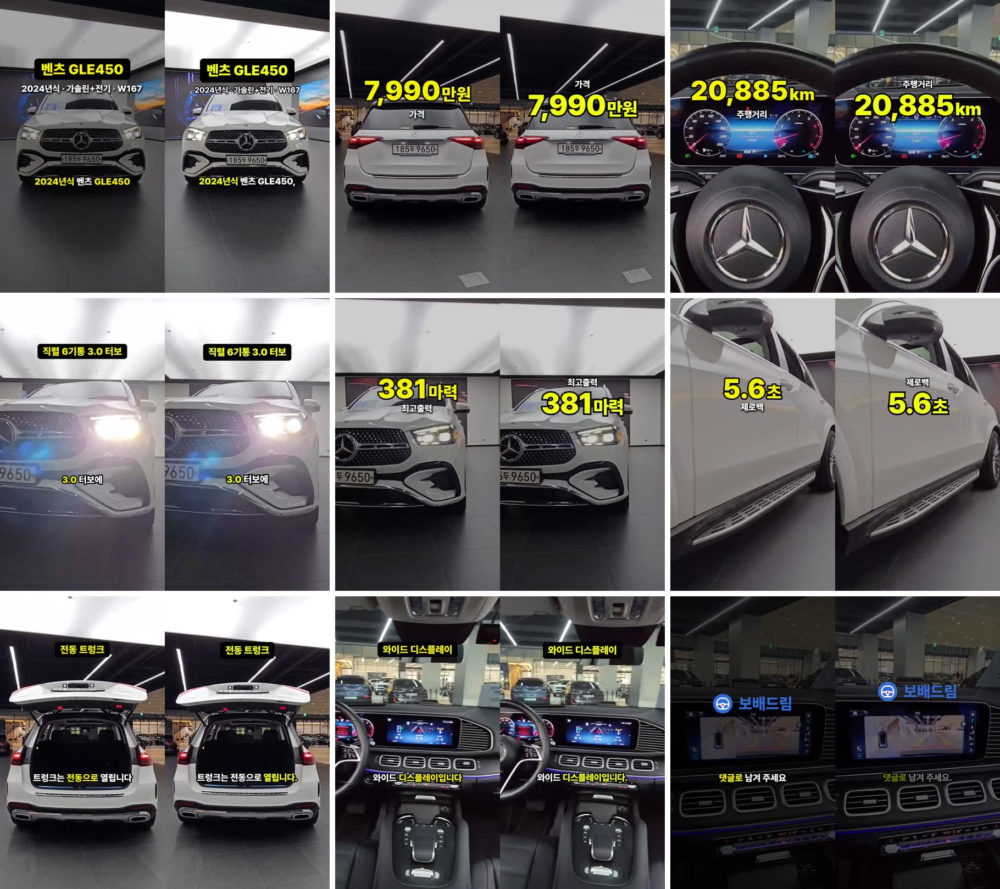
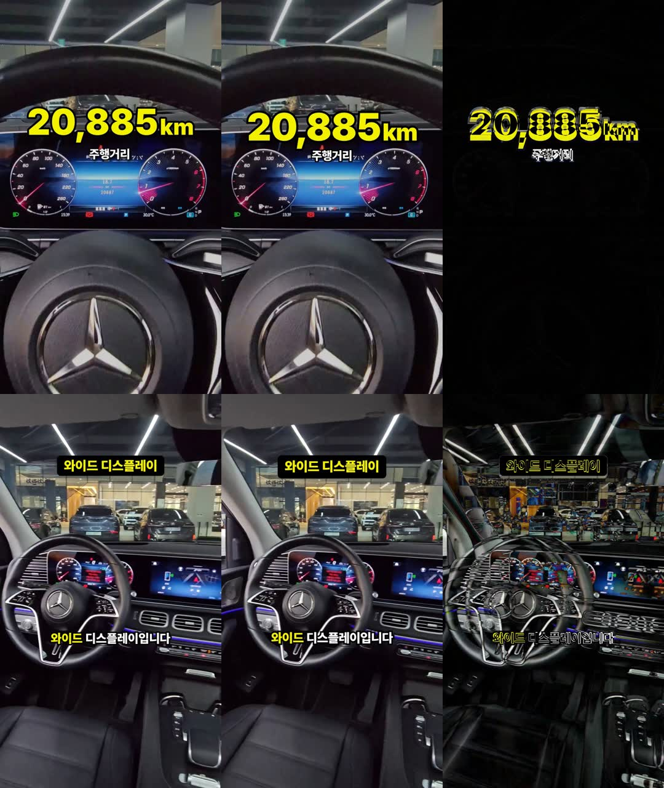

# 차란차 10번 벤츠 GLE450 — 벨기에 오토스카우트 편집 뼈대 숏폼 샘플 v1

① 한 줄 요약: 드라이브의 차란차 숏폼 원본(10번, 벤츠 GLE450 4MATIC)을 기준 영상 G350 v13과 같은 렌더 코드로 64초 세로 숏폼으로 만들었다.

② 브랜치 `shortform/cha10-gle450-be`(출발 `shortform/title-tilt`) · PR 없음 · 상태: 푸시만(병합·배포 안 함) · 과제 ID 없음

③ 한 일
- 원본(57초, 1080×1920)에서 문장마다 그 부위가 보이는 구간을 골라 18컷으로 다시 배열했다(원본 순서·길이 그대로 두지 않음).
- 대본은 매물 원장(드라이브 `10_차란차_매물정보.txt`)과 원본에 보이는 것만 썼다. 차량번호·연락처·무사고·지어낸 수치 없음.
- 음성은 ElevenLabs Taehyung · eleven_v3로 1번만 만들었고(62.3초), 낱말 시각은 ElevenLabs 받아쓰기(scribe v1), 글자는 대본 글자를 썼다.
- `g350_v8_render.py`에 다른 차 입력(`CAR=samples/<차>_car.json`)을 받는 길을 넣었다. `CAR`이 없으면 G350 그대로다.
- 부위 추적은 `car_track.py`(VitTrack, 시작 점은 차 입력 파일)로 7컷.
- 기법은 계획기가 고른 대로: 스포트라이트 2 · 숫자 카운트업 2 · 돋보기 1 · 부위 당기기 2, 3D 큰 숫자 3(2,999cc · 20,885km · 7,990만원), 화살표 칩 8, 위쪽 칩 6.

④ 기준 영상 비교(`reports/shortform-cha10-gle450-be/compare_v13.jpg`)
| 항목 | G350 v13 | 이번 |
|---|---|---|
| 길이 | 69.9초 | 64.0초(−8.4%, ±10% 안) |
| 첫 화면 | 차 전체 + 노랑 판 제목 + 사실 줄 | 같음(벤츠 / GLE450 4MATIC / 2024년식 · 가솔린+전기 · W167) |
| 붓칠 칩 · 화살표 칩 · 3D 숫자 | 있음 | 있음 |
| 위아래 2분할 · ✓ 목록 · 점프컷 · 마력 흔들림 | 있음 | 없음(해당 장면·사실이 없음) |
| 휠 인치 · 트렁크 용량 · 시트 재질 아이콘 | 있음 | 없음(원장에 제원 없음, 타이어 규격 글자 판독 불가) |

⑤ 검증
- `check_be.py` 통과(음량 −14.4 LUFS, 효과음 15번, 칩 노랑 실측 (242,241,0)).
- `edit_gate.py post --plates` 통과(번호판 덮지 않음, 음성↔자막 +0ms).
- 듣기 검수(사람이 직접 듣는 확인)는 하지 않았다. 숫자 측정만 했다.
- G350 자체 재렌더(변경 뒤에도 v13과 화소 차이 0인지)는 원본이 이 환경에 없어 다시 확인하지 못했다.

⑥ 기준과 다르게 남긴 것: 원본이 25프레임이라 30프레임 사본으로 바꿔 렌더(그림 보정 없음). 원본이 57초뿐이라 일부 컷은 0.25~0.6배로 느리게 재생.

⑦ 못 한 것·다음: 제원(휠 인치·트렁크 용량)은 JATO 연결 뒤 추가. 돋보기 원이 메모리 버튼 일부를 가리는 자리 조정. 3초짜리 정보 알약(자동 변속기)이 헤드램프 위에 놓임.

⑧ 확인: 영상은 저장소에 넣지 않고 구글 드라이브 「차란차_숏폼샘플_20대_2026-11-05」 폴더에 `bobae_cha10_gle450_be_v1.mp4`로 올림.

---

# v2 (2026-11-24) — 매핑 다듬기 · 칩 자리 규격 · 노션 원본 꾸밈

① **한 줄 요약**: 부위를 자동으로 찾아(OWLv2) 화살표 자리를 다시 잡고, 칩을 「같은 왼쪽 선 · 위/아래 두 줄」에만 놓는 슬롯 규격과 노션 원본 강조 선 꾸밈을 넣은 v2(64.03초)를 만들었다.

② 브랜치 `shortform/cha10-gle450-be` · PR 없음 · 상태: 푸시(병합·배포 안 함).

③ **한 일**
- 자동 부위 찾기 `car_map.py`(OWLv2, 컷마다 0.25초 간격 프레임) 추가 → 11곳 중 8곳 채택, 3곳(전동 시트 조절·메모리 버튼·카메라 화면)은 자동 결과가 틀려 눈으로 본 값 유지. 선루프는 자동이 트렁크 문을 잡아 추적 없이 위쪽 칩만.
- 추적(VitTrack)을 자동으로 찾은 상자 크기로 시작 → v1에서 빗나가던 뒷좌석 송풍구 화살표가 송풍구 위에 붙음. 트렁크·컵홀더에도 화살표 추가.
- 컷 구간 늘림(헤드램프 2.85~5.2 · 송풍구 17.5~18.9 · 터치패드 20.5~22.4) → 느린 재생 줄임.
- 칩 슬롯 규격(`chip_layout: "slots"`, 문서 `docs/shortform/chip-slot-standard-v1.md`): T줄 10 · B줄 4.
- 꾸밈: 큰 숫자 양옆 노션 원본 「강조 선_125x139」(노랑), 끝 가격 컷에 연식·주행 흰 붓칠 알약 요약(벨기에 28번 요약 카드 방식), 정보 알약은 칩 아래 같은 선.
- 구글 시트 「숏폼 레퍼런스_개별 계정 › 오토스카우트24 쇼츠 편집사례 · 편집요소 자산」과 벨기에 캡처 6장(28·29·31·33·35·37) 확인.

④ **v1 → v2 비교**: `reports/shortform-cha10-gle450-be/compare_v13_v1_v2.jpg` (위 기준 v13 · 가운데 v1 · 아래 v2)

| 항목 | v1 | v2 |
|---|---|---|
| 칩 자리 | 부위 따라 제각각 | 왼쪽 선 하나 · T/B 두 줄 |
| 화살표 칩 | 8 | 10(트렁크·컵홀더 추가, 와이드 디스플레이는 위쪽 칩으로) |
| 부위 시작 점 | 눈대중 8곳 | 자동 8 · 눈 3 |
| 돋보기 원이 버튼 가림 | 있음 | 칩을 B줄로 내려 겹침 없음 |
| 길이 | 64.03초 | 64.03초 |

⑤ **검증**: `check_be.py` 통과(칩 노랑 (242,241,0), 위쪽 칩 자리 300, 칠 높이 131~143px) · `edit_gate.py post --plates` 통과(번호판 덮지 않음, 음성↔자막 0ms, 안전영역). 기법 T04×2 · T05×2 · T06×1 · T08×2. 음성은 v1 것을 그대로 씀(다시 만들지 않음). **듣기 검수는 하지 않았다.** 기준 v13 비교는 길이 −8.4%(±10% 안), 눈으로 본 비교 이미지 첨부 — 「품질 통과」 판단은 사용자 몫.

⑥ **기준과 다르게 남긴 것**: 슬롯 규격의 B줄(1030px)은 잠금 규칙에 없는 새 자리라 제안 상태(car.json 옵션으로만 켜짐). 끝 컷 연식·주행 알약은 말하지 않는 글자다(요약 카드 방식). 벨기에 원본은 칩이 가운데 정렬·화살표 없음인데, 우리는 기준 영상과 같은 왼쪽 선 + 화살표를 유지했다.

⑦ **못 한 것**: 두 줄 칩·✓ 칩(벨기에 29·31·37번)과 「붓 곡선 띠」는 넣지 않음. 계기판 주행거리 글자 읽기(OCR) 대조 안 함. 변경 뒤 G350 다시 렌더해 화소 비교 안 함. 자동 찾기는 프레임당 약 7초(CPU)라 12컷에 약 15분.

⑧ 확인 파일: `bobae_cha10_gle450_be_v2.mp4`(채팅 전달).

## v3 — 화살표 교체 (2026-11-24)

① 한 줄 요약: 코드로 그린 노랑 화살표를 노션 「스카우트24 테마별」 원본 손그림 화살표 + 흰색으로 바꿨다.
② 브랜치 `shortform/cha10-gle450-be` · 상태 푸시(병합·배포 안 함) · 결과 `bobae_cha10_gle450_be_v3.mp4`(64.0초)
③ 한 일
- 노션 화살표 후보(강조 화살표 566x270 · 손그림 화살표 469x264)를 받아 비교, 붓으로 그린 굵은 손그림 화살표를 골랐다.
- 원본 SVG는 고치지 않고 `public/assets/shortform/doodle/as24-theme/hand_drawn_arrow_469_264.svg`에 그대로 두었다. 렌더러가 모양만 읽어 흰색으로 칠하고(밝은 배경에서도 보이게 얇은 어두운 테두리) 위·아래로 돌려 쓴다. 가로·세로 같은 배율로만 줄인다.
- 입력 파일 `deco.arrow: "hand_white"`일 때만 켜진다. 기준 영상 G350 등 다른 영상은 기존 화살표 그대로다.
- 음성·자막·칩 자리·장면은 v2와 같다(음성 새로 만들지 않음).
④ 검사: `check_be.py` 통과 · `edit_gate.py post --plates` 통과. 화면 확인 `reports/shortform-cha10-gle450-be/v3_white_arrows.jpg`. 듣기 검수는 하지 않았다(음성은 v1·v2와 같은 파일).
⑤ 규칙과 다르게 둔 것: 「강조색은 노랑만」 규칙이 있지만 사용자 지시로 화살표만 흰색이다(흰색은 정보 알약에 이미 쓰는 색). 규칙 값 파일은 바꾸지 않았다.
⑥ 다음에 할 것: 짧은 화살표(길이 70)는 폭이 약 41px로 가늘다. 더 굵게 원하면 최소 길이를 올리면 된다.

## v4 — 노랑 화살표 + 부위 찾기 교체 (2026-11-24)

① 한 줄 요약: 화살표를 노랑으로 되돌리고(모양은 노션 원본 손그림), 화살표가 부위에서 빗나가던 원인인 추적기를 빼고 최신 공개 검출 모델 LLMDet으로 매 0.3초마다 부위를 다시 찾게 바꿨다.
② 브랜치 `shortform/cha10-gle450-be` · 상태 푸시(병합·배포 안 함) · 결과 `bobae_cha10_gle450_be_v4.mp4`(64.0초)
③ 한 일
- 원인: 부위를 한 장에서만 찾고 나머지는 추적기(VitTrack)가 따라가게 했는데, 카메라가 움직이면 추적 점이 튀었다(헤드램프 컷에서 x 0.55 → 0.26).
- 공개 모델 조사: SAM 3(받으려면 승인 필요) · MolmoPoint-8B(메모리 7GB 환경에서 불가) · LLMDet large(메모리 초과)는 못 썼고, LLMDet base(Apache-2.0, 936MB)를 썼다. 화면 한 장 약 13초(CPU 2개).
- 새 스크립트 `car_ground.py`(훑기) · `car_ground_apply.py`(입력 파일·추적 파일에 반영). 못 찾은 컷은 화살표를 끄고 칩만 둔다.
- 터치패드 컷은 원본 구간에 터치패드가 안 보여서 구간을 22.0~23.9초로 옮겼고, 겹치지 않게 내비게이션 컷을 23.9~25.7초로 옮겼다. 컵홀더는 풀어 쓴 문구로 다시 찾았다.
- 파노라마 선루프는 또렷이 못 찾아 화살표 없이 칩만.
④ 원본과 비교: 해당 없음(편집 영상). 확인 화면 `v4_detect_check.jpg`(검출 상자와 화살표 지점) · `v4_yellow_arrows_llmdet.jpg`(완성 화면).
⑤ 검사: `check_be.py` 통과 · `edit_gate.py post --plates` 통과. v13 나란히 비교는 다시 하지 않았다(규칙 통과). 듣기 검수 안 함(음성은 v1과 같은 파일).
⑥ 남긴 것: 와이드 디스플레이 컷은 화면이 컷 끝에 화면 밖으로 나가 9장 중 4장만 잡혔다(끝에서는 마지막 자리 유지).
⑦ 다음: GPU가 있으면 SAM 3 · MolmoPoint로 같은 12컷을 비교. 짧은 한 낱말 문구는 점수가 낮아 풀어 쓴 문구가 낫다.

## v5 — 자막 강조 끊김 · 화살표 · 매핑 대조 (2026-11-24)

① 한 줄 요약: 말 자막의 노랑 강조가 뚝뚝 끊기던 것을 고치고, 화살표를 다시 짜고, 부위 지점을 두 번째 검출로 대조해 경로를 0.15초 간격으로 촘촘히 했다.
② 브랜치 `shortform/cha10-gle450-be` · 상태 푸시(병합·배포 안 함) · 결과 `bobae_cha10_gle450_be_v5.mp4`(64.0초)
③ 한 일
- 자막: 받아쓰기 낱말 길이가 0.08~0.16초인 낱말이 9개 있어 노랑 강조가 깜빡였다. 덩어리 안에서 강조 최소 유지 0.26초, 받아쓰기 시각과 글자 수 비례 시각의 가운데 값, 옆 낱말로 넘어갈 때 0.1초 겹쳐 바꿈(`caption_hl`). 색·크기·자리는 그대로.
- 화살표: 길이 180 고정(짧은 컷에서 가늘어지던 것 없앰), 부위 가운데를 덮지 않게 가장자리 쪽을 짚고, 칩 쪽으로 최대 26° 기울임. 칩은 부위가 칩 자리 밑에 깔릴 때만 아래 줄.
- 대조: v4 화살표 지점을 다른 시각(0.15초 어긋남)·다른 문구로 다시 검출해 비교 → 72장 중 69장이 상자 안. 어긋난 컷(헤드램프 · 와이드 디스플레이 · 공조 1장 · 터치패드 1장)은 두 결과 중 경로가 덜 흔들리는 쪽을 기준으로 합쳤다. 추적 평활 0.7초 → 0.3초(화살표가 부위보다 늦게 따라오던 것 줄임).
- 캡컷 안내 참고: 또렷한 기준점을 따라가고 어려운 구간만 고친다 / 자막은 흰 글자 바탕에 낱말 강조.
④ 검사: `check_be.py` 통과 · `edit_gate.py post --plates` 통과. 화면 `v5_sheet.jpg`. v13 나란히 비교는 다시 하지 않음(규칙 통과). 듣기 검수 안 함.
⑤ 남긴 것: 파노라마 선루프는 화살표 없음. 헤드램프 컷은 불빛이 번져 화살표가 불빛 안에 놓인다. 와이드 디스플레이는 컷 끝에 화면 밖으로 나감.

## v6 — 남은 점 수정 (2026-11-24)

① 한 줄 요약: v5에서 남겨 둔 헤드램프 화살표 자리 · 화면 밖으로 나간 부위의 화살표 · 짚는 자리 규칙을 고쳤다.
② 브랜치 `shortform/cha10-gle450-be` · 상태 푸시(병합·배포 안 함) · 결과 `bobae_cha10_gle450_be_v6.mp4`(64.0초)
③ 한 일
- 헤드램프: 풀어 쓴 문구 쪽 검출이 차 앞면 전체를 상자로 잡고 있었다(다른 쪽보다 36배 큼). 두 검출의 상자 크기가 2.5배 넘게 다르면 작은 쪽만 쓰게 했다. 전동 시트 조절도 같은 규칙으로 정리.
- 화면 밖: 부위 상자가 화면 끝에 걸려 잘리면 화살표를 서서히 지운다(와이드 디스플레이 컷 끝).
- 짚는 자리: 작은 부위는 상자 가장자리 안쪽(반높이의 0.8), 큰 부위(휠)는 가운데.
- 파노라마 선루프: 검출이 불안정하고(7장 중 2장은 계기판 화면을 잡음) 칩이 선루프 유리 바로 위에 놓여 있어 화살표 없이 둔다.
④ 검사: `check_be.py` 통과 · `edit_gate.py post --plates` 통과 · v13 나란히 비교 `compare_v13_v6.jpg`(길이 64.0초 / v13 69.9초, 첫 화면 차 전체 · 제목 아래 사실 · 붓칠 칩 · 3D 숫자 · 화살표 칩 · 끝 로고 모두 있음). 낱말 시작 시각 95개 중 71개는 시작 직후 말소리 에너지가 확인됨(나머지는 받아쓰기 시각이 조금 이름). 사람 귀로 듣는 검수는 하지 않았다.
⑤ 남긴 것: v13은 칩이 부위 옆에 붙고 화살표가 수직, 이 영상은 칩이 왼쪽 고정 자리 · 화살표가 기울어짐(v2에서 정한 슬롯 규격 + 이번 화살표 지시).

## v7 — 주행거리 옆 강조 선 제거 · 시트 조사 응용 후보 (2026-11-24)

① 한 줄 요약: 주행거리 큰 숫자 양옆의 강조 선을 빼고, 구글 시트 「오토스카우트24 편집요소 자산」(44종) · 「오토스카우트24 칩」(24행)에서 이 영상에 쓸 수 있는 것을 골랐다.
② 브랜치 `shortform/cha10-gle450-be` · 상태 푸시(병합·배포 안 함) · 결과 `bobae_cha10_gle450_be_v7.mp4`(64.0초)
③ 한 일
- 주행거리 컷(`no_emphasis`)만 강조 선 제거. 배기량 숫자의 강조 선은 그대로.
- 칩이 부위를 덮던 컷(전동 시트 조절)을 찾아, 부위가 칩 자리 170px 안에 오면 칩을 아래 줄로 보내게 했다. 그 결과 뒷좌석 공조 · 내비게이션 · 전동 시트 조절 칩이 아래 줄로 갔다.
④ 시트에서 고른 응용 후보(시트의 「우리 BE 규칙」이 사용인 것만)
- 28번 체크 마크 목록 → 끝 요약(연식 · 주행 · 연료)을 ✓ 줄로 쌓기
- 27번 스펙 요약 표(라벨:값 4줄) → 가격 컷의 알약 2개 대신
- 24번 자막 숫자 노랑 → 자막에서 숫자 낱말은 늘 노랑
- 18번 기울인 사진 액자 → 옵션 부위를 작은 사진으로 띄우기(돋보기 대신)
- 17번 마스킹 테이프 + 38번 매물 카드 → 끝 화면에 보배드림 매물 카드
- 칩 시트 23번 정보 알약(달력 · 주행거리 · 주유기 아이콘) → 지금 흰 알약의 아이콘 짝 맞춤
⑤ 검사: `check_be.py` 통과 · `edit_gate.py post --plates` 통과. v13 비교는 v6에서 함. 듣기 검수 안 함.

## v8 샘플 — 시트 응용 2종 (2026-11-24)

- 결과 `bobae_cha10_gle450_be_v8_sample.mp4`(64.0초). v7에 시트 자산 28번(체크 마크 목록)과 24번(자막 숫자 노랑)만 더한 샘플.
- 28번: 가격 컷의 아이콘 알약 2개를 ✓ 줄(2024년식 · 20,885km)로 바꿈(`pills[].check`).
- 24번: 자막에서 숫자가 든 낱말은 늘 노랑(`caption_hl.number_yellow`). 말하는 낱말 강조는 그대로.
- 검사: `check_be.py` 통과 · `edit_gate.py post --plates` 통과. 화면 `v8_sample_sheet.jpg`. 듣기 검수 안 함.
- 27 · 18 · 17+38 · 칩 23번은 아직 만들지 않음.

## v9 — 배기량 옆 강조 선 제거 (2026-11-24)

- 결과 `bobae_cha10_gle450_be_v9.mp4`(64.0초). v8 샘플(체크 목록 · 자막 숫자 노랑)에서 배기량 큰 숫자 양옆 강조 선만 뺐다. 가격 숫자 옆 강조 선은 그대로.
- 검사: `check_be.py` 통과 · `edit_gate.py post --plates` 통과. 듣기 검수 안 함.

## 글꼴 비교(2026-11-24)
- 한 일: GLE450 v9 편집을 그대로 두고 글꼴만 프리텐다드 · 수트(SUIT) · G마켓 산스로 바꿔 3벌 렌더한 뒤 비교 영상 `bobae_font_compare_v1.mp4`(62초)를 만들었다. 앞 9초와 가운데 8.5초를 글꼴마다 차례로, 끝 9초는 3벌 나란히.
- 코드: `g350_v5_lib.py`에 `BBM_FONT_DIR` 환경 변수(비교용 글꼴 폴더)만 추가. 기본값은 그대로 프리텐다드, 규칙 값은 바꾸지 않았다.
- 굵기 짝: 프리텐다드 Black/ExtraBold/Bold ↔ SUIT Heavy/ExtraBold/Bold ↔ G마켓 산스 Bold(굵기가 3단계뿐이라 모두 Bold).
- 참고 릴스(마이바흐 브랜드센터, DgEpLPUzKtt) 자막은 G마켓 산스 Bold로 판단.
- 검증: 비교용이라 check_be · edit_gate는 돌리지 않았다. 듣기 검수 안 함.

## 글꼴 섞어 쓰기 시안(2026-11-24)
- 한 일: v9 편집 그대로, 큰 숫자(3D)와 첫 화면 제목(브랜드 판 글자 · 모델명)만 G마켓 산스 Bold로 바꾼 `bobae_cha10_gle450_be_v9_fontmix.mp4`(64초). 말 자막 · 칩 · 알약 · 제목 아래 사실 줄은 프리텐다드 그대로.
- 코드: `g350_v5_lib.py`에 `BBM_FONT_ACCENT_DIR`(없으면 기존과 같음), `g350_v8_render.py` 제목 모델명에 적용. 규칙 값은 바꾸지 않았다.
- 검증: check_be 통과, edit_gate post --plates 통과(규칙 통과). v13 비교는 v6에서 한 것과 편집이 같아 다시 하지 않았다. 듣기 검수 안 함(소리는 v9와 같음).
- 남은 것: G마켓 산스 파일은 저장소에 넣지 않았다(채택되면 라이선스 글과 함께 fonts 폴더에 추가).

## 글꼴 결정(2026-11-24)
- 사용자 결정: 「프리텐다드가 낫다」 → 숏폼 글꼴은 프리텐다드 그대로. 수트 · G마켓 산스 · 섞어 쓰기 시안은 채택하지 않는다.
- 코드의 `BBM_FONT_DIR` · `BBM_FONT_ACCENT_DIR`는 비교용으로만 남긴다(지정하지 않으면 프리텐다드). 규칙 값 변경 없음.

## 명조 섞어 쓰기 시안(2026-11-24)
- 한 일: v9 편집 그대로, 큰 숫자(3D)와 첫 화면 제목(브랜드 판 글자 · 모델명)만 본명조(Noto Serif KR) Black으로 바꾼 `bobae_cha10_gle450_be_v9_serifmix.mp4`(64초). 말 자막 · 칩 · 알약은 프리텐다드 그대로.
- 글꼴 고르기: 본명조 Black · 나눔명조 ExtraBold · 마루 부리 Bold · 부크크 명조 Bold를 같은 글자로 그려 보고 가장 굵은 본명조 Black 선택(모두 무료 라이선스).
- 코드 변경 없음(`BBM_FONT_ACCENT_DIR`만 지정). 규칙 값 변경 없음.
- 검증: check_be 통과, edit_gate post --plates 통과(규칙 통과). 듣기 검수 안 함(소리는 v9와 같음).

## 글꼴 최종 결정(2026-11-24)
- 사용자 결정: 「프리텐다드로만 가자」 → 숏폼의 모든 글자(말 자막 · 칩 · 알약 · 제목 · 큰 숫자)는 프리텐다드만 쓴다. 명조 · G마켓 산스 · 수트 섞어 쓰기는 채택하지 않는다.
- 기준 영상은 v9(`bobae_cha10_gle450_be_v9.mp4`) 그대로. 비교용 설정은 지정하지 않으면 프리텐다드라 기본 동작 변화 없음.

## 나세르식 역동 컷 샘플 v10s(2026-11-24)
- 한 줄 요약: 신차 제원 수치를 넣은 새 대본(25.8초)으로 15컷 · 평균 1.8초짜리 빠른 컷 샘플 `bobae_cha10_gle450_nasser_v10s.mp4`(27.5초)를 만들었다.
- 대본(자막 표기): 2024년식 벤츠 GLE450, 381마력입니다. / 보닛 아래엔 직렬 6기통 3.0 터보, 여기에 48V 전기 모터가 힘을 보탭니다. / 제로백은 5.6초, 9단 자동에 네 바퀴를 다 굴리는 사륜입니다. / 트렁크는 전동으로 열리고요, 실내는 화면 두 개를 이은 와이드 디스플레이, 터치패드로 조작합니다. / 주행거리는 20,885km, 가격은 7,990만원입니다.
- 제원 출처: 매물정보(연식 · 주행 · 가격) + 신차 제원 기사(381마력 · 직렬 6기통 3.0 터보 · 48V 마일드 하이브리드 · 9단 자동 · 4MATIC · 제로백 5.6초). 출처마다 다른 연비 · 전장은 쓰지 않았다.
- 음성: ElevenLabs KKC HQ · eleven_v3 · `[calm]`, 한 번 생성. 낱말 시각은 Scribe 한 번.
- 역동 컷(입력 `dyn`이 있을 때만 켜짐): 컷이 바뀔 때 0.2초 만에 13% 툭 다가가거나 툭 물러나고(컷마다 번갈아), 이후 천천히 흐른다. 문장 가운데서도 컷을 나눴다(한 문장 2컷). 트렁크는 1.6배속으로 열린다. 마력은 흔들림 + 말 울음, 제로백은 초시계 소리.
- 코드: `g350_v8_render.py` — `dyn`(펀치인) · 컷별 `move`(in/out/none) · 끝 안내 문장이 없을 때 로고 시각 · 마력 아이콘 시각을 큰 숫자 낱말에서 읽기. 기본(G350) 동작은 그대로(G350 재렌더로 확인하지는 않음).
- 검증: check_be 통과, edit_gate post --plates 통과(규칙 통과). v13 비교는 길이가 달라(샘플 27.5초) 하지 않았다. 듣기 검수 안 함.
- 원본과 다르게 남긴 것: 원본에 엔진룸 장면이 없어 엔진 · 48V 설명은 앞모습 · 헤드램프 장면 위에 얹었다(말하는 부위와 화면이 완전히 맞지는 않음). 계기판에는 20,887km로 보이지만 숫자는 매물정보 값 20,885km를 썼다.

## v11nl — 네덜란드 오토스카우트24식 편집 샘플 (2026-11-24)

① 한 줄 요약: 같은 GLE450 매물을 네덜란드 채널 편집 방식으로 다시 만든 34.1초 샘플.
② 브랜치 shortform/cha10-gle450-be · 푸시만(병합·배포 안 함).
③ 한 일
- 순서를 네덜란드식으로: 차명 → 가격 → 주행거리 → 힘(엔진·마력·제로백) → 옵션 → 댓글 유도 → 로고.
- 말 자막: 흰 굵은 글자 + 검정 테두리, 높이 62%(1190px), 2~4낱말, 톡 나타남, 말하는 낱말만 노랑.
- 칩: 검정 둥근 상자 + 노랑 글자, 기울기 0, 위쪽 가운데 고정 자리(화살표 없음).
- 큰 숫자: 평면 노랑 + 검정 테두리(3D 아님), 위 27%, 숫자가 떠 있는 동안 말 자막 숨김.
- 컷: 보통 컷(툭 다가가기 없음), 장면 평균 약 2.1초. 효과음은 딩만 6번(첫 화면 1 + 숫자·칩), 간격 1초 이상, 배경음 0.12.
- 렌더러: 입력 `style:"nl"` + `nl{}` 값이 있을 때만 켜지는 옵션으로 추가. 규칙 파일(be_locked_rules.json)은 바꾸지 않음.
④ 근거: docs/shortform/as24-nl-be-edit-manual-v4.md §1·§3·§4·§5(네덜란드 100편 실측).
⑤ 검증: edit_gate.py post --plates 통과. check_be.py는 1건 실패(첫 컷 브랜드 칩 기울기 — 벨기에판 전용 검사, 네덜란드판은 반듯한 상자라 설계상 다름). 음량 −14.5 LUFS(렌더 뒤 제한기로 한 번 더 맞춤). v13 비교·듣기 검수는 하지 않음.
⑥ 원본과 다르게 남긴 것
- 네덜란드 기준 영상(폴로 XUF4hHbka9A)을 직접 보지 못함(유튜브 내려받기 막힘). 100편 통계 규칙으로 만듦.
- 우리 문서 §9는 네덜란드판 칩도 노랑 붓칠로 정해 두었으나, 이번 샘플은 원본 네덜란드 모양(검정 상자)으로 만듦 → 사용자 선택 필요.
- 원본에 엔진룸 장면이 없어 엔진·48V 칩이 앞모습·헤드램프 위에 뜸. 381마력 숫자에는 딩이 빠짐(말 울음 대체 규칙을 끈 영향).
⑦ 다음: 폴로 원본 파일을 받으면 초 단위로 맞춤, 칩 모양 결정, 네덜란드판 전용 검사 추가.
⑧ 캡처: 

## 무료 소리 비교 (2026-11-24)

- 한 일: Wyzowl SFX Kit(CC0, GitHub)와 OpenGameArt CC0 배경음 3곡을 받아 v10s 영상에 소리만 바꿔 끼움. 비교 영상 `bobae_sound_compare_v1.mp4`(110초: 지금 소리 → Funky House → Midnight Cruiser → Chill Lofi).
- 렌더러: `BBM_BGM` · `BBM_SFX_DIR` 환경 변수로 소리만 교체(안 주면 기존 그대로). 음량 −14.7~−14.8 LUFS.
- v10s에는 효과음이 딩뿐이라 휙·쿵·팝은 이번 비교에 나오지 않음. 듣기 검수는 하지 않음(사용자 판단 필요).
- 출처·라이선스: docs/shortform/oss-audio-candidates.md. 음원 파일은 채택 전이라 저장소에 넣지 않음.

## 하이퍼프레임(HyperFrames)으로 같은 네덜란드판 만들기 (2026-11-24)

- 한 일: HeyGen의 오픈소스 HTML → 영상 도구 HyperFrames 0.9.88을 작업 환경에 설치하고, v11nl과 같은 입력(car · edit · words JSON)으로 같은 34.1초 영상을 만듦. 결과 `bobae_cha10_gle450_nl_hyperframes_v1.mp4`.
- 방식: `scripts/shortform/hyperframes/build_nl.mjs`가 ① 원본에서 그래픽 없는 바탕 영상을 같은 컷 시각으로 잘라 붙이고 ② 제목 상자 · 칩 · 큰 숫자 · 말 자막 · 끝 로고를 HTML/CSS + GSAP 타임라인으로 만든 뒤 ③ `hyperframes render`가 화면 없는 크롬으로 구움. 소리는 v11nl 완성본의 소리를 그대로 씀.
- 걸린 시간: 렌더 약 157초(그래픽카드 없는 환경). 파이썬 렌더러는 약 90~120초.
- 같은 점: 글꼴(프리텐다드) · 색 · 자리 · 컷 시각. 다른 점: 바탕 영상의 느린 다가가기가 없음, 부위 화살표 추적 · 번호판 검사 · 효과음 배치는 하이퍼프레임에 없어 기존 파이썬 쪽 결과를 가져와야 함.
- 검사: lint 오류 0(구조 권고 39건). check_be · edit_gate는 돌리지 않음(비교 시안).
- 비교 캡처(왼쪽 파이썬, 오른쪽 하이퍼프레임, 첫 렌더 기준): 

## 하이퍼프레임 정밀 비교 테스트 (2026-11-24)

같은 대본·음성·컷 표로 만든 두 영상을 프레임 1,023장 전부 비교했다. A = 파이썬 렌더러(`bobae_cha10_gle450_nl_v11.mp4`), B = 하이퍼프레임(`bobae_cha10_gle450_nl_hyperframes_v2.mp4`).

비교 전에 하이퍼프레임 생성기(`scripts/shortform/hyperframes/build_nl.mjs`)를 파이썬과 같은 조건으로 맞췄다: 컷마다 천천히 다가가기(1 → 1.045배), 컷 경계는 프레임 번호로 반올림, 로고 구간은 마지막 프레임 정지, 끝 어둡기 0.3초·72.5%.

| 항목 | 파이썬(A) | 하이퍼프레임(B) | 판정 |
|---|---|---|---|
| 화면 유사도 SSIM(1이 같음) | 기준 | 맞추기 전 0.796 → 맞춘 뒤 0.876 | 같은 영상이라 하기엔 부족 |
| 컷 전환 프레임 | 89·160·240·315·376… | 91·160·241·319·377…(컷 표와 정확히 일치) | 차이 0~4프레임(최대 0.13초) |
| 칩·숫자 등장 시각 | 105·164·173·244·434·477… | 108·163·176·245·433·476… | 차이 ±4프레임 안 |
| 제목 상자 위치 | 기준 | 오른쪽 4px · 아래 6px | 거의 같음 |
| 위 칩 위치 | 기준 | 3~5px 차이 | 거의 같음 |
| 큰 숫자 위치·크기 | 기준 | 22px 아래, 세로 8px 큼 | 다름(맞춰야 함) |
| 말 자막 위치 | 기준 | 2px 위 | 같음 |
| 소리 | −14.7 LUFS | −14.7 LUFS, 파형 상관 0.9998, 밀림 0ms | 같음 |
| 두 번 렌더했을 때 | 미측정 | 1,023장 모두 같음 | 재현됨 |
| 렌더 시간 | 약 90~120초(이전 기록) | 158~177초 | 하이퍼프레임이 느림 |
| 용량 | 20.3MB | 50.3MB | 하이퍼프레임이 2.5배 |

남은 차이의 원인(화면을 나란히 놓고 확인):
1. 파이썬에만 있는 컷 효과 — 컷마다 번갈아 툭 다가가기·물러나기, 점프컷, 마력 흔들림, 부위 당기기. 생성기에는 느린 다가가기만 있다.
2. 원본 프레임 시작점 — 파이썬은 OpenCV로 찾아가 컷마다 −2~+4프레임 어긋난다. 하이퍼프레임 쪽이 컷 표와 정확히 맞는다.
3. 첫 화면 밝기 — 파이썬은 제목 구간을 더 어둡게 깐다(같은 띠 평균 밝기 65 대 103).
4. 큰 숫자 글자 테두리·크기 계산 방식(PIL 테두리 대 CSS 테두리).

효과가 없는 컷(2·6·7·15·끝 화면)은 SSIM 0.93~0.95, 효과가 많은 실내 컷(12·13)은 0.73~0.75.

판단: 소리·타이밍·칩·자막 위치는 옮길 수 있음이 확인됐다. 컷 효과 4가지와 첫 화면 어둡기, 큰 숫자 크기는 아직 옮기지 않았다. 지금 상태로 하이퍼프레임 결과를 기준 영상 대신 쓸 수 없고, 검사(check_be.py)도 돌리지 않았다. 듣기 검수는 하지 않았다.

(위 = 200번째 프레임, 아래 = 700번째 프레임. 왼쪽 파이썬 · 가운데 하이퍼프레임 · 오른쪽 차이)
