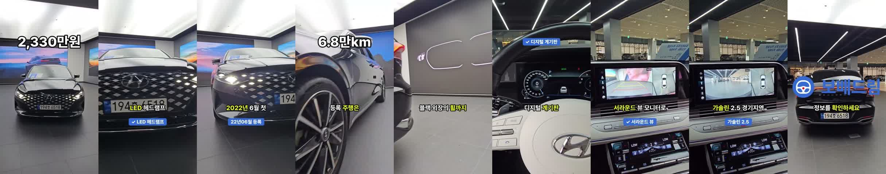

# AS24 네덜란드형 그랜저 샘플 — 자동 파이프라인 시간 측정 (2026-11-12)

## 걸린 시간 (시작 05:18:44 → mp4 저장 05:25:41)
| 단계 | 시각 | 걸린 시간 |
|---|---|---|
| 음성 → 낱말 시각(whisper) · 장면 컷 · 사실 입력 · 편집 계획(as24_edit_planner --style bobae) | 05:18:44 → 05:20:27 | 1분 43초 |
| 칩·숫자·자막 PNG 62장 만들기(Pillow, Pretendard) | → 05:21:08 | 41초 |
| 노트북으로 옮기기 + 캡컷 프로젝트 생성(pycapcut, 0.64초) | → 05:24:18 | 3분 10초(대부분 전송 방법 정리) |
| 캡컷 열기 → 내보내기 → 저장 | → 05:25:41 | 1분 23초 |
| **합계** | | **6분 57초** |

결과: 1080×1920 · H.264 · 53.5초 · 66.8MB, 캡컷 9.7에서 그대로 열림. 캡컷 라이브러리 자산 0개.

## 프레임 (0.5 / 5.9 / 7.0 / 9.6 / 12 / 35 / 43.2 / 46 / 52.6초)

## 원본(AS24 NL)과 다른 점 · 고칠 것
1. 파란 칩이 원본보다 작다 → 높이 4.2%를 5.5%대로, 글자 54→64.
2. 말 자막(62%)과 칩(70%)이 가까워 번호판·차 앞부분과 겹친다 → 칩을 위쪽 띠(24%)로 몰거나 자막을 칩 동안 숨김.
3. 끝 로고 2초 동안 말 자막이 같이 보인다 → 로고 구간 자막 숨김.
4. 자막 묶음이 문장 중간에서 끊긴다(“등록 주행은”) → 쉼·문장 기준으로 묶기.
5. 전송 3분은 반복 시 0에 가깝다(노트북에서 바로 PNG 생성하거나 같은 방식 재사용).

→ 반복 실행 기준 예상 약 4분(사람 손은 내보내기 클릭 1번).
