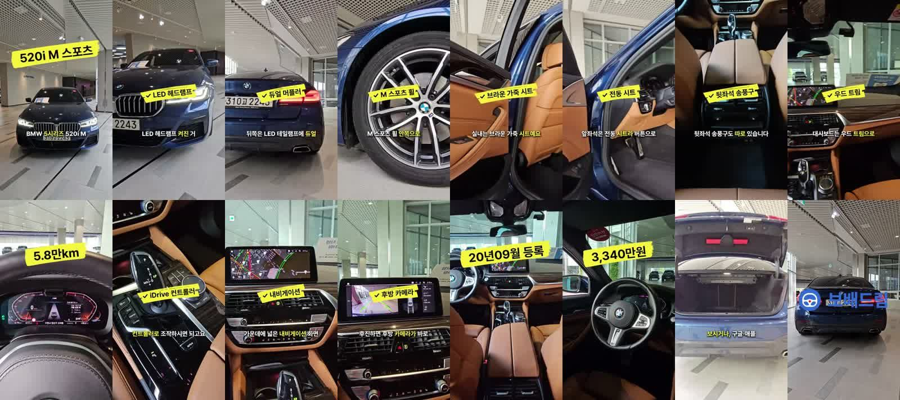

# 차란차 BMW 520i — 벨기에판(원본 재현) 캡컷 v2 시간 측정 (2026-11-12)

요청 05:49:36 → mp4 저장 05:57:43 = **8분 7초** (사람 손: 캡컷 내보내기 클릭 1번)

| 단계 | 시각 |
|---|---|
| 편집 매뉴얼 v4 §9(벨기에 원본 재현 규칙) 읽기 | 05:49:36 → 05:50 |
| 원본 0.5초 간격 부위 태깅(20개 부위) | → 05:51 |
| 대사 다시 쓰기(17구절, 부위별 1구절) | → 05:51:33 |
| 한국어 남성 음성 1회(ElevenLabs v3, Mr.J 크리에이터, 46.6초, 407크레딧) | → 05:52 |
| 받아쓰기로 구절 시각 맞추기(대조율 0.87) | → 05:53:53 |
| 칩·자막 PNG 86장(파이프라인 렌더러 sag_reel_v1의 bobae_be 함수를 그대로 호출) | → 05:55:22 |
| 노트북 전달·캡컷 프로젝트 생성(0.78초) | → 05:56:19 |
| 캡컷 열기·내보내기 | → 05:57:43 |

결과: 1080×1920 · H.264 · 48.6초 · 65MB, 17컷.

## 적용 규칙(매뉴얼 v4 §9 벨기에판)
- 칩: 원본 노랑 #F7EC38 붓칠(노션 원본 SVG 칠 모양) + 검정 글자, 늘 반시계로 기울임, 숫자 칩은 위쪽(520·y), 옵션 칩은 부위 장면 위.
- 말 자막: 그림자 흰 글자, 말하는 어절만 #F7EC38, 4어절·13자, y=1283, 컷 뒤 0.3초 비움, 숫자 칩 떠 있는 동안 숨김, 끝 로고 동안 숨김.
- 컷: 구절 경계에서만 바꿈. 장면이 짧으면 속도를 늦춤(최소 0.53배).
- 칩 매핑: 한 부위 = 한 구절 = 한 칩. 칩은 그 낱말을 말하는 순간 +0.05초(글자 비례 추정).
- 소리: 배경음 bobae_showroom_v1(목소리 동안 0.15 · 끝 2초 0.34), 팝 1번(가격 칩), 끝 로고 커짐.
- 발음: 비엠더블유·오이공아이·엠 스포츠·엘이디·아이드라이브·오만 팔천 킬로·이 리터·삼천삼백사십만 원. 끝 문장: 보배드림 앱에서 자세한 정보를 보시거나, 구글·애플 스토어에서 다운받으세요!

## 칩 ↔ 화면 대조 (16장 확인, 어긋남 0)
520i M 스포츠(앞모습) · LED 헤드램프(헤드램프) · 듀얼 머플러(뒷모습) · M 스포츠 휠(휠) · 브라운 가죽 시트(뒷좌석) · 전동 시트(앞좌석 버튼) · 뒷좌석 송풍구(송풍구) · 우드 트림(대시보드) · 5.8만km(계기판) · iDrive 컨트롤러(기어 옆) · 내비게이션(화면) · 후방 카메라(후방 화면) · 20년09월 등록(실내 전체) · 3,340만원(핸들)

## 남은 것
- 음성: 「오시리즈」·「헤드램프」 발음이 조금 뭉개짐(받아쓰기 기준). 크레딧 규칙상 다시 생성하지 않음.
- 배경음 자동 줄이기(덕킹)는 캡컷 프로젝트에서 구간 볼륨 2단으로 대신함.
- 칩 시각은 구절 안 글자 비례 추정 → 낱말 단위 받아쓰기 시각으로 바꾸면 더 정확.
- 원본 매물은 판매완료 — 내부 시험용, 게시 금지.
