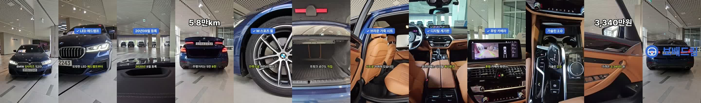

# 차란차 BMW 520i (G30) — 대본·음성·자막·캡컷 전 과정 시간 측정 (2026-11-12)

시작 05:31:01 (요청 받음) → mp4 저장 05:39:54 = **8분 53초**

| 단계 | 시각 | 걸린 시간 |
|---|---|---|
| 노션 자동화 의견 읽기(9-2 최종 결정 · 자막 규정 v1) | 05:31 → 05:33 | 약 2분 |
| 차란차 숏폼 원본·매물 정보 받기 | → 05:33:30 | 다운로드 2.5초 (나머지는 받을 매물 찾기) |
| 원본 장면 확인 · 대본 쓰기 | → 05:35:30 | 약 2분 |
| 남성 AI 음성 1회 생성(ElevenLabs Jubal, 41.6초, 262크레딧) | → 05:36:12 | 약 40초 |
| 낱말별 시간 맞추기(faster-whisper, 대본 대조 190/190자 일치) | → 05:37:03 | 13초 실행 |
| 컷 계획 · 칩·숫자·자막 PNG 68장 | → 05:37:51 | 약 50초 |
| 노트북 전달 · 캡컷 프로젝트 생성(0.64초) | → 05:38:36 | 약 45초 |
| 캡컷 열기 → 내보내기 | → 05:39:54 | 1분 18초 |

결과: 1080×1920 · H.264 · 43.7초, 원본 한 컷 영상을 대본 순서대로 12컷으로 잘라 붙임. 캡컷 라이브러리 자산 0개.

## 반영한 노션 규칙
- 자막 규정 v1: Pretendard Bold 56px, 의미 단위 2~3낱말·14자 안팎, 자막 영역 y≈1240, 끝 로고 구간 자막 숨김.
- 고정 결정: 키워드 칩 파랑 #306BD9·흰 글자, 노랑 #EEEF05는 말하는 낱말 표시에만.
- 사실만: 매물 정보(최초등록 2020년 9월·5.8만km·가솔린 2.0·3,340만원) + 화면에 보이는 것(LED 헤드램프·M 스포츠 휠·파란 캘리퍼·브라운 가죽 시트·디지털 계기판·내비·후방 카메라)만 씀. 사고·옵션 목록은 원본 데이터에 없어 말하지 않음.

## 프레임 (1.5 / 6.5 / 10 / 13 / 16 / 20.5 / 23.5 / 27 / 32 / 35 / 37 / 42.8초)

## 고칠 점
1. 10초 「2020년 9월 등록」 구간 화면이 주차장(원본 34초)으로 나옴 → 계기판(원본 약 36초)으로 컷 시작점 수정. 장면 위치를 2초 간격 썸네일로 어림잡은 탓 → 0.5초 간격 장면 태깅을 자동화해야 함.
2. 끝 로고가 차 위에 바로 얹힘 → 끝 카드 배경(흐림·어둡게) 필요.
3. 원본 매물이 현재 판매완료 상태 → 내부 시험용으로만 씀(게시 금지).

## 반복 실행 예상
매물 찾기·노션 읽기(약 4분)를 빼면 약 5분. 사람 손은 캡컷 내보내기 클릭 1번.
