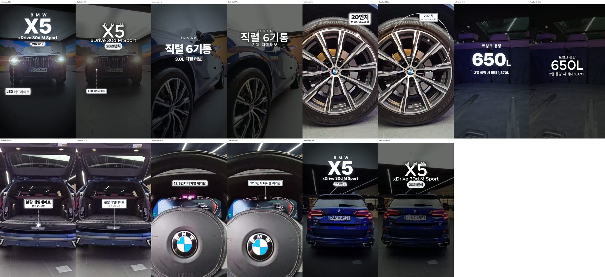
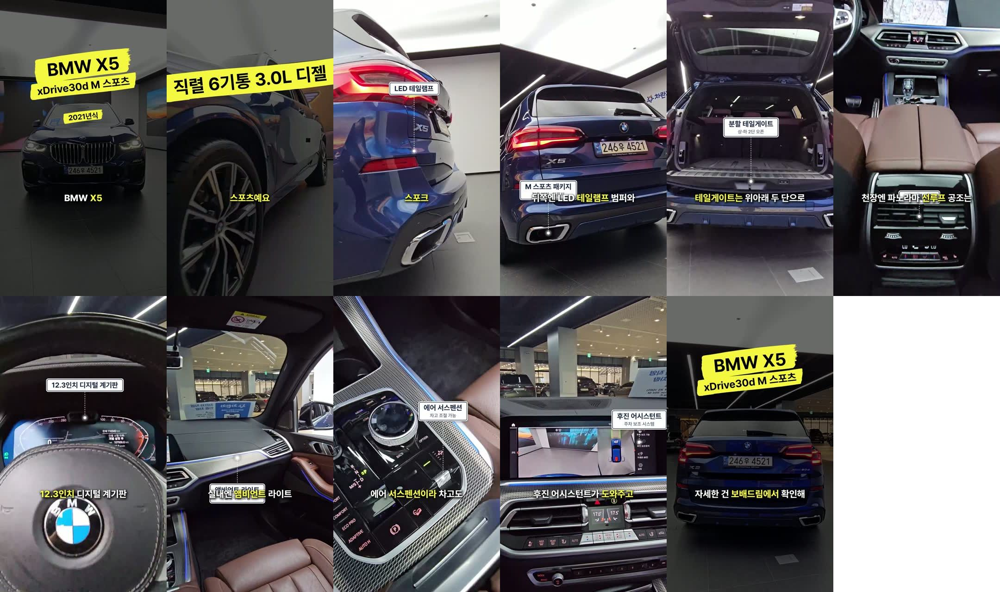
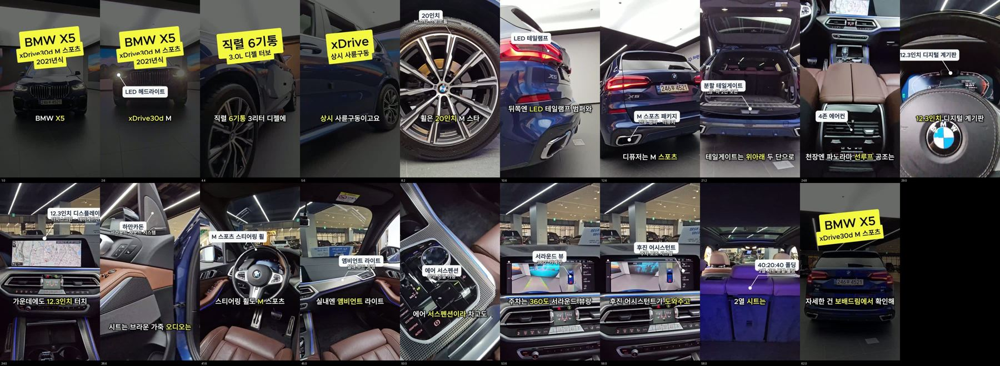

# 차란차 BMW X5 모션그래픽 — 캡컷 재현 + 시간 측정

① **한 줄 요약**: 노션 「클로드 매물영상 파이프라인, 사용도구」의 X5 모션그래픽(63.6초)을 캡컷 프로젝트로 다시 만들었다. 시작부터 2차 완성 mp4까지 **약 17분**이 걸렸다. 프로젝트를 만드는 데 1~2초, 캡컷 내보내기에 45~50초가 들었다.

② 과제: 노션 415ee9c4b60680518220fcc48dde5076 · 브랜치 `shortform/nasser-insights` · 커밋은 이 보고서를 올린 커밋 · PR 없음 · 상태: 푸시만 함(병합·배포 없음)

## ③ 한 일
- 원본 촬영 영상과 레퍼런스 모션그래픽을 프레임마다 비교해 콜아웃(점·안내선·라벨)이 언제, 어디에 나오는지 자동으로 찾았다(`render_x5_assets.py`).
  - 콜아웃 19개를 찾았다.
  - 각 콜아웃의 위치를 시간별로 기록했다(트래킹 대신 쓰는 키프레임).
- 콜아웃 그림(흰 라벨, 남색 안쪽 테두리, 점선 안내선, 빛나는 점)과 휠 원호, 어둡게 깔기 판을 PNG로 만들었다. 글자는 캡컷 글자로 넣었다.
  - 타이틀, ENGINE, DRIVETRAIN, 트렁크 510→650L 카운트업, 엔딩.
- `make_x5_draft.py`(pycapcut)로 캡컷 프로젝트를 자동으로 만들었다.
  - 원본 영상과 원본 소리는 그대로 두었다.
  - 콜아웃은 위치 키프레임으로 카메라 움직임을 따라간다.
  - 캡컷 기본 애니메이션을 썼다: 확대 등장, 흐림→선명, 페이드.
- 1차를 레퍼런스와 비교해 보니 라벨이 레퍼런스의 약 0.74배였다. 그래서 2차에서 라벨을 1.35배 키웠다(글자 46/30).
- 캡컷에서 내보낸 mp4를 드라이브에 올렸다. 게시는 하지 않았다.

## ④ 시간 측정 (2026-11-12, 한국 시각)
| 단계 | 시각 | 걸린 시간 |
|---|---|---|
| 시작(노션 확인 · 원본/레퍼런스 확보) | 06:45 | — |
| 프레임 비교로 콜아웃 19개 찾기 + 에셋 49개 만들기(1차) | ~06:51 | 약 6분 |
| 1차 캡컷 프로젝트 생성 | 06:52:57 | 1.9초 |
| 1차 내보내기 완료 | ~06:54:40 | 약 50초 |
| 1차 비교 → 라벨 1.35배로 에셋 다시 만들기 | ~06:57 | 약 2분 |
| 2차 프로젝트 생성 | 06:57:21 | 0.7초 |
| 2차 내보내기 완료 + 드라이브 업로드 | ~07:01 | 약 50초(나머지는 원격 조작 대기) |
| 비교표 · 보고 | 07:02 | — |
| **합계** | | **약 17분** |

- 사람이 캡컷에서 손으로 만든다고 하면 키프레임 19개와 글자 20여 개를 넣어야 한다. 그 시간은 측정하지 않았다(비교 기준 없음).
- 같은 매물 형식이라면 다음부터는 에셋 생성(약 1분)과 프로젝트 생성(2초), 내보내기(50초)만 다시 돌리면 된다.

## ⑤ 원본과 비교

| 장면 | 레퍼런스와 같은 점 | 남은 차이 |
|---|---|---|
| 타이틀(0.3–3.4초) | 문구, 위치, 어둡게 깔기 | 2차에서 `B M W`가 `X5`와 겹친다(줄 간격) |
| LED 헤드라이트 | 위치, 아래로 내려오는 안내선 | 라벨이 아직 조금 작다. 점의 빛 번짐이 약하다 |
| ENGINE / DRIVETRAIN | 문구, 흐림→선명 등장 | 글자가 레퍼런스보다 위쪽에 있다 |
| 20인치 휠 | 원호, 라벨, 안내선 | 원호가 레퍼런스보다 크다. 라벨이 작다 |
| 트렁크 카운트업 | 510→650L, 1,870L 문구 | 레퍼런스는 단위 `L`을 작게 쓴다. 우리는 같은 크기다 |
| 분할 테일게이트 · 12.3인치 계기판 | 라벨 크기와 위치가 거의 같다 | 점의 빛이 약하다 |
| 엔딩(61–63.6초) | 문구, 어둡게 깔기 | 타이틀과 같은 겹침 |

1초 간격 전체 모습: [v2_sheet.jpg](v2_sheet.jpg)

## ⑥ 원본과 다르게 남긴 것과 이유
- 트래킹: 캡컷 자동 추적 대신 위치 키프레임을 썼다(0.2초 간격). 자동화 도구로 캡컷 추적 기능을 켤 수 없어서다.
- 콜아웃은 PNG로, 글자는 캡컷 글자로 넣었다. 캡컷 라이브러리 스티커와 효과는 꺼내 쓰지 않았다(규칙).

## ⑦ 못 한 것 · 다음
- 타이틀 `B M W` 줄 간격, 휠 원호 크기, 트렁크 단위 `L` 작게, 점 빛 번짐 키우기 → 3차.
- 사실 확인 필요(노션 「한계」): 트렁크 용량 510/650/1,870L는 일반 제원이다. 게시 전에 이 매물로 확인해야 한다.
- 매물 상태: 판매중(019f7d38). 게시는 하지 않았다.

## ⑧ 확인 링크
- 캡컷 2차 mp4: https://drive.google.com/file/d/1VLUqE_VG1if_D8PL1IA26a5COR79ogcf/view
- 캡컷 1차 mp4: https://drive.google.com/file/d/1-HU2gulRyjiC4Vd0ia_BtwXabGS-S5Nv/view
- 에셋 묶음: `assets.zip`(이 폴더) · 만드는 코드: `scripts/shortform/capcut_draft/render_x5_assets.py`, `make_x5_draft.py`

---

## 3차 (07:17~07:43) — 내레이션 · 트래킹 다시 · 벨기에판 타이틀/자막
- **음성**: 일레븐랩스로 한 번 만들었다. 사용자가 화면에서 고른 「안교수」 목소리(eleven_v4)이고 길이는 59초다.
  - 받아쓰기(faster-whisper)로 문장 경계를 찾아 16문장으로 잘랐다.
  - 1.08배 빠르게 해서 장면이 시작하는 시각에 맞춰 놓았다(`voice.wav`, -16 LUFS). 원본 소리는 25%로 낮췄다.
  - 대본에는 화면 라벨에 나온 사실만 넣었다. 트렁크 용량 숫자는 말하지 않는다(확인 전).
- **트래킹**: 2차는 0.2초 간격이었고, 라벨 상자 가운데를 따라가서 출렁였다.
  - 3차(`track_x5_dots.py`)는 레퍼런스 화면에서 점(흰 둥근 점)을 찾고, 원본 영상에서 그 점을 매 프레임(25fps) 광학 흐름으로 앞뒤로 추적한다.
  - 레퍼런스에 점이 보이는 프레임에서는 그 점 위치로 맞춘다(snap).
  - 키프레임은 0.04초 간격이다.
  - 점을 자동으로 못 찾은 3곳(M 스포츠 패키지, 에어 서스펜션, 후진 어시스턴트)은 레퍼런스 화면에서 위치를 직접 재서 넣었다.
  - 검사: 레퍼런스 점과 차이가 대부분 0~5px이다(`track_check.jpg`).
- **타이틀·스탯**: 벨기에판 노랑 붓띠 스티커(BMW X5 / xDrive30d M 스포츠 / 2021년식, 직렬 6기통 3.0L 디젤, xDrive 상시 사륜구동, 엔딩).
- **말 자막**: 벨기에판 그대로다. 그림자 흰 글자에 말하는 어절만 노랑, 4어절·13자 묶음, y=1283.
- 결과(1초 장면 모음): 
- 남은 점:
  - 말 자막(y=1283)이 아래쪽 콜아웃 라벨과 몇 군데 겹친다(M 스포츠 패키지, 4존, 앰비언트).
  - 첫 문장이 길어서 뒤 문장이 1~1.5초 늦게 따라간다(휠·테일램프 구간).
- 3차 mp4: https://drive.google.com/file/d/1Ca8doqW7ts6OW4tM8KL3H1ejFNdq8ncA/view

| 3차 단계 | 시간 |
|---|---|
| 내레이션 대본 + 일레븐랩스 생성 | 약 3분 |
| 점 추적 다시(검사·보정 포함) | 약 10분 |
| 받아쓰기 · 음성 배치 · 자막·스티커 에셋 | 약 3분 |
| 캡컷 프로젝트 생성 · 내보내기 | 3초 · 약 55초 |
| 3차 합계(사용자 목소리 변경 대기 포함) | 약 26분 |

---

## 4·5차 (07:50~08:22) — 캡컷 기능으로 다시 만듦
사용자 결정(08:11~08:16): 캡컷으로 배포할 영상이라 파이프라인에서도 캡컷 스티커·효과·애니메이션을 쓴다. 계정이 프로라 프로 요소도 쓴다.

- **포인터**: 캡컷 스티커 'callout line'(점 → 사선 → 가로선)으로 바꿨다.
  - 라벨은 캡컷 글자(흰 바탕, 남색 굵은 글자), 보조 글은 그림자 흰 글자다.
  - 스티커·라벨·보조 글 모두 매 프레임(0.04초) 위치 키프레임으로 차를 따라간다.
  - 화면 밖으로 넘치는 쪽을 피해 좌우·위아래를 뒤집고, 그래도 넘치면 선을 줄인다.
- **칠 칩**(타이틀·엔진·구동·엔딩): 큰 줄과 작은 줄 두 크기로 맞췄다. 5차부터는 캡컷 글자다(노랑 바탕, 검정 굵은 글자, 기울기, 튀어나오기 등장).
- **말 자막**: 5차부터 캡컷 글자다. 흰 글자에 검정 테두리를 두르고, 말하는 어절만 노랑으로 칠한다(캡컷 글자 스타일 범위를 나눠 적음).
  - 포인터·칩과 겹치는 시간이 가장 적은 높이에 놓는다.
- **휠**: 허브를 추적하고 림 크기에 맞춘 원호(PNG)를 둔다. `20인치 / M 스타 스포크 휠` 포인터는 림 위쪽에 붙어 따라간다.
  - 4차 1회에서는 원호가 안 보였다. 원인은 uniform_scale 키프레임이었다. 가로·세로 크기 키프레임으로 바꿨다(5차 화면에서는 아직 다시 확인하지 못함).
- **LED 헤드라이트**: 원본에서 추적한 위치가 레퍼런스 점 (198, 802)과 맞는다. 3.3초 장면 전환에서 추적이 튀어 그 뒤는 버렸다. 라벨은 타이틀 칩을 피해 아래로 내렸다.
- **장면 효과**(캡컷 효과, 5차):
  - 첫 화면은 흐림에서 열린다.
  - 큰 장면이 바뀌는 7곳에 0.3초 번쩍임을 넣었다.
  - 끝은 흐림으로 닫는다.
  - 원본의 색·화질을 바꾸는 필터는 쓰지 않았다.
- 결과(1초 장면 모음): 
- 남은 점:
  - 타이틀 칩 3줄(BMW X5 / xDrive30d M 스포츠 / 2021년식) 사이가 붙어 보인다(캡컷 글자 바탕이 PNG보다 크다).
  - 4존 에어컨처럼 카메라가 크게 움직이는 구간은 포인터가 화면을 가로질러 잠깐 자막과 가까워진다.
  - 캡컷 화면 왼쪽 위가 '로그인' 상태로 보인다. 프로 요소를 쓸 때는 로그인이 필요할 수 있다.
- 5차 mp4: https://drive.google.com/file/d/1qQBHEjRyCD8-5nmiNqwIQhKh2Prnw_ol/view
- 코드: `render_x5_v4.py`(에셋·위치), `make_x5_v4_draft.py`(4차), `make_x5_v5_draft.py`(5차, 캡컷 글자·효과), `track_x5_dots.py` · `track_x5_led.py` · `track_x5_wheel.py`(추적)

| 4·5차 단계 | 시간 |
|---|---|
| 캡컷 포인터 디자인 조사 · 스티커 기하 실측 | 약 12분 |
| LED·휠 추적, 4차 에셋·프로젝트 · 내보내기 · 보정 | 약 15분 |
| 5차(캡컷 글자·효과) 코드 · 프로젝트 · 내보내기 | 약 6분(프로젝트 1.4초, 내보내기 약 50초) |
