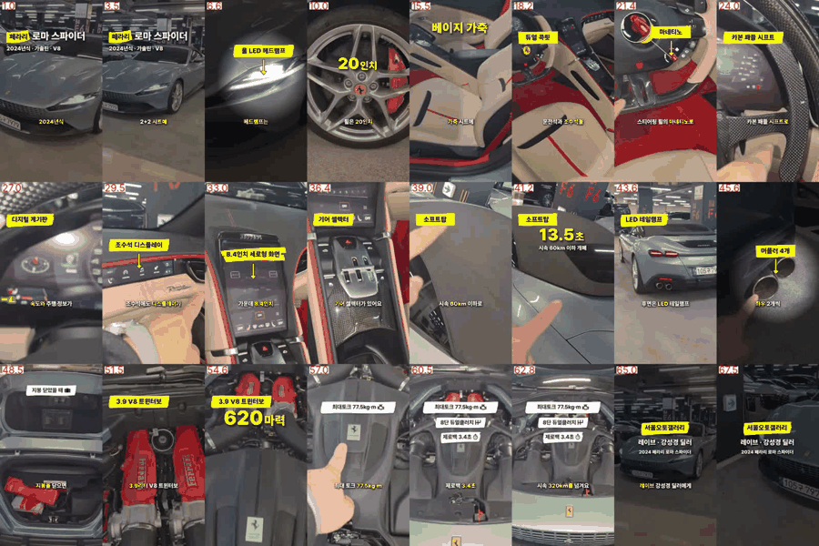
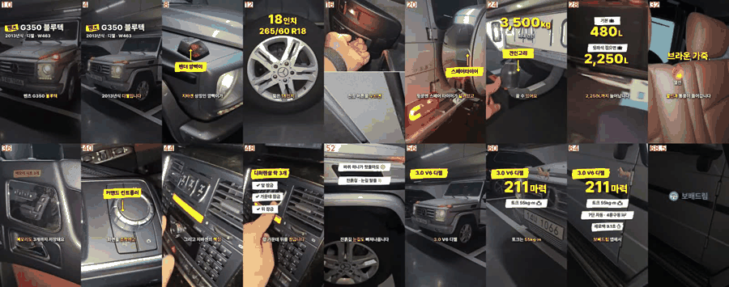

# 로마 스파이더 r11 — 엄격 기준 점수·크로스체크·컨설팅 (2026-11-23)

## ① 한 줄 요약
r11(정보 위주 대본)은 **79점 / 100점**이다. 품질 통과선 90점에 못 미치며, 바로 고칠 것 5가지를 r12에서 처리하자.

## ② 과제 · 브랜치 · 커밋 · 상태
- 과제: 서울오토갤러리 2024 페라리 로마 스파이더, 벨기에 뼈대 편집(기준 영상 G350 v13)
- 브랜치: `work/roma-spider` · 커밋: 이 보고서 커밋(채팅 마지막 줄 참고) · 상태: 푸시만 함(병합·배포 없음)
- 영상: `bobae_roma_spider_r11_trap.mp4` · `bobae_roma_spider_r11_cyber.mp4`(각 68.8초). 편집 관문(edit_gate) 2건이 실패해서 **전달하지 않았다**.

## ③ 한 일
1. 대본을 정보 위주로 다시 썼다(112낱말). 「즐거워요」 같은 꾸밈말은 뺐다. 음성은 한 번만 만들었고, 쉬는 구간을 0.32초 이하로 줄여 67.4초가 됐다.
2. 낱말 시각을 맞췄다. 시각이 비던 V8 · 제로백 · 77.5kg·m는 받아쓰기 원본 시각으로 채웠다.
3. 큰 숫자가 떠 있는 동안 말 자막을 숨기도록 렌더 코드를 고쳤다.
4. **크로스체크로 찾은 큰 결함**: 트랩·사이버를 동시에 렌더하면 두 렌더가 같은 중간 파일(nov8.mp4)을 함께 써서 영상이 깨진다(해독 오류 1,468줄). 따로 렌더해서 다시 만들었고, 오류 0줄을 확인했다. 앞으로는 잠금 파일로 동시 실행을 막는다.

## ④ 점수표 (100점, 엄격 기준)
| 항목 | 배점 | 점수 | 깎은 이유 |
|---|---|---|---|
| 사실·대본 | 15 | 13 | 「가늘게 뻗은」 꾸밈말이 남음. 조수석 화면 「음악 확인」은 매물 정보로 확인하지 못함 |
| 음성 | 10 | 8 | 사람이 직접 들어 보는 검수를 안 함. 낱말 3개를 손으로 채움 |
| 말한 부위 = 화면 부위 | 15 | 13 | 57초 「최대 토크」 장면이 손으로 엔진 덮개를 가리킴. 수치와 화면이 약하게 맞음 |
| 첫 화면 | 5 | 5 | 차 전체 3/4 + 노랑 판 + `2024년식 · 가솔린 · V8` |
| 칩 규칙(check_be) | 10 | 10 | 두 판 모두 통과(−14.1 / −14.0 LUFS, 효과음 15번) |
| 큰 숫자 | 10 | 6 | 20인치·245/285가 휠·캘리퍼를 덮음(v13은 휠 위 빈 곳). 휠·트렁크 숫자 중 말 자막이 그대로 보이고, 「255리터」 자막이 255L와 겹침 |
| 옵션 편집 다양성 | 10 | 7 | T03·T04·T05·T06·T07·T08은 씀. v13에 있는 T01 위아래 2분할, T02 ✓ 목록은 없음 |
| 말 자막 | 10 | 8 | 낱말 따라 노랑으로 바뀌는 것은 정상. 저장소 지침(뜻 단위 두 줄)과 뼈대 규칙(1~3낱말) 중 뼈대 규칙만 따름 |
| 소리 | 10 | 7 | 음량·효과음은 통과. 지침에 있는 `check-shortform-audio` 채널 검사는 안 돌림 |
| 파이프라인 품질 | 5 | 2 | 동시 렌더로 영상이 깨진 일(고침). edit_gate 2건 실패: 렌더러가 판(ED-SIMPLE = g350_v8_render)과 다름, 필수 기법 `end_logo` 빠짐(딜러 명함으로 끝내라는 지시 때문) |
| **합계** | **100** | **79** | |

## ⑤ 검증
- check_be: 트랩·사이버 모두 통과
- edit_gate post: 실패 2건(위 표). 번호판 덮음 없음, 음성↔자막 어긋남 0ms, 안전영역 통과
- 영상 해독: 다시 렌더한 뒤 두 판 모두 오류 0줄
- v13 나란히 비교(첨부 시트): 길이 68.8초 대 69.9초(±10% 안). 첫 화면·붓칠 칩·화살표 칩·3D 숫자 있음. T01·T02 빠짐

## ⑥ 원본(v13)과 다르게 남긴 것
- 끝 화면을 보배드림 로고 대신 딜러 명함으로 했다(사용자 지시). 판 잠금(edition_lock)의 `end_logo` 필수 규칙과 충돌하므로, 규칙을 고치려면 사용자의 말이 필요하다.
- 전용 렌더러 `roma_render.py`를 썼다. 판 잠금은 `g350_v8_render.py`만 허용한다.

## ⑦ 컨설팅 — r12에서 고칠 것(우선순위 순)
1. **휠·타이어·트렁크 숫자 위치**: v13처럼 부위 위 빈 곳(화면 위쪽 띠)에 두고, 떠 있는 동안 말 자막을 숨긴다. 지금 숨김은 c11·c15 큰 숫자만 되고 특수 숫자(20인치·245/285·255L)에는 안 된다.
2. **✓ 목록(T02) 추가**: 실내 컷(베이지 가죽 · 레드 카펫 · 듀얼 콕핏)이나 끝 제원(토크·8단·제로백)을 노랑 ✓ 목록으로 쌓는다. 지금 흰 칩 3줄은 v13과 같은 방식이지만, ✓ 기법으로 기록되지 않는다.
3. **320km 카운트업 빠짐**: 편집 계획에는 T04 320km(62.19초)가 있는데 렌더러가 그리지 않는다(계획과 렌더러 불일치). 그리거나 계획에서 빼야 한다.
4. **대본 정리**: 「가늘게 뻗은」을 빼고, 「조수석 디스플레이로 속도·음악 확인」은 매물 정보로 확인되면 남긴다. 고치면 해당 문장만 다시 녹음한다.
5. **판 규칙 정리(사용자 결정 필요)**: 딜러 명함 끝 화면을 판의 정식 끝 화면으로 인정할지, `roma_render.py`를 판에 등록할지 정해야 한다.
6. 음성: 사람이 직접 들어 보는 검수 + 채널 검사(`node scripts/check-shortform-audio.mjs`)를 돌린다.
7. T01 위아래 2분할은 소프트탑 열림/닫힘 두 장면이 원본에 있으면 13.5초 컷에 쓴다(원본 확인 필요).

## ⑧ 확인
- 영상(전달 보류): `scratchpad/roma/bobae_roma_spider_r11_trap.mp4`, `..._cyber.mp4`
- 기준: `public/shortform-samples/g350-v13/g350-v13.mp4`
