# 로마 스파이더 r11 — 엄격 기준 점수·크로스체크·컨설팅 (2026-11-23)

## ① 한 줄 요약
r11(정보 위주 대본)은 **79점 / 100점**이다. 품질 통과선 90점에 못 미치며, 바로 고칠 것 5가지를 r12에서 처리하자.

## ② 과제 · 브랜치 · 커밋 · 상태
- 과제: 서울오토갤러리 2024 페라리 로마 스파이더, 벨기에 뼈대 편집(기준 영상 G350 v13)
- 브랜치: `work/roma-spider` · 커밋: 이 보고서 커밋(채팅 마지막 줄 참고) · 상태: 푸시만 함(병합·배포 없음)
- 영상: `bobae_roma_spider_r11_trap.mp4` · `bobae_roma_spider_r11_cyber.mp4`(각 68.8초). 편집 관문(edit_gate) 2건이 실패해서 **전달하지 않았다**.

## ③ 한 일
1. 대본을 정보 위주로 다시 썼다(112낱말). 「즐거워요」 같은 꾸밈말은 뺐다. 음성은 한 번만 만들었고, 쉬는 구간을 0.32초 이하로 줄여 67.4초가 됐다.
2. 낱말 시각을 맞췄다. 시각이 비던 V8 · 제로백 · 77.5kg·m는 받아쓰기 원본 시각으로 채웠다.
3. 큰 숫자가 떠 있는 동안 말 자막을 숨기도록 렌더 코드를 고쳤다.
4. **크로스체크로 찾은 큰 결함**: 트랩·사이버를 동시에 렌더하면 두 렌더가 같은 중간 파일(nov8.mp4)을 함께 써서 영상이 깨진다(해독 오류 1,468줄). 따로 렌더해서 다시 만들었고, 오류 0줄을 확인했다. 앞으로는 잠금 파일로 동시 실행을 막는다.

## ④ 점수표 (100점, 엄격 기준)
| 항목 | 배점 | 점수 | 깎은 이유 |
|---|---|---|---|
| 사실·대본 | 15 | 13 | 「가늘게 뻗은」 꾸밈말이 남음. 조수석 화면 「음악 확인」은 매물 정보로 확인하지 못함 |
| 음성 | 10 | 8 | 사람이 직접 들어 보는 검수를 안 함. 낱말 3개를 손으로 채움 |
| 말한 부위 = 화면 부위 | 15 | 13 | 57초 「최대 토크」 장면이 손으로 엔진 덮개를 가리킴. 수치와 화면이 약하게 맞음 |
| 첫 화면 | 5 | 5 | 차 전체 3/4 + 노랑 판 + `2024년식 · 가솔린 · V8` |
| 칩 규칙(check_be) | 10 | 10 | 두 판 모두 통과(−14.1 / −14.0 LUFS, 효과음 15번) |
| 큰 숫자 | 10 | 6 | 20인치·245/285가 휠·캘리퍼를 덮음(v13은 휠 위 빈 곳). 휠·트렁크 숫자 중 말 자막이 그대로 보이고, 「255리터」 자막이 255L와 겹침 |
| 옵션 편집 다양성 | 10 | 7 | T03·T04·T05·T06·T07·T08은 씀. v13에 있는 T01 위아래 2분할, T02 ✓ 목록은 없음 |
| 말 자막 | 10 | 8 | 낱말 따라 노랑으로 바뀌는 것은 정상. 저장소 지침(뜻 단위 두 줄)과 뼈대 규칙(1~3낱말) 중 뼈대 규칙만 따름 |
| 소리 | 10 | 7 | 음량·효과음은 통과. 지침에 있는 `check-shortform-audio` 채널 검사는 안 돌림 |
| 파이프라인 품질 | 5 | 2 | 동시 렌더로 영상이 깨진 일(고침). edit_gate 2건 실패: 렌더러가 판(ED-SIMPLE = g350_v8_render)과 다름, 필수 기법 `end_logo` 빠짐(딜러 명함으로 끝내라는 지시 때문) |
| **합계** | **100** | **79** | |

## ⑤ 검증
- check_be: 트랩·사이버 모두 통과
- edit_gate post: 실패 2건(위 표). 번호판 덮음 없음, 음성↔자막 어긋남 0ms, 안전영역 통과
- 영상 해독: 다시 렌더한 뒤 두 판 모두 오류 0줄
- v13 나란히 비교(첨부 시트): 길이 68.8초 대 69.9초(±10% 안). 첫 화면·붓칠 칩·화살표 칩·3D 숫자 있음. T01·T02 빠짐

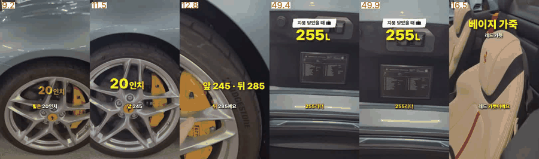

## ⑥ 원본(v13)과 다르게 남긴 것
- 끝 화면을 보배드림 로고 대신 딜러 명함으로 했다(사용자 지시). 판 잠금(edition_lock)의 `end_logo` 필수 규칙과 충돌하므로, 규칙을 고치려면 사용자의 말이 필요하다.
- 전용 렌더러 `roma_render.py`를 썼다. 판 잠금은 `g350_v8_render.py`만 허용한다.

## ⑦ 컨설팅 — r12에서 고칠 것(우선순위 순)
1. **휠·타이어·트렁크 숫자 위치**: v13처럼 부위 위 빈 곳(화면 위쪽 띠)에 두고, 떠 있는 동안 말 자막을 숨긴다. 지금 숨김은 c11·c15 큰 숫자만 되고 특수 숫자(20인치·245/285·255L)에는 안 된다.
2. **✓ 목록(T02) 추가**: 실내 컷(베이지 가죽 · 레드 카펫 · 듀얼 콕핏)이나 끝 제원(토크·8단·제로백)을 노랑 ✓ 목록으로 쌓는다. 지금 흰 칩 3줄은 v13과 같은 방식이지만, ✓ 기법으로 기록되지 않는다.
3. **320km 카운트업 빠짐**: 편집 계획에는 T04 320km(62.19초)가 있는데 렌더러가 그리지 않는다(계획과 렌더러 불일치). 그리거나 계획에서 빼야 한다.
4. **대본 정리**: 「가늘게 뻗은」을 빼고, 「조수석 디스플레이로 속도·음악 확인」은 매물 정보로 확인되면 남긴다. 고치면 해당 문장만 다시 녹음한다.
5. **판 규칙 정리(사용자 결정 필요)**: 딜러 명함 끝 화면을 판의 정식 끝 화면으로 인정할지, `roma_render.py`를 판에 등록할지 정해야 한다.
6. 음성: 사람이 직접 들어 보는 검수 + 채널 검사(`node scripts/check-shortform-audio.mjs`)를 돌린다.
7. T01 위아래 2분할은 소프트탑 열림/닫힘 두 장면이 원본에 있으면 13.5초 컷에 쓴다(원본 확인 필요).

## ⑧ 확인
- 영상(전달 보류): `scratchpad/roma/bobae_roma_spider_r11_trap.mp4`, `..._cyber.mp4`
- 기준: `public/shortform-samples/g350-v13/g350-v13.mp4`

---

# r12 — 고친 뒤 다시 매긴 점수 (2026-11-23)

## ① 한 줄 요약
r12는 **86점 / 100점**(r11 79점에서 +7)이다. 숫자 위치, ✓ 목록, 320km, 꾸밈말을 고쳤다. 90점에 못 미친 이유는 사람이 직접 듣는 검수를 하지 않았고, 판 규칙 2건은 사용자 결정이 필요하며, T01 위아래 2분할이 없기 때문이다.

## ② 상태
- 브랜치 `work/roma-spider`, 푸시만 함(병합·배포 없음)
- 영상: `bobae_roma_spider_r12_trap.mp4` · `bobae_roma_spider_r12_cyber.mp4`(각 67.9초, 해독 오류 0줄). 편집 관문(edit_gate)이 실패해서 **전달하지 않았다**.

## ③ 한 일
1. 음성에서 「가늘게 뻗은」을 잘라냈다. 새로 녹음하지 않았고, 소리가 가장 작은 지점을 골라 12ms 겹쳐 이었다.
2. 「20인치」와 「앞 245 · 뒤 285」를 휠 위가 아닌 화면 위쪽 띠(7.5%)로 옮겼다. 휠은 가리지 않는다.
3. 휠·타이어·255L 숫자가 떠 있는 동안 말 자막을 숨겼다.
4. 엔진 제원 컷에 「엔진 제원」 칩과 노랑 ✓ 목록(T02)을 넣었다. 목록은 최대토크 → 8단 듀얼클러치 → 제로백이 말할 때마다 한 줄씩 쌓인다.
5. 계획에만 있던 320km 카운트업을 실제로 그렸다. ✓ 목록과 겹치지 않게 화면 52% 높이에 두었다.

## ④ 점수표 (r11 → r12)
| 항목 | 배점 | r11 | r12 | 남은 이유 |
|---|---|---|---|---|
| 사실·대본 | 15 | 13 | 14 | 「조수석 화면으로 속도·음악 확인」은 매물 정보로 확인하지 못함 |
| 음성 | 10 | 8 | 8 | 사람이 직접 들어 보는 검수를 안 함. 잘라 이은 곳은 들어서 확인해야 함 |
| 말한 부위 = 화면 부위 | 15 | 13 | 13 | 「최대 토크」 장면에서 손이 엔진 덮개를 가림 |
| 첫 화면 | 5 | 5 | 5 | 차 3/4 + 노랑 판 + `2024년식 · 가솔린 · V8` |
| 칩 규칙(check_be) | 10 | 10 | 10 | 두 판 모두 통과 |
| 큰 숫자 | 10 | 6 | 9 | 부위 위 빈 곳에 두고 자막 숨김까지 고침. 620마력은 엔진 위에 겹쳐 조금 답답함 |
| 옵션 편집 다양성 | 10 | 7 | 9 | T02 ✓ 목록 추가. T01 위아래 2분할은 아직 없음(소프트탑 열림·닫힘 두 장면이 원본에 있는지 미확인) |
| 말 자막 | 10 | 8 | 8 | 그대로 |
| 소리 | 10 | 7 | 7 | `check-shortform-audio` 채널 검사를 안 돌림 |
| 파이프라인 품질 | 5 | 2 | 3 | 동시 렌더를 잠금 파일로 막음. edit_gate 실패 3건 중 2건은 판 규칙 충돌, 1건은 번호판 오탐 |
| **합계** | **100** | **79** | **86** | |

## ⑤ 검증
- check_be: 트랩·사이버 모두 통과
- edit_gate post: 실패 3건
  - 렌더러가 판에 등록된 것과 다름(`roma_render.py`)
  - `end_logo` 빠짐(딜러 명함으로 끝내라는 지시 때문)
  - 번호판 「머플러 4개(43.9초)」: 43.75 · 43.9 · 44.1초 장면을 직접 봤고 번호판이 없다. 검출기 오탐으로 본다.
  - 음성↔자막 어긋남 +0ms
- 해독 오류 0줄, 길이 67.9초(v13 69.9초, ±10% 안)

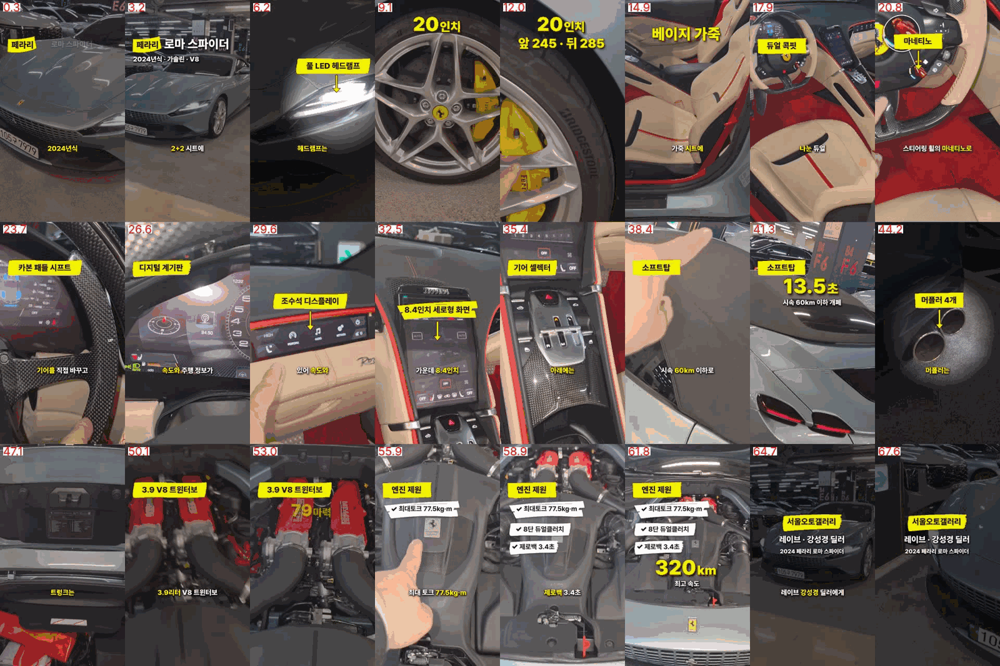
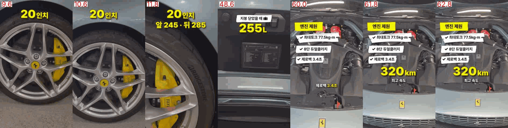

## ⑥ 사용자 결정이 필요한 것
1. 딜러 명함으로 끝나는 화면을 판의 정식 끝 화면으로 인정할지(`edition_lock`의 `end_logo` 예외)
2. `roma_render.py`를 판에 렌더러로 등록할지
3. 위 두 가지가 정해지면 edit_gate가 통과하고, 그때 영상을 전달한다.

## ⑦ 다음에 할 것
- 사람이 직접 들어 보는 검수, `node scripts/check-shortform-audio.mjs` 채널 검사
- T01 위아래 2분할: 소프트탑 열림·닫힘 장면을 원본에서 확인
- 「최대 토크」 장면을 손이 가리지 않는 엔진 구간으로 바꾸기

# r13 — 노션 붓칠 원본으로 ✓ 목록 꾸미기 (2026-11-24)

## ① 한 줄 요약
엔진 제원 ✓ 목록의 검정 ✓ 글자를 노션 「스카우트24 테마별」 노랑 체크 원 원본으로 바꿨다. 규칙 검사(check_be)는 통과, 편집 관문(edit_gate)은 r12와 같은 3건이 남아 **전달 보류**.

## ② 상태
- 브랜치 `work/roma-r13`, 푸시만 함(병합·배포 없음)
- 영상: `scratchpad/roma/bobae_roma_spider_r13_trap.mp4`(67.9초, 효과음·길이 r12와 같음)

## ③ 한 일
1. 구글 시트 `50_AS24_아이콘칠_사례` 32건을 봤다. 우선순위 상은 1(주행거리 아이콘+노랑 덩어리) · 3(전기 플러그+노랑 덩어리) · 5(✓ 목록 첫 낱말 형광펜) · 6(점검·이력 제목 형광펜) · 10(노랑 원 ✓ 목록) · 28(ⓘ+붓칠 띠).
2. 노션 DB에서 SVG 원본만 골랐다. 노랑 체크 원(`checkmark_in_yellow_circle`, #F5F200)을 한 글자도 고치지 않고 `public/assets/shortform/brush-fill/as24-theme-v2/check_circle_yellow.svg`로 넣고, 크기만 rsvg 배율(높이 56)로 맞췄다. 사례 10을 따른 것이다.
3. `roma_render.py`의 ✓ 목록 아이콘이 이 원본을 쓴다. 예전 글자 ✓는 `CHECK_GLYPH=1`로 되돌릴 수 있다.

## ④ 원본과 비교
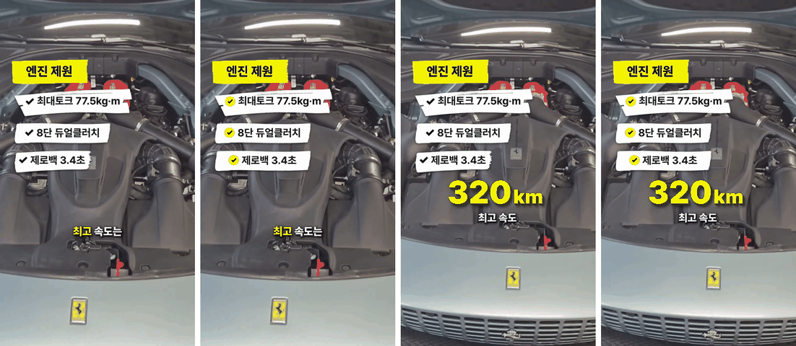

## ⑤ 검증
- check_be: **통과**(음량 −14.0 LUFS, 효과음 17번, 칩 노랑 실측 242·241·0, 칩 윗선 331~334)
- edit_gate post --plates: 실패 3건(r12와 같음) — 렌더러 미등록(`roma_render.py`) · `end_logo` 빠짐(딜러 명함 끝) · 번호판 「머플러 4개(43.9초)」(r12에서 직접 봐서 번호판 없음, 검출기 오탐으로 판단)
- v13 비교: 길이 67.9초(v13 69.9초, ±10% 안)

## ⑥ 쓰지 않은 것과 이유
- 노션 「강조선」: 주황색이라 노랑 하나 규칙에 어긋나고, 색을 바꾸면 원본을 고치는 것이 된다.
- 노션 「스크리블 칠」: 노랑 3D 숫자 뒤에 두면 노랑 위 노랑이라 보이지 않는다. 흰 아이콘 뒤(사례 1)에만 맞아 다음 회차로 미뤘다.
- 「1121 추가」 붓칠 다수: SVG가 아닌 캡처 이미지라 원본이 아니다.

## ⑦ 다음에 할 것
- 사용자 결정 2건(딜러 명함 끝 화면 인정 · `roma_render.py` 판 등록)이 나면 edit_gate 통과 → 전달
- 사례 5·6(✓ 목록 첫 낱말 · 제목 형광펜)을 노션 붓칠 원본으로 시안

## r13 크로스체크 · 재발 방지 (2026-11-24)

- 사용자 지적: 「옵션 붓칠 칩 매핑이 이상하고 노출 위치가 어정쩡」.
- 판단: 기준은 있었는데 r13 렌더러가 어겼고, 검사가 그 항목을 보지 않아 통과됐다.
- 어긋남(칩 13개 중):
  - 포인트 칩 왼쪽 붙음 8
  - 부위 칩인데 화살표 없음 7
  - 말보다 0.6~1.6초 일찍 뜸 8
  - 말하지 않은 글자 1(「엔진 제원」)
  - 부위 덮음 1
- 재발 방지:
  - 매뉴얼 `docs/shortform/as24-nl-be-edit-manual-v4.md` v4.1 §10에 규칙 7개를 적었다.
  - `check_be.py`에 칩 매핑 검사를 더했다: 말한 낱말인지, 등장 시각, 부위 칩에 화살표가 있는지, 가운데 정렬인지.
  - r13에 돌리면 **23건 실패**로 잡힌다(고치기 전 기준선).
- 다음: r14에서 렌더러를 고친다(부위 칩 callout, 포인트 칩 가운데, 낱말 시각에 맞춰 등장, plan에 words 경로).

## r14 — 칩 매핑·위치 수정, 배포 (2026-11-24)

- 사용자 지시: 「수정하고 배포해」
- 영상: `public/shortform-samples/roma-spider-r14/`(67.9초)

**고친 것**
- 칩이 뜨는 시각을 그 칩 글자의 첫 낱말 시작에 맞췄다(이전엔 문장 첫 낱말 기준이라 최대 1.6초 일찍 떴다).
- 칩 글자를 말한 낱말로 바꿨다: 「최대 토크」(이전 「엔진 제원」), 「8.4인치 세로 화면」(이전 「세로형」). ✓ 목록 첫 줄은 「77.5kg·m」만 쓴다.
- 위쪽 칩을 가로 가운데로 옮겼다. ✓ 목록은 가운데 칩의 칠 왼쪽 끝에 맞췄다.
- 부위 추적에 OWLv2를 붙였다(`roma_owl_track.py`). LED 테일램프는 33칸 중 33칸을 찾아 화살표 칩이 됐다.
- 화살표를 빼고 위쪽 칩으로 둔 곳은 이유를 기록한다(`no_track_reason`).
  - 화면을 부위가 꽉 채움(fills_frame): 계기판·듀얼 콕핏·소프트탑
  - 오검출이라 버림(not_found): 패들 3/23칸, 기어 셀렉터 3/11칸

**검사**
- check_be: 통과. 같은 검사로 r13은 22건 실패.
- check_be 등장 시각 판정을 칩 글자 중 가장 먼저 말한 낱말 기준으로 고쳤다(「헤드램프는 풀 LED」처럼 어순이 칩과 다른 경우).
- edit_gate post --plates: 3건(r12·r13과 같음)
  - 렌더러 미등록
  - end_logo
  - 번호판 「머플러 4개」 오탐 — 43.9초 화면을 직접 봐서 번호판 없음 확인

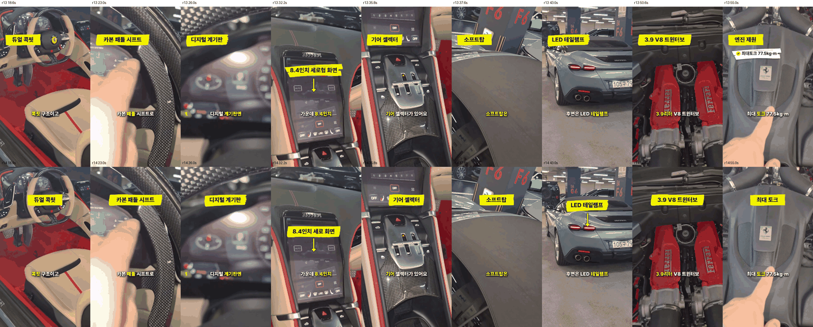

## 끝 화면 결정 (2026-11-24)

- 사용자 결정: 「딜러 카드로 엔딩」
- `edition_lock.json` v1.3에서 ED-SIMPLE 필수 기법을 `end_logo|end_dealer_card`(둘 중 하나)로 바꿨다. `edit_gate.py`가 「a|b」 표기를 읽는다.
- r14 edit_gate post 결과: 실패 1건만 남음 — 렌더러 미등록(`roma_render.py`). 번호판 경고(--plates)는 오탐으로 확인했다.

## r15 — 표시 방식 기준(§11) · 출고 체크리스트 장치(§12), 배포 (2026-11-24)

- 사용자 질문: 「붓칠 기준은 뭔데? 휠은 텍스트, 시트도 텍스트. 이 기준 매뉴얼에 없나. 타이어 수치도 매핑 엉성하고」
- 사용자 지시: 「변경하고 깃허브 배포해라. 그 전에 매뉴얼대로 제작하는지 체크리스트 장치 필요하지 않나」

**매뉴얼 v4.2**
- §11: 붓칠 칩 · 3D 글자 · 흰 알약을 언제 쓰는지 한 표로 정리했다. 부위에 붙는 글자는 그 부위를 따라간다.
- §12: 출고 체크리스트 장치 `scripts/shortform/release_checklist.py`를 만들었다.
  - check_be · edit_gate · v13 나란히 시트를 한 번에 돌리고, 매뉴얼 21개 항목에 결과를 표로 남긴다.
  - 자동 실패가 있으면 종료 코드 1로 막는다.

**r15에서 고친 것**
- 타이어 규격은 타이어 옆면 추적(c3t)을 따라간다.
- 20인치는 휠 윗선을 따라간다.
- 베이지 가죽은 시트 추적(BootsTAPIR 키프레임, 142칸 중 141칸)을 따라간다.
- 레드 카펫은 말할 때 카펫이 화면에 없어 띄우지 않는다.
- OWLv2는 시트·카펫 상자를 잘못 잡아서(문짝·화면 위쪽) 쓰지 않았다.

**체크리스트 결과:** 자동 실패 1건 — 렌더러 미등록(`roma_render.py`, 사용자 결정 대기). 번호판 경고는 사람 판단으로 오탐 처리했다. 사람 확인 3건은 v13 시트로 봤다.
- 첫 화면이 차 전체: 확인
- 말한 부위와 화면 부위: 일치
- 사실: 매물 정보만 씀

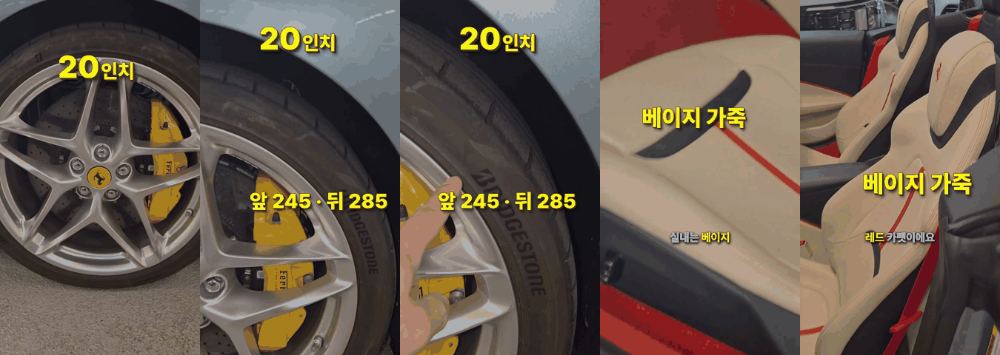
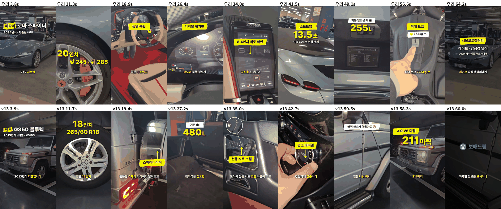

## r16 — 말투 섞기 · 젊은 목소리 (2026-11-24)

- 사용자 지시: 「니다와 에요 적절하게 섞으라니까」 「음성 더 젊은」
- 근거 규칙: `docs/shortform/listing-reel-pipeline-agents.md` 15-2 「입니다」와 「요」를 섞는다.
- 문장 끝 18개를 나눴다(낱말 수 110개 그대로).
  - 「합니다」 7: 오픈카입니다 · 285입니다 · 바꿉니다 · 확인합니다 · 닫습니다 · 620마력입니다 · 넘깁니다
  - 「요」 4: 카펫이에요 · 떠요 · 있어요 · 4개예요
  - 그 밖: 연결어미(고요 · 이고 · 바꾸고 · 조작하고), 명사로 끝남(테일램프 · 255리터), 문의하세요
- 목소리: 일레븐랩스 eleven_v3에서 Taehyung으로 한 번 만들었다가, 「더 젊은」 지시로 뚝상 드래곤(Dduksang Dragon, 20대 숏폼 남성)으로 한 번 다시 만들었다. 크레딧 520 × 2.
- 새 음성 맞춤 도구 `scripts/shortform/video_listing/roma_voice_prep.py`를 만들었다. 쉬는 구간 줄이기 → 받아쓰기(시각만) → 대본 글자와 맞추기 → 계획 시각 옮기기를 한 번에 한다.
- 영상 63.4초(v13 70초 ±10% 안).
- 체크리스트: 자동 실패 1건 — 렌더러 미등록. 사람 확인 3건은 v13 시트로 확인했다.

## 브러시 프레임 프로필 — 딜러 얼굴 원형 + 노랑 붓칠 (2026-11-24)
- 근거: 노션 「스카우트24 테마별」 › 브러시 프레임 프로필(Brush Frame Portrait) 150×150 · 158×142(임모스카우트24), 「BE 사용: 노랑이면 사용」 → 칠은 #F5F200만.
- 코드: `scripts/shortform/brush_frame_portrait.py` — 사진을 정사각·원형으로만 자름(보정 없음). 끝 화면 시안 1080×1920 + 3초 움직임(원 톡 → 칠 왼→오 → 이름 올라옴).
- 2차(사용자 「원본 써라고. 색만 바꿔봐. 얼굴 좀 더 작게 밸런스」): 다른 붓칠(325_76)로 다시 그리던 것을 버리고, 노션 원본 PNG(`public/assets/shortform/brush-frame-portrait/`, 수정 없음)의 민트 칠을 그대로 떼어 색만 노랑으로 바꿈. 모양·자리·기울기 원본 그대로. 원 자리(중심 81·64.5, 지름 117)에 딜러 사진, 얼굴은 원 지름의 86%로 줄여 아래 맞춤. 원과 칠 사이 틈은 원 안쪽 4px에서 바깥 칠을 이어 받아 없앰.
- 번호판을 칠·이름이 덮지 않게 배지 윗선 300, 이름 줄 1220(로마 원본 번호판 y 1080~1160).
- 사진: 저장소의 서울오토갤러리 딜러 프로필(`seoul-auto-gallery-formal-ai/450551-1.webp`) — 폴더 이름대로 AI 정장 프로필이라 실제 본인 사진으로 바꿔야 함.

 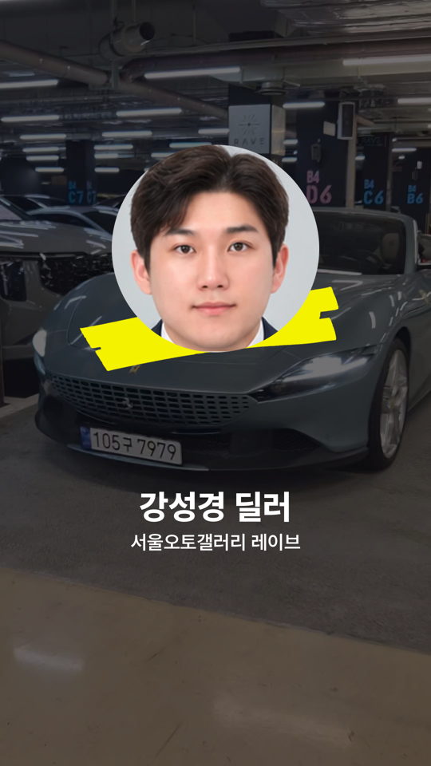

## 노랑 붓 뒤 인물 컷아웃(리싱마크트) — 딜러 정장 상반신 (2026-11-24)
- 사용자: 「정장 입혀」 「리싱마크트가 더 낫지 않나」 → 노션 「스카우트24 테마별」 › 노랑 붓 뒤 인물 컷아웃_1000_842(독일 리싱마크트, BE 사용: 사용).
- 판단: 원형 프로필(얼굴만)보다 상반신 정장 누끼가 끝 화면에서 사람이 크게 보이고 딜러다움(정장)이 산다. 리싱마크트 쪽을 기본 끝 화면 후보로 둔다. 원형은 작은 칸(목록·알약)용으로 남긴다.
- 코드: `scripts/shortform/brush_stroke_cutout.py` — 노션 원본 PNG(수정 없음)에서 노랑 칠만 떼어 쓰고(원본도 #F4F000 근처라 #F5F200으로 맞춤), 원본 인물 자리에 딜러 누끼(rembg u2net_human_seg)를 같은 크기로 놓음. 끝 화면에서는 인물 아래 70px을 부드럽게 사라지게 함.
- 움직임: 인물이 먼저 나타나고(0.15초) 뒤에서 칠이 왼→오로 그어짐. 칠만 먼저 보이면 원본 인물에 가려졌던 칠 구멍이 드러나서 순서를 바꿈.
- 정장 사진: 딜러 사진이 얼굴뿐이라 ElevenLabs gpt-image-2.5로 상반신·정장까지 늘린 AI 그림 4장 중 1장(약 433크레딧 × 4). 원래 사진도 AI 프로필이라 실제 딜러 사진으로 바꿔야 함.
- 번호판: 배지 윗선 220(아래 끝 1062) · 이름 1220 — 로마 번호판(y 1080~1160)을 덮지 않음.

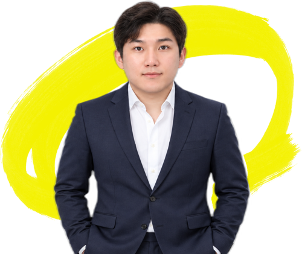 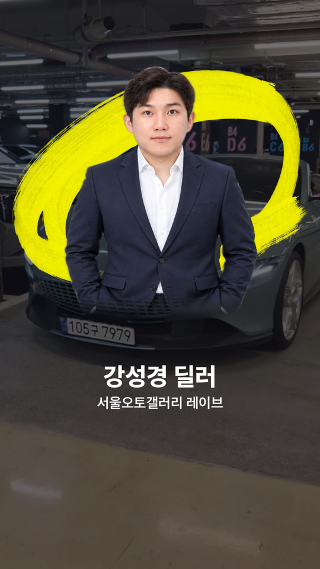

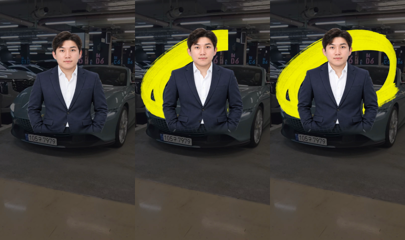
- 손(사용자 「손 단정하게」): 주머니에 넣은 손을 허리 앞에서 가지런히 모은 자세로 바꿈(같은 사진에서 손만 바꾸는 편집, 4장 중 1장, 약 433크레딧 × 4). 손이 흐려지지 않게 아래 끝 사라짐을 70px → 28px로 줄임.
- 얼굴 크기(사용자 「얼굴이 너무 커」): 머리 대 어깨 비율이 0.37로 원본 리싱마크트 인물(0.33)보다 머리가 컸다. 사람 전체를 줄이면 원본 칠의 가려졌던 구멍이 드러나서(줄여 본 시안에서 확인), 사진 쪽 비율을 고침 — 머리 약 15% 작게·어깨 조금 넓게(AI 편집 4장 중 얼굴이 가장 닮은 1장, 약 433크레딧 × 4). 칠 구멍 없음, 번호판 안 덮음.

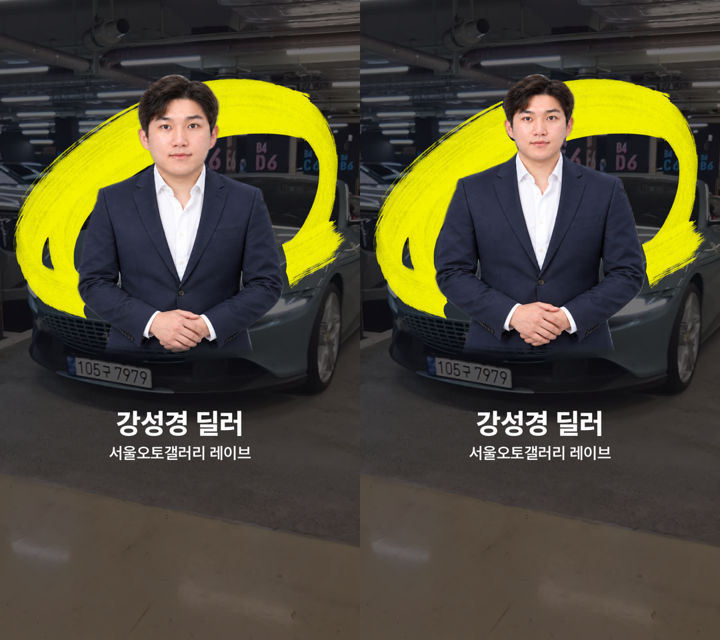

## 임모스카우트 원형(브러시 프레임 프로필) — 실제 딜러 사진 (2026-11-24)
- 사용자: 「근데 딜러 얼굴 맞니?」 「찾아봐 얼굴」 「임모스카우트 형태로 넣어봐」.
- 사진: 서울오토갤러리 공식 사이트 상사정보(주식회사 레이브, ShopNo 450551) 소속딜러 강성경 카드의 사진(115×162, 정면 증명사진). 시안에 쓰던 `formal-ai` 프로필과 앞의 정장 상반신은 AI 그림이라 본인 얼굴이 아님. 연락처는 저장하지 않음. 사진 파일은 저장소에 넣지 않음.
- 코드: `brush_frame_portrait.py`에 세로로 긴 증명사진 처리를 더함 — 자르지 않고 원 아래 끝에 맞춰 놓고(머리 위 여백·어깨가 원본처럼 보임), 사진 옆 끝 8%만 부드럽게 이음. `--face 0.62`(원 지름 대비 사진 폭)로 얼굴이 원의 절반쯤.
- 한계: 원본이 115px라 끝 화면(원 지름 440)에서 약 2.4배 키움 → 살짝 흐림. 큰 원본을 받으면 해결.

 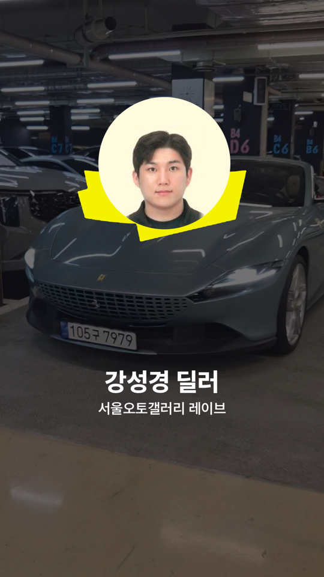
