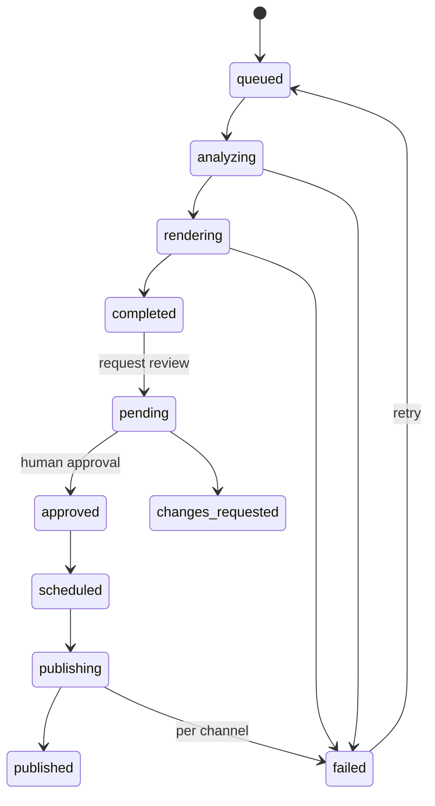

# 상태 모델과 Idempotency-Key 계약

## 정본 경계

화면은 Nuxt가 담당하지만 상태 전이, 권한, Fact Lock 검증, 예약·게시 차단은 Laravel 12가 최종 판정한다. PostgreSQL 15.15가 영속 상태, Redis 7.0.15가 큐·락·24시간 멱등 응답, Meilisearch 1.54.3이 재고 검색·상태별 개수를 담당한다.

## 상태 모델

- render job: `queued | analyzing | rendering | completed | failed | cancelled`
- approval: `draft | pending | approved | changes_requested | rejected`
- publish job: `not_requested | blocked | scheduled | publishing | published | failed | cancelled`
- YouTube, Instagram, TikTok은 각각 독립 publish job을 가진다.

## 필수 불변 조건

1. `approval=approved`가 아니면 예약·게시할 수 없다.
2. `listing.status=sold`면 예약 작업은 즉시 `blocked`, 실행 중 게시 작업은 중단 요청한다.
3. 가격·연식·주행거리·옵션의 source version이 바뀌면 기존 승인은 무효가 되고 재생성 경고를 만든다.
4. 하자 장면을 자동으로 숨기지 않는다.
5. SNS 키나 OAuth가 없으면 mock adapter가 `published=false`를 반환한다.

## Idempotency-Key

- 헤더: `Idempotency-Key`
- 형식: `{operation}:{listing_id}:v{source_version}:{client_uuid}`
- 예: `render:BD-261031-101:v17:019a-preview`
- 보관: Redis 24시간, PostgreSQL 감사 로그 영구 보관
- 같은 키 + 같은 payload: 최초 응답을 그대로 반환
- 같은 키 + 다른 payload: `409 IDEMPOTENCY_CONFLICT`
- 재시도 가능한 실패는 같은 키를 사용하고, 사용자가 입력을 바꾸면 새 키를 만든다.

## Laravel 호환 API 초안

| Method | Path | 역할 |
| --- | --- | --- |
| POST | `/api/v1/render-jobs` | 렌더 작업 생성 |
| GET | `/api/v1/render-jobs/{id}` | 단계·진행률·실패사유 조회 |
| POST | `/api/v1/approvals` | 사람 승인·Fact Lock 체크 저장 |
| POST | `/api/v1/publish-jobs` | 채널별 예약·게시 작업 생성 |
| POST | `/api/v1/publish-jobs/{id}/retry` | 실패 채널만 재시도 |
| POST | `/api/v1/listings/{id}/sold` | 예약 게시 차단·진행 작업 중단 |

